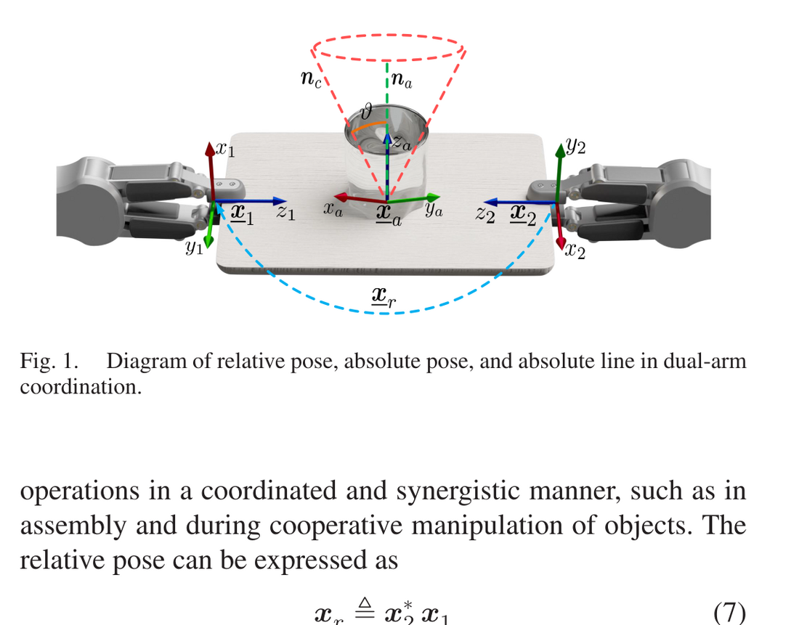
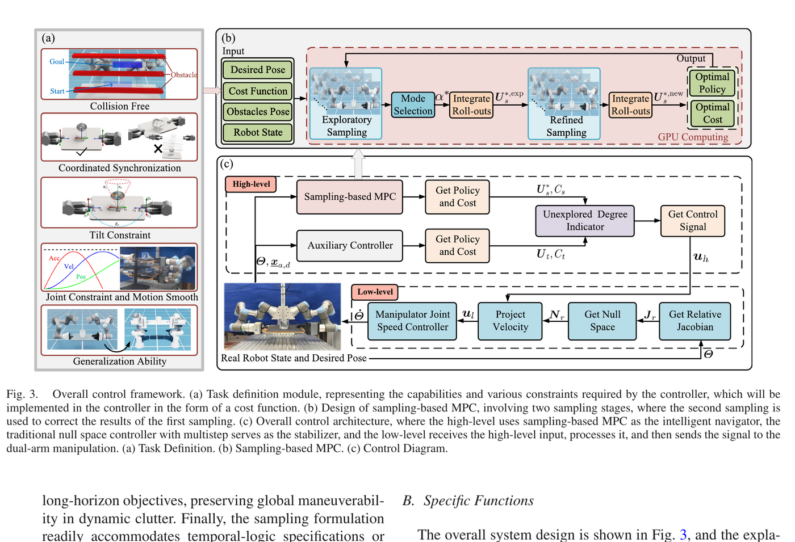
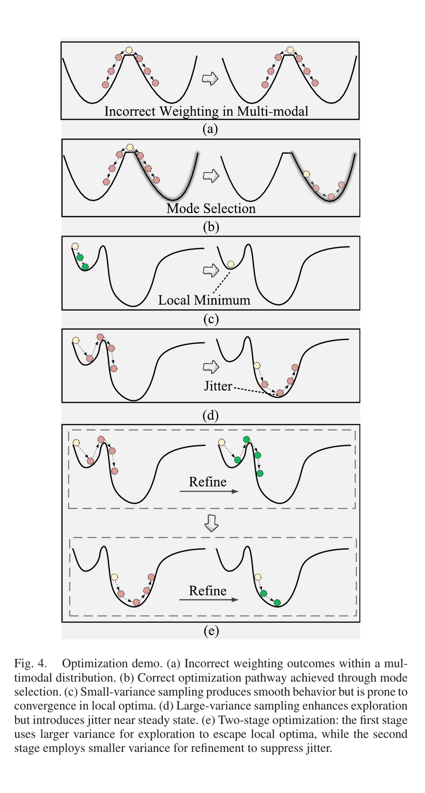
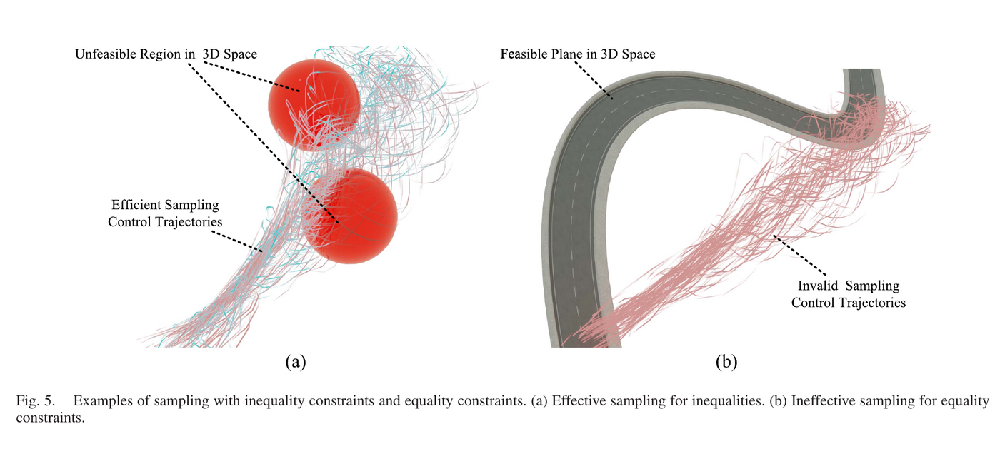
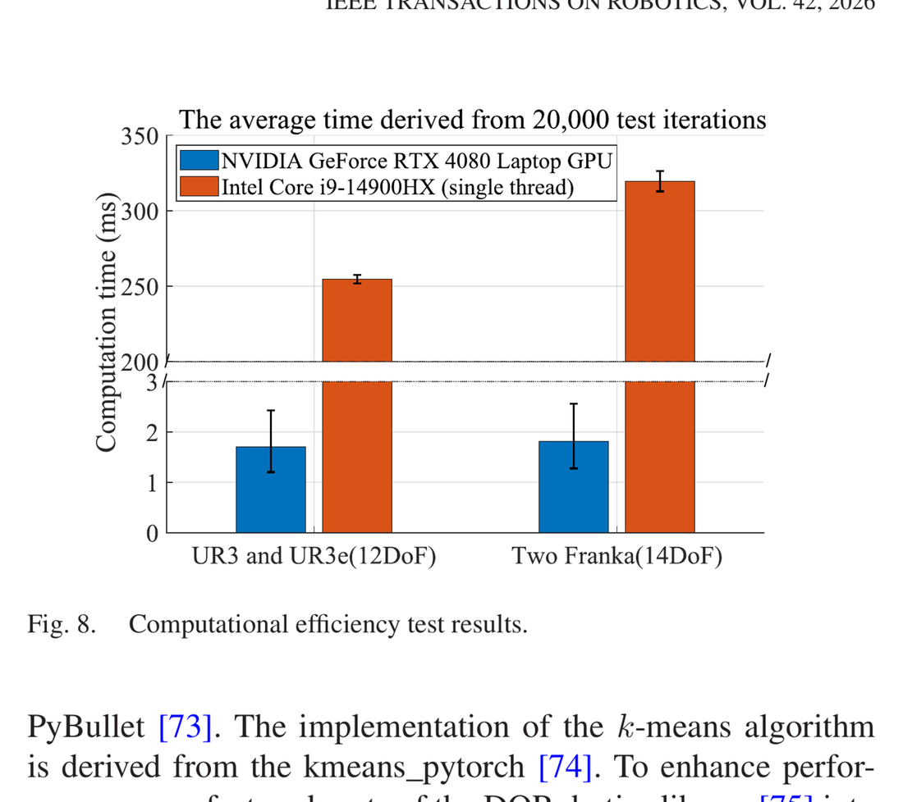
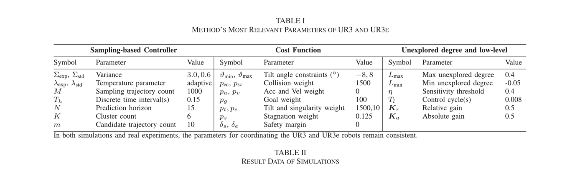
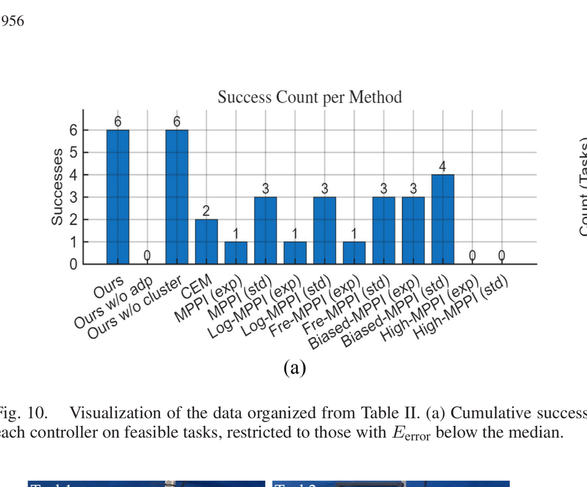

# P1 论文研究：Real-Time Dual-Arm Cooperative Manipulation Under Multiple Constraints: A Two-Stage Sampling MPC Approach

> 阶段：**G0 — 论文研读与复现规划（不实现算法）**
> 分支：`reproduce-p1-numerical-20261021`
> 基线：`a596c973`（`main`，2026-10-21，"docs: enforce concise research-report content in agent instructions"）
> 论文：Tianqi Zhu, Jianliang Mao, Jun Yang, Shihua Li, *Real-Time Dual-Arm Cooperative Manipulation Under Multiple Constraints: A Two-Stage Sampling MPC Approach*, IEEE Transactions on Robotics, vol. 42, 2026, pp. 1941–1958, DOI `10.1109/TRO.2026.3686224`
> 配套文件：`P1_EQUATION_AUDIT.md`、`P1_OFFICIAL_CODE_AUDIT.md`、`P1_ORIGINAL_EXPERIMENT_MATRIX.csv`、`P1_PROPOSED_REPRODUCTION_MATRIX.csv`、`P1_IMPLEMENTATION_PLAN.md`（草案）、`evidence/`

---

## 0. 中文研究综述

**问题。** 双臂共持一个刚体时，两条运动链被一个 6 维相对位姿等式约束耦合成闭链，可行构型被压到低维流形上；同时还要满足外部障碍、自碰撞、关节位置/速度/加速度、物体倾角等多重不等式约束，并在动态障碍下实时反应。论文要求在**不可微、非凸、多模态**的约束集合中做实时预测控制。

**方法。** 论文用对偶四元数（dual quaternion）统一表达相对位姿 $x_r$、绝对位姿 $x_a$ 与绝对直线 $l_a$，把双臂协调写成协作对偶任务空间（CDTS）上的采样型 MPC（MPPI 家族）。核心是**两阶段采样**：第一阶段用大方差（实际实现为频域有色噪声）撒点，用含"停滞惩罚"的探索代价评估，再对轨迹描述子（探索代价 + 关节变化量）做 k-means 聚类，用"精英样本落入最多的簇"选出主导模式，只在该簇内做代价加权聚合；第二阶段以该聚合序列为均值，用小方差（实际实现为对数正态混合采样）重采样并再做一次加权聚合。等式约束不靠惩罚，而是在**每个 rollout 步**用零空间投影 $N=I-J_r^{\dagger}J_r$ 把控制量投到相对位姿雅可比的零空间，再用确定性映射 $g$ 处理关节位置/速度/加速度限幅；不等式约束分两类处理——难建模的（障碍、倾角）用指示函数罚项，易建模的（关节限幅）直接截断。稳态附近引入一个 CDTS 辅助控制器，并用"未探索度"积分指标 $L$ 在两个控制器之间切换；低层再以 $u_l=u_r+N_ru_h$ 做相对位姿漂移补偿。全部 rollout、投影、聚类与碰撞检测在 GPU 上批处理。

**贡献。** (1) 把"全局模式发现"与"局部精化"解耦的两阶段采样 MPC；(2) 约束感知的传播方式：等式约束逐步零空间投影、不等式约束混合执行并配合代价整形；(3) 据作者所知首个 GPU 加速的对偶四元数双臂控制器，含开源代码与 120× 量级的加速声明。

**实验。** 6 个仿真场景（点到点、窄通道、单/双动态障碍、静动混合、十字障碍），UR3+UR3e 与双 Franka 两套平台；对照 MPPI、Log-MPPI、Fre-MPPI、Biased-MPPI、High-MPPI、CEM，以及"去掉未探索度切换""去掉聚类"两个消融；指标为成功率与累积绝对位姿误差 $E_{\text{error}}=\int\|e_a\|_2dt$。另有 5 组真机实验（含持水杯、AprilTag 突发障碍、自碰撞、1 分钟实时避障）与 1 组 20 000 次实例的 CPU/GPU 计时对比。

**数值复现可行性。** 算法主体（对偶四元数运动学、零空间投影、两阶段采样/聚类/精化、辅助控制器与 $L$ 指标）全部可在 CPU 上用 NumPy/SciPy 独立复现，且存在多个独立 oracle（SE(3) 复合、有限差分、SVD 零空间、枚举式模式标注）。但**论文表 I 的参数与公开仓库示例 YAML 不一致**、**六个场景只公开了前三个**、**基线只存在于论文接收前的代码快照**、**动态障碍速度膨胀未实现**、**两阶段采样在代码中被改为确定性种子复用的频域/对数正态采样**。因此：算法机理可高保真复现；表 II 的逐格数值不可直接复现，只能做"同结构、自建场景、自建基线"的受控对比。最小忠实复现应聚焦 A（运动学）、B（零空间）、D（两阶段）、F（单/两阶段消融）四个模块；表 II 级复现属于独立的大工程，不应作为第一目标。

---

## 1. 文档定位与阅读方法

本文不是"MPPI 的一个变体介绍"。论文的三块内容互相锁定：**对偶四元数任务空间**决定状态与雅可比的形状（8 行、秩 6），**零空间投影**决定采样必须在切空间里进行，**两阶段采样**决定代价函数必须分两层（探索层含停滞项、精化层不含）。任何一块单独拿出来都会改变算法语义。例如只实现"两阶段噪声"而不做簇条件加权，得到的仍是单阶段 MPPI 的两个不同温度，不是论文的方法。

阅读与核对方法：

1. 全文 19 页（期刊页 1941–1958）逐页 150 dpi 通读；公式与表格在 250–400 dpi 下逐条裁切核对，避免 `pdftotext` 对上下标、星号与范数符号的错位。
2. 每个公式记录：假设、输入、输出、维度、在源码中的落点、是否与源码一致。
3. 源码审计只读：`codeload` 固定 SHA 快照 + GitHub API 元数据，记录 tar 包与关键文件 SHA256（见 `P1_OFFICIAL_CODE_AUDIT.md` 与 `evidence/P1_official_code_manifest.json`）。
4. 本阶段未安装任何论文依赖、未编译 CUDA 扩展、未初始化 GPU 上下文、未运行论文算法。唯一的数值核对是一个**纯 CPU 的 SE(3) 对数/指数恒等式检查**（§3.3(b)），用于判定式 (8) 的几何含义，不构成算法实验。



---

## 2. 论文识别与身份校验

### 2.1 书目信息

| 项 | 值 |
|---|---|
| 标题 | Real-Time Dual-Arm Cooperative Manipulation Under Multiple Constraints: A Two-Stage Sampling MPC Approach |
| 作者 | Tianqi Zhu, Jianliang Mao, Jun Yang, Shihua Li |
| 单位 | 东南大学自动化学院；上海电力大学人工智能学院；香港科技大学（广州）机器人与自主系统学域 |
| 期刊 | IEEE Transactions on Robotics, vol. 42, 2026 |
| 页码 | 1941–1958（19 页） |
| DOI | `10.1109/TRO.2026.3686224` |
| 收稿/录用/上线 | 2026-02-08 / 2026-03-27 / 2026-04-21 |
| 基金 | 江苏省自然科学基金 BK20253020；国家自然科学基金 62203292 |
| 补充材料 | DOI 页面提供补充下载；项目页 `https://dq-gpu-mpc.github.io/` 仅链接代码与 YouTube 视频，无数据集与参数文件 |

### 2.2 全文 PDF 指纹

| 项 | 值 |
|---|---|
| 路径（本地私有，不入库） | `/home/ubuntu2004/lmy/papers_and_reference_all/references/private_sources/P1_original.pdf` |
| 字节数 | 11,973,481 |
| 页数 | 19；页面 594 × 792 pt；PDF 1.4 |
| SHA256 | `8b4589ce07f932bf1294c7a39b30320a8791f630a4bcd2cd71782b3a2a56de3c` |
| 生成链 | LaTeX + hyperref；Acrobat Distiller 11.0；iText 7.2.4 二次保存 |
| 时间戳 | CreationDate 2026-05-08；ModDate 2026-05-13 |
| 身份结论 | 首页标题、作者、卷期页码、DOI 与任务书逐项一致；公式为矢量文本，可在 400 dpi 下逐符号核对。`ModDate` 说明本地副本被重新保存过元数据，因此身份依据是正文内容而非发行方原始字节 |

### 2.3 与仓库既有卡片的关系

`references/P1_sampling_mpc.md` 是立项期的粗粒度卡片，正确指出了两阶段、k-means、零空间、GPU 五个要素，但把"复现上游示例 → 移植双 FR3 → 集成 Isaac"排成一条工程路线，**没有区分"算法数值复现"与"平台集成"**，也没有记录任何公式级信息。本研究把该卡片视为历史规划，不改写其历史表述，只在其末尾追加指向本文件的补注。旧的 `docs/tasks/TASK20–TASK26` 同样按"上游复现 → FR3 适配 → 零空间 → 两阶段 → GPU → Isaac 集成"排列，属于同一套历史规划，不构成当前 G0 的范围授权。

---

## 3. 研究问题与数学准备

### 3.1 问题的精确表述

给定双臂系统（关节维数 $n_1,n_2$，$\Theta=[\theta_1^\top,\theta_2^\top]^\top\in\mathbb{R}^n$，$n=n_1+n_2$）共持一个刚性物体，求一个反馈策略 $\pi:\mathcal{S}\to\mathbb{R}^n$，使

```
min_{u_0..u_{N-1}}  J = 终端绝对位姿误差 + 安全/平滑代价
s.t.  x_r(Θ_k) = x_r,d                    (相对位姿等式，6 DoF)
      Θ_min ≤ Θ_k ≤ Θ_max,  |Θ̇_k| ≤ Θ̇_max,  |Θ̈_k| ≤ Θ̈_max
      d_{k,ij} ≥ d_min  ∀(i,j)∈C           (外部与自碰撞)
      ϑ_min ≤ ϑ_k ≤ ϑ_max                  (物体倾角)
      Θ_{k+1} = Θ_k + T_h u_k
```

并且单次求解必须落在实时预算内（论文声称 30 Hz 高层、125 Hz 低层）。难点不在单个约束，而在**它们的交集是非凸、多模态、且等式约束把可行集压到零测集**。

### 3.2 对偶四元数表示

四元数 $\mathbb{H}=\{h_1+h_2i+h_3j+h_4k\}$，$i^2=j^2=k^2=ijk=-1$；对偶四元数 $\mathcal{H}=\{h_r+\epsilon h_d\}$，$\epsilon\neq0,\epsilon^2=0$。单位对偶四元数

```
x = r + ε (1/2) p r,      r = a + bi + cj + dk,  a²+b²+c²+d² = 1      (3)(4)
p = 0 + xi + yj + zk                                                   (6)
```

- $r$ 编码旋转（式 (5)：绕单位轴 $n$ 转 $\varphi$ 时 $r=\cos(\varphi/2)+\sin(\varphi/2)(n_xi+n_yj+n_zk)$）；
- $p$ 是纯四元数，编码平移；平移可由 $t=2\,d\,r^{*}$ 还原（$d$ 为对偶部）；
- 单位条件给出两个标量约束 $r^\top r=1$、$r^\top d=0$，故 $x$ 的 8 个分量实际只张成 **6 维流形**。这一点决定了后文雅可比秩为 6、零空间维数为 $n-6$。

**逆与共轭。** 对单位对偶四元数，$x^{-1}=x^{*}=r^{*}+\epsilon(-r^{*}d\,r^{*})$。注意代码中 `dq_inv` 用 `conj` 后再乘标量逆（`dq_primitives.cuh:246-258`），在单位输入下与上式等价；非单位输入时两者不同，这是数值实现必须固定的约定。

**vec8。** 论文只写"$\mathrm{vec}_8$ 把 $\mathcal{H}$ 映射到 $\mathbb{R}^8$"（p.1945），未给分量顺序。代码与 `dqrobotics` 的约定是 $\mathrm{vec}_8(x)=[r_w,r_x,r_y,r_z,d_w,d_x,d_y,d_z]^\top$（`manipulability.py:26-71` 假定同一顺序）。这是第一个必须记录的口径：**误差、范数、代价都依赖分量顺序与尺度**。

### 3.3 相对位姿、绝对位姿与绝对直线

**(a) 相对位姿（式 (7)）**

```
x_r ≜ x_2* x_1                                                        (7)
```

即"把末端 1 的位姿表示在末端 2 的坐标系中"。代码 `rel_abs_pose_rel_jac_inline` 先算 `conj(x_effector2) ⊗ x_effector1`（`dq_composite_ops.cuh:113-116`），与式 (7) 逐字一致。

**(b) 绝对位姿（式 (8)）——论文有一处排版错误**

论文印为

```
x_a ≜ x_2* x_{r/2}                                                    (8)
```

但代码实现的是

```
x_a = x_2 ⊗ sqrt(x_r)                                                 (8')
```

（`dq_composite_ops.cuh:114-118`：`dq_sqrt_inline(rel_pose, s); dq_mult_inline(x_effector2, s, abs_pose)`）。

判定式 (8') 才是自洽读法的三条理由：

1. **群中点恒等式**：由 $x_1=x_2x_r$ 与 $x_r=s^2$（$s=\sqrt{x_r}$），有
   $x_a^{-1}x_1=(x_2s)^{-1}x_2x_r=s^{-1}x_r=s$，$x_a^{-1}x_2=s^{-1}$。
   即 $x_a$ 到两个末端的"群距离"相等，是 $SE(3)$ 意义下的中点。按式 (8) 字面（$x_2^{*}x_{r/2}$）则得不到该性质。
2. **与基座选择无关**：$x_1s^{-1}=x_2x_rs^{-1}=x_2s=x_a$，故无论以哪条臂为"2"结果相同。字面式 (8) 不满足。
3. **与正文"averaging the transformations of the two end-effectors"一致**（p.1945）。

**必须同时纠正一个直觉**：这个中点是**螺旋中点（screw midpoint）**，一般**不等于位置坐标的算术平均**。用独立 SE(3) 对数/指数实现的纯 CPU 核对（输入 $R_1=R_z(0.9)$、$R_2=R_z(-0.4)$、$t_1=(0.5,0.2,0.1)$、$t_2=(-0.1,0.3,0.2)$）得到
$t_a=(0.1832,0.1489,0.1500)$ m，而算术平均为 $(0.2,0.25,0.15)$ m，相差 0.1025 m。
纯平移或纯旋转（相对平移为零）时两者才重合。**绝对位姿因此依赖相对旋转**，这会直接进入 $C_{\text{goal}}$ 与辅助控制器，复现时必须显式记录。

**(c) 绝对直线（式 (9)）与倾角（式 (17)）**

```
l_a = n_a + ε (s_a × n_a)                                             (9)
ϑ_min ≤ ϑ_k ≤ ϑ_max                                                   (17)
```

式 (9) 是 Plücker 形式：方向 $n_a$ 加"过点 $s_a$ 的矩"$s_a\times n_a$。倾角约束只用到方向部分；代码确实只算了方向：把参考方向 `line_d` 用绝对姿态的旋转四元数旋转，再与 `quat_line_ref` 求四元数夹角（`dq_composite_ops.cuh:130-135`），**没有计算矩**。对纯倾角约束这是等价的，但式 (9) 的完整直线语义（位置）在实现中不存在，属于"公式被弱化实现"。

### 3.4 微分运动学与雅可比

```
vec8(ẋ) = J(Θ) Θ̇                                                    (10)
vec8(ẋ_r) = J_r Θ̇,  vec8(ẋ_a) = J_a Θ̇,  vec8(l̇_a) = J_l Θ̇          (11)
```

论文把 $J_r,J_a,J_l$ 的推导交给文献 [3],[35]，正文没有给出。复现必须自己补齐，否则无法判断代码是否正确。以 $J_r$ 为例，推导如下。

设 $x_i=b_i\,A_{i,1}(q_{i,1})\cdots A_{i,n_i}(q_{i,n_i})\,e_i$，单关节导数
$\partial A_{i,k}/\partial q_{i,k}=\tfrac12\,\zeta_{i,k}A_{i,k}$，其中 $\zeta_{i,k}$ 是第 $k$ 个关节螺旋轴在当前坐标系下的对偶四元数。于是第 $k$ 列
$j_{i,k}=\tfrac12\,(b_iA_{i,1}\cdots A_{i,k-1})\,\zeta_{i,k}\,(A_{i,k}\cdots e_i)=\tfrac12\,z_{i,k}\,x_i$，
$z_{i,k}$ 为轴在当前坐标系的表达。代码正是这个结构：`Ad_inline(x1,w,z1); z1*=0.5; dq_mult_inline(z1,x_effector1,j1)`（`dq_composite_ops.cuh:87-96`）。

对 $x_r=x_2^{*}x_1$ 求导：

```
ẋ_r = ẋ_2* x_1 + x_2* ẋ_1
    = C_8 ẋ_2 x_1 + x_2* ẋ_1            (d(x*) = C_8 ẋ, C_8 = diag(1,-1,-1,-1,1,-1,-1,-1))
⇒ J_r = [ H_+(x_2*) J_1 ,  H_-(x_1) C_8 J_2 ]                          (11')
```

其中 $H_+,H_-$ 为四元数左/右乘矩阵。代码 `Jxr1 = H_+(x_2^*) J_1`、`Jxr2 = H_-(x_1) C_8 J_2`（`dq_composite_ops.cuh:120-127`），与此推导逐项一致。

**维度与秩**：$J_r\in\mathbb{R}^{8\times n}$，$\mathrm{rank}(J_r)=6$（一般位形）。8 行中只有 6 行独立，因为 $x_r$ 恒在 6 维流形上。这带来两个后果：(i) $J_rJ_r^\top$ 奇异，伪逆必须用阻尼；(ii) $J_r^{\dagger}J_r$ 是秩 6 的投影，零空间维数 $n-6$（UR3 对 $n=12$ → 6 维；Franka 对 $n=14$ → 8 维）。



---

## 4. 系统模型与预测模型

```
Θ_{k+1} = Θ_k + T_h u_k,   Θ̇_k = u_k,   Θ̈_k = (u_k - u_{k-1})/T_h      (12)
S_N = f(T_h, S_0, U_s),     U_s = [u_{s,1},...,u_{s,N}]                (19)
```

- **模型是速度积分模型**，不含动力学、摩擦、柔顺；$S_k$ 只含关节位置（以及由它算出的任务量）。代码 `update_fake_joint_pos` 与 `mppi_project_step` 都是这一形式。
- $T_h$ 在表 I 中为 0.15 s，$N=15$ → 预测时域 2.25 s。高层声称 30 Hz（周期 0.033 s），两者不一致：**若每个控制周期只执行序列第一个元素，则 $T_h$ 只是预测步长，与实际执行步长解耦**；论文没有解释这一点（见 §13 与 §14 的歧义清单）。
- 预测模型与真实系统的差别由低层相对位姿反馈补偿（式 (50)(51)），论文明确承认"Jacobian 时变 + 离散化误差"会导致相对位姿漂移（p.1952）。

---

## 5. MPC 目标与约束

约束（式 (13)–(18)）：

```
Θ_min ≤ Θ_k ≤ Θ_max,  Θ̇_min ≤ Θ̇_k ≤ Θ̇_max,  Θ̈_min ≤ Θ̈_k ≤ Θ̈_max   (13)(14)(15)
x_{r,k} = x_{r,d}   ⇔   vec8(ẋ_{r,k}) = J_r(Θ_k) Θ̇_k = 0              (16)(29)
d_{k,ij} ≥ d_min,  ∀(i,j)∈C                                           (18)
```

代价（式 (32)–(41)）：

```
C_tilt = Σ_k p_t [ I(ϑ_k<ϑ_min) + I(ϑ_k>ϑ_max) ]                       (32)
C_ec   = Σ_k Σ_i Σ_j p_ec I(d_{k,ij} < r_i + r_j + δ_e)                 (33)
C_sc   = Σ_k Σ_i Σ_{j=i+2} p_sc I_{k,ij},  I_{k,ij}=1 iff (i,j)∉S ∧ d<r_i+r_j+δ_s  (34)(35)
w      = (Π_{i=1}^{6} σ_i)^{1/2},  σ_i = 非零特征值(J_rJ_r^T)           (36)
C_sing = p_e / max(ζ, w)                                               (37)
C_goal = p_g ‖vec8(x_{a,N} - x_{a,d})‖_1                               (38)
C_vel  = Σ_k p_v ‖Θ̇_k‖_1,   C_acc = Σ_k p_a ‖Θ̈_k‖_1                  (39)(40)
C_std  = C_ec + C_sc + C_tilt + C_sing + C_goal + C_vel + C_acc        (41)
C_stay = p_s C_goal / max(ζ, ‖Θ_0 - Θ_N‖_1)                            (42)
C_exp  = C_std + C_stay                                                (43)
```

几点必须写清楚：

1. **$C_{\text{goal}}$ 只在终端出现**（$x_{a,N}$），不是逐步代价。代码中逐步 `abs_cost` 的权重在示例 YAML 里被设为 0，行为一致。
2. **$C_{\text{sing}}$ 的 $w$ 就是吉川可操作度**。因为 $J_rJ_r^\top$ 的特征值 $\sigma_i=s_i^2$，故 $w=\prod_i s_i=\sqrt{\det(J_rJ_r^\top)}$；论文用"非零特征值"表述，等价于对秩 6 情形取 6 个奇异值之积。代码的 `pdet` 正是 6 个奇异值之积（`manipulability.py:109-130`），但**只在第二阶段终端**加、权重 0.5，而论文是逐 step、两层、$p_e=10$（见 §12）。
3. **$C_{\text{stay}}$ 的符号方向**：分母是关节变化量，故关节几乎不动而终端误差大时该项爆炸——这是"反停滞"项，不是"鼓励停滞"。但它同时依赖 $C_{\text{goal}}$，量纲上把"误差/位移"混在一起。
4. **不等式约束全部是软约束**。$p_{ec}=p_{sc}=p_t=1500$ 使违反样本的权重近似为 0，但没有任何可行性证书；论文用"采样拒绝"来描述（p.1949），实现上是指示函数罚项。这一点必须在复现中如实标注，否则会把"高罚项"误当成"硬约束"。

---

## 6. 采样 MPC：两阶段结构

### 6.1 第一阶段：高方差探索

```
U_{s,i} ~ N(U_s^{*,last}, Σ_exp),   i=1..M                            (20)
w_exp,i = exp( -C_exp,i / λ_exp )                                      (23a)
U_s^{*,exp} = Σ_{i∈α*} w_exp,i U_{s,i} / Σ_{i∈α*} w_exp,i              (23b)
```

- 采样均值是**上一周期的最优序列**（热启动），不是当前状态的重参数化；这是 MPPI 的标准做法 [64][65]。
- 权重只在**主导簇 $\alpha^*$** 内归一化，不是全样本。这一点是全文最关键的算法差异：它把"多模态混合"变成"先选模式、再在模式内平均"。
- 论文式 (23) 的 $\lambda_{\exp}$ 被称为温度参数；表 I 写"adaptive"。

### 6.2 k-means 聚类与模式发现

```
min_{α_k} Σ_{k=1}^{K} Σ_{D∈α_k} ‖D - μ_k‖²                              (22)
D = [ C_exp , [Θ_0 - Θ_N]^T ]                                          (52)
```

- 特征 = 探索代价 + 关节净变化。论文的解释是：相同末端姿态可能对应不同关节构型，关节变化量是"行为模式"的自然坐标；加入代价是为了防止把低代价轨迹误分到高价值簇（Remark 1）。
- 模式选择：取代价最低的 $m$ 条（精英集），统计其簇标签的众数，得 $\alpha^*$（§V-4，Algorithm 1 第 14 行）。
- 代码与论文一致：`topk(stage_cost, k=common_num)` → `bincount` → `argmax`（`kmeans_adpan.py:307-327`）。但特征是三个**逐列归一化**的块（代价、臂 1 关节变化、臂 2 关节变化），维度 $1+n_1+n_2$，归一化方式论文未提（`kmeans_adpan.py:268-300`）。

**为什么这一步能解决模式平均。** 设两个可行模式 $A,B$，代价相同、样本各半，则全样本加权均值 $\bar U=\tfrac12(U_A+U_B)$ 一般既不在 $A$ 也不在 $B$ 的可行域内（Fig. 4(a) 的"球停在原地"）。簇条件均值 $\mathbb{E}[U\mid \alpha^*]=\mu_A$ 则保持在一个模式内。代价是**方差不再随 $M$ 下降**（只随簇内样本数下降），这正是第二阶段要补的。

### 6.3 第二阶段：低方差精化

```
ΔU_std,i ~ N(0, Σ_std),   Σ_std < Σ_exp                               (24a)
w_std,i = exp( -C_std,i / λ_std )                                      (24b)
U_s^{*,new} = Σ_i w_std,i (U_s^{*,exp} + ΔU_std,i) / Σ_i w_std,i       (24c)
```

- 均值是**第一阶段簇条件聚合结果**，不是第一阶段全样本均值；这是"级联"的实际含义。
- 代价换成 $C_{\text{std}}$（去掉 $C_{\text{stay}}$），即第二阶段不再奖励"动起来"，只做局部最优与平滑。
- 精化后的序列作为下一周期的 $U_s^{*,last}$，闭环。

### 6.4 有效样本数与方差

把式 (23b) 看作自归一化重要性采样，权重 $w_i\propto e^{-C_i/\lambda}$，则估计量的有效样本数
$M_{\text{eff}}=1/\sum_i \tilde w_i^2$（$\tilde w$ 归一化权重）。
当 $C_i$ 在簇内近似常数时 $M_{\text{eff}}\approx M_{\alpha^*}$，命令标准差 $\approx\sigma_{\exp}/\sqrt{M_{\alpha^*}}$；
当代价差异远大于 $\lambda$ 时 $M_{\text{eff}}\to1$，退化为"取最优样本"，平滑性消失。
第二阶段的噪声标准差若为第一阶段的 $1/5\sim1/10$（表 I：$3.0\to0.6$，即 0.2 倍），则单样本方差降为 1/25，再经 $M$ 次平均，终端抖动应显著下降——这是可量化的验收点（模块 F）。



---

## 7. 等式约束：零空间投影

```
u_i^{null,temp} = N(S_i) u_i                                          (26)
N(S_i) = I - J_c†(S_i) J_c(S_i)                                       (27)
u_i^{null} = g(T_h, u_i^{null,temp}, S_i)                             (28)
Θ_{i+1} = Θ_i + T_h u_i^{null}                                        (31)
```

**性质。** $N$ 是对称幂等矩阵（$N^2=N$），$\mathrm{range}(N)=\ker(J_c)$，$\mathrm{rank}(N)=n-\mathrm{rank}(J_c)=n-6$。故 $J_cN=0$，投影后的速度在**当前线性化点**不产生任何相对位姿变化。

**但"exactly"只在一阶意义成立。** 对有限步长，

```
x_r(Θ_k + T_h N u) = x_r(Θ_k) + T_h J_r N u + (T_h²/2) ẍ_r + O(T_h³)
                  = x_r(Θ_k) + O(T_h²)
```

即每步残差是 $T_h^2$ 量级，$N$ 步累积 $O(NT_h^2)$。论文贡献 2 写"equality constraints are enforced exactly via per-step null space projection"（p.1943），严格说应写成"一阶精确、二阶残差"。复现必须测这个残差的 $T_h$ 阶数（模块 B 的接受准则就是斜率≈2），否则无法判断"零空间是否真的在工作"。

**Remark 2 的正确读法。** 论文说"等式约束数不得超过自由度，否则 $I-J^\dagger J$ 退化为零矩阵"。对 8 行约束、$n=12$ 的情形，$\mathrm{rank}(J_r)=6<n$，故 $N\neq0$；真正会退化的是 $\mathrm{rank}(J_c)=n$（约束数达到关节数）。论文这句话在"8 行约束"语境下容易被误读，复现时应以秩条件而非行数条件判定。

**阻尼。** 代码用 $J^\dagger=J^\top(JJ^\top+\varepsilon I)^{-1}$，$\varepsilon=10^{-16}$ 且全程 float64（`mppi_project_step.h:60-70`）；低层用 $\varepsilon=10^{-7}$（`relative.py:74-78`）。两个阻尼值不同，后者更保守，因为它要面对真实测量噪声。

---

## 8. 不等式约束：混合执行

论文把不等式分两类（p.1949）：

1. **难建模**（外部障碍、自碰撞）：采样 + 指示函数罚项（式 (33)(34)），罚权 1500，使违反样本权重 $\approx e^{-1500/\lambda}\to0$。代码在 `q` 与 `q_mid` 两个构型上各查一次碰撞，取"有碰撞即罚"的二值化（`base.py:280-294`），与式 (33) 的指示函数一致；`min_collision_distance=0`、$\delta_e=0$ 与表 I 一致。
2. **易建模**（关节位置/速度/加速度）：采样时截断。代码在投影核里先按速度限幅、再积分、再按位置限幅，并用 $(q_{\text{next}}-q)/T_h$ 回算允许速度（`mppi_project_step.h:72-88`）；加速度限幅在 Python 侧对差分序列截断（`kmeans_adpan.py:240-243`）。这对应式 (28) 的 $g$，但**加速度限幅不在 $g$ 内**，是外层实现细节。

**倾角**同样是软罚项（式 (32)），不保证满足。论文 Task 3/4 中 CEM 因"过早收敛违反倾角约束"失败（p.1957），说明该约束在实验里确实会被违反——这反证它是软约束。

**结论**：论文所谓"约束感知传播"只有等式约束是结构化的（投影），不等式全部是"罚项 + 截断"。复现时若把不等式当硬约束实现，会得到与论文不同的成功率（可行域被改变，可能更好也可能更差），属于 [DEVIATION]，必须显式记录。



---

## 9. 稳态辅助控制与未探索度指标

```
u_a = J_a† K_a e_a,   e_a = vec8(x_{a,d} - x_a)                        (44)
u_t = N_r u_a                                                          (45)
Θ_{i+1} = Θ_i + T_h u_{t,i}                                            (46)
L_{k+1} = L_k + T_h ( C_{k,t}/C_{k,s} - η )                            (47)
L_{k+1} = clip(L_{k+1}, L_min, L_max)                                  (48)
u_h = u_s  if L ≥ 0;   u_t  if L < 0                                   (49)
```

**辅助控制器**是"绝对位姿任务 + 相对位姿零空间"的经典两级层次：先算绝对位姿的伪逆速度，再投到 $N_r$ 的零空间，保证不破坏相对位姿。它的 $N$ 步开环 rollout 用与采样 MPC **相同的代价** $C_{\text{std}}$ 评估，得 $C_t$，从而可与 $C_s$ 直接比较（p.1952）。

**$L$ 是一个带饱和的积分比较器**：$C_t/C_s>\eta$ 时上升（传统控制更差 → 继续探索），$<\eta$ 时下降（传统控制够好 → 切回）。平衡点是 $C_t/C_s=\eta$，不是 1；$\eta<1$ 意味着"只有当传统控制明显更差时才持续探索"。

**切换不对称的真正来源**是饱和界不对称：$|L_{\min}|=0.05 \ll L_{\max}=0.4$（表 I）。从 $L_{\max}$ 掉到 0 需要 $(0.4)/(\eta-\text{ratio})$ 的时间，从 $L_{\min}$ 回到 0 只需 $(0.05)/(\text{ratio}-\eta)$，前者是后者的 8 倍。论文说"switching back is faster due to a smaller threshold"（p.1952），**机制描述不准确**：不对称来自饱和界，不是阈值。这一点在复现时应以式 (47)(48) 为准，并把它作为模块 E 的一个可测现象（切换停留时间比）。

---

## 10. 低层控制与整体算法

```
u_r = J_r† K_r e_r,   e_r = vec8(x_{r,d} - x_r)                        (50)
u_l = u_r + N_r u_h                                                    (51)
```

低层以 125 Hz 运行，把高层 30 Hz 的 $u_h$ 零阶保持，同时用 $u_r$ 修正相对位姿漂移，且修正量不破坏高层指令（$N_r u_h$）。代码 `relative.py:69-93` 逐行对应式 (50)(51)，阻尼 $10^{-7}$。

整体流程见 Algorithm 1（p.1953）：读状态 → 第一阶段采样/投影/rollout/代价 → 聚类/选模 → 簇内聚合 → 第二阶段采样/代价/聚合 → 传统控制 rollout 与 $C_t$ → 更新 $L$ → 选 $u_h$ → 低层投影并下发。**注意 Algorithm 1 第 17–18 行把序列与代价写在同一赋值中**（`U_s^*, C_s ← U_s^{*,new} and function C_std`），语义不清；应理解为 $U_s^*=U_s^{*,new}$、$C_s$ 由 $C_{\text{std}}$ 计算。第 12 行的 $C_{\exp,i}$ 也只写了“状态与控制拼接”的求和，未说明是逐步和还是终端值。复现应以式 (41)(43) 为准。

---

## 11. GPU 加速策略

论文把"实时"建立在**批处理 + 单指令多数据**上，而不是把单个 rollout 做快。其结构是：

### 11.1 批次的组织方式

一次控制周期内，数据张量的形状是固定的：

```
关节位置/速度       (M, n)           M=1000, n=12 或 14
控制序列            (M, N, n)        N=15
相对/绝对位姿       (M, 8)
相对雅可比          (M, 8, n)
碰撞距离            (M, 1) × 2       q 与 q_mid 两个构型
聚类特征            (M, 1+n)
```

同一时刻的 $M$ 条轨迹共享同一套核函数，只有样本索引不同；因此每条轨迹的"决策"没有被单独调度，GPU 的占用率来自 $M	imes N$ 的网格。

### 11.2 每步做哪些核

| 步骤 | 核/库 | 作用 | 复杂度/样本 |
|---|---|---|---|
| 1 | `rel_abs_pose_rel_jac` | DH/MDH FK + $x_r$ + $x_a$ + $J_r$ | $O(n)$ 次 DQ 乘 + 8×8 矩阵组装 |
| 2 | `mppi_project_step` | $N=I-J^\top(JJ^\top+\varepsilon I)^{-1}J$、限幅、积分 | 8×8 求逆 + $8n^2$ 乘加 |
| 3 | cuRobo `get_world_self_collision_distance_from_joints` | 世界/自碰撞距离 | 球-球/球-盒查询，$q$ 与 $q_{\text{mid}}$ 各一次 |
| 4 | 张量代价累加 | $C_{\text{ec}},C_{\text{sc}},C_{\text{tilt}},C_{\text{goal}},\dots$ | $O(n)$ |
| 5 | `kmeans_pytorch.kmeans` | 对 $(M,1+n)$ 特征聚类 | 迭代 $O(MK)$ |
| 6 | `compute_weights(_k)` | 指数权重 + 加权和 | $O(MNn)$ |

单周期总量：两阶段各 $M\times N$ 步，合计约 $2\times1000\times15=3\times10^4$ 次"位姿+雅可比+投影+碰撞"，再加两次 k-means。按 30 Hz 计，相当于每秒 $9\times10^5$ 次这样的步进——这是论文必须用 GPU 的原因。

### 11.3 瓶颈在哪

论文结论（p.1958）自己指出：**零空间映射需要矩阵求逆，是主要计算负担**。这与代码一致：`mppi_project_step` 对每个样本、每个预测步都要算一次
$(JJ^\top+10^{-16}I)^{-1}\in\mathbb{R}^{8\times8}$，即 $2MN\approx3\times10^4$ 次 8×8 求逆/周期。8×8 求逆本身很小，但它是**串在 rollout 链上的**：第 $i$ 步的 $J_r$ 依赖第 $i$ 步的状态，无法跨步并行，只能跨样本并行。这就是"批处理能救实时、但不能救单样本"的原因。

### 11.4 没有被 GPU 覆盖的部分（审计新增）

| 组件 | 实现 | 位置 | 影响 |
|---|---|---|---|
| 辅助控制器 rollout | **CPU** `dqrobotics` + `np.linalg.pinv`，$N$ 步循环 | `kmeans_adpan.py:441-487` | 每周期 15 步 × 2 次 8×8 pinv + 15 次 cuRobo 查询 |
| 序列相对修正 | **CPU** numpy 循环 $T$ 步 | `kmeans_adpan.py:299-316` | 每周期 15 次 pinv |
| 权重滑动平均 | **CPU** numpy `convolve` | `common_ops.py:5-14` | 每周期两次 $O(MNn)$ 拷贝 |
| 低层相对控制 | **CPU** `dqrobotics` | `relative.py:69-93` | 125 Hz，但每次只 1 个构型 |
| 高层节流 | 无 | `examples/*/mppi_kmeans_adpan.py` | 实际频率由 CPU 段决定 |

因此"首个 GPU 加速的对偶四元数双臂控制器"应理解为**采样与传播路径**的 GPU 化；辅助控制器、序列修正与低层仍在 CPU。这一区分对复现很重要：即使不装 CUDA，也能复现算法；但要复现论文的 30 Hz，必须同时优化这些 CPU 段。

### 11.5 Fig. 8 的读法与边界



- 论文 Fig. 8：20,000 次实例，UR3 对 GPU≈1.7 ms / CPU≈255 ms，Franka 对 GPU≈1.8 ms / CPU≈322 ms（柱高读数）；正文称"up to 120×"。
- 上游 `pre-paper-accept` 内核 README 给出精确表：UR3/UR3e **260 ms vs 1.1 ms**，双 Franka **330 ms vs 1.6 ms**（CUDA 11.8 / PyTorch 2.0.1）。
- 两者隐含的加速比是 200× 量级，与"120×"不一致；论文没有给 120× 的计算口径（是否含数据传输、是否含 Python 开销）。
- 本机是 RTX 3070（8 GB），与 RTX 4080 Laptop 不同级；**只能复现相对趋势，不能复现绝对毫秒**。这也是模块 G 只做"本机计时包络"、不做"论文复刻"的原因。

### 11.6 对复现的含义

1. 算法正确性与 GPU 无关：A–F 全部可在 CPU 上验证。
2. GPU 只影响"能否实时"，不影响"是否忠实"；把 GPU 作为前置会把算法复现变成环境工程。
3. 若要测实时性，必须先明确计时边界（是否含 CPU 段、是否含 ROS、是否含 cuRobo 初始化），否则数字不可比。

---

## 12. 与通用 MPPI 的结构差异

| 维度 | 通用 MPPI | 本文 |
|---|---|---|
| 采样分布 | 各向同性高斯，逐步独立 | 第一阶段频域有色噪声（$1/f^\gamma$ 谱），第二阶段对数正态混合；式 (20)(24) 写高斯，§VII-A 与代码不是 |
| 权重 | 全样本 softmax，含控制代价/KL 项 | 第一阶段**簇内** softmax，无控制代价项；第二阶段全样本 softmax |
| 多模态 | 无显式处理，均值可能落在模式之间 | k-means + 精英众数选模，簇条件聚合 |
| 等式约束 | 罚项或增广 | 每步零空间投影（结构化） |
| 不等式 | 罚项 | 罚项（难建模）+ 截断（易建模） |
| 稳态 | 靠降温/滤波 | 辅助控制器 + $L$ 指标切换 |
| 时序平滑 | 无 | 权重噪声再过一次窗长 $T$ 的滑动平均（代码） |
| 计算 | CPU/GPU 批处理 | 全 GPU：FK+相对/绝对位姿+雅可比+投影+碰撞+聚类 |

**一句话**：本文的"两阶段"不是"两个温度的高斯"，而是"**模式选择 + 模式内平均 + 局部再平均**"。任何只改噪声尺度的实现都不构成复现。

---

## 13. 实现细节（§VII）与代码的对照



| 论文条目 | 论文说法 | 代码事实 | 判定 |
|---|---|---|---|
| 采样方法 | 第一阶段频域 [47]，第二阶段对数正态混合 [46] | `epsilon_generator_colored` / `epsilon_generator_log` | 一致（但与式 (20)(24) 冲突） |
| 聚类特征 | $D=[C_{\exp},[\Theta_0-\Theta_N]^\top]$ | 归一化后的代价 + 两臂关节变化 | 一致（归一化未记载） |
| 动态障碍 | 估计速度并按速度膨胀尺寸 | `update_obstacle_velocity_estimate(): pass` | **未实现** |
| 温度 | 自适应，归一化参数 clamp 到 [5,10] | 调 $\lambda$ 使 $\sum e^{(S-\rho)/\lambda}\in[22,30]$（簇内 [15,20]） | **口径不同** |
| 方差 | $\Sigma_{\exp}$ 2–3，$\Sigma_{\text{std}}$ 为 1/10–1/5 | 标量 std 3.0 / 1.0（示例 YAML），噪声逐元素截断 ±0.45 | **口径不同** |
| 簇数 | 平面 K=2，机械臂 K∈[3,12] | 表 I K=6；代码 K=6 | 一致 |
| 精英数 | $m\in[10,50]$，表 I $m=10$ | `common_num=3` | **不一致** |
| 未探索度 | $\eta$ 接近收敛时的 $C_t/C_s$，表 I 0.1 | `c_eta=0.4` | **不一致** |
| 高层频率 | 30 Hz | 示例 `while True: play_once()` 无节流 | **未实现** |

（逐条出处见 `P1_OFFICIAL_CODE_AUDIT.md` §6。）

---

## 14. 论文内部不一致与科学歧义

以下问题会改变算法或改变结论，必须在实现前决策。编号与 `P1_EQUATION_AUDIT.md` 的 A-编号一致。

| 编号 | 问题 | 影响 | 建议默认 |
|---|---|---|---|
| A1 | 式 (8) 印为 $x_2^*x_{r/2}$，代码与几何自洽读法是 $x_2\sqrt{x_r}$ | 绝对位姿、终端代价、辅助控制 | 采用 $x_2\sqrt{x_r}$，并在报告中注明论文排版错误 |
| A2 | $\mathrm{vec}_8$ 未定义；$x_{a,d}-x_a$ 不是 $SE(3)$ 误差，且四元数与米制混在同一个 $L_1$ 里 | 代价尺度、成功率阈值 0.01 的含义 | 忠实实现字面式 (38)，另设"物理误差"作为实验对照，不替换主指标 |
| A3 | 式 (20)(24) 写高斯，§VII-A 与代码是频域/对数正态 | 探索行为、抖动 | 主实现用代码口径，另设"高斯版"消融 |
| A4 | $\Sigma$ 是协方差矩阵、方差还是标准差？表 I 的 3.0/0.6 与代码标量 std 对应 | 探索幅度 | 记录为标量 std，逐元素独立（除频域相关） |
| A5 | $C_{\text{stay}}$：论文 $p_s$ 在分子、$L_1$ 分母；代码 $p_s$ 在分母、平方 $L_2$ | 无固定比例（$T_c/T_p=0.8/\|\Delta\Theta\|$，小位移时代码惩罚更大） | 两个版本都实现，主表用论文式 (42) |
| A6 | $C_{\text{sing}}$：论文逐 step、两层、$p_e=10$；代码仅第二阶段终端、权重 0.5、pdet | 奇异规避行为 | 主实现按论文，代码版作为对照 |
| A7 | 表 I 与示例 YAML 有 8 项数值不一致（$\Sigma_{\text{std}}$、$m$、$p_e$、$p_s$、$\eta$、$T_l$、$K_a$、$K_r$），另有 $\lambda$ 口径不同 | 逐格数值不可比 | 双参数集：paper-faithful（表 I）与 code-faithful（YAML），全部记录 |
| A8 | 高层 30 Hz vs $T_h=0.15$ s、$N=15$（2.25 s 时域）；$T_l=0.004$ vs 125 Hz | 实时性、预测时域语义 | 定义 $T_h$ 为预测步长、控制周期 $1/30$ s，二者分离并显式记录 |
| A9 | 不等式全为软约束；倾角/碰撞无可行性保证 | 成功率与"约束满足"表述 | 复现中报告违反率，不称"满足约束" |
| A10 | 动态障碍膨胀规则未实现且论文未给公式 | Task 3–6 不可逐字复现 | 自建规则需标 [DEVIATION]，或不做动态场景 |
| A11 | 消融标签"ours without adp"无法唯一映射到公开模块（所有模块都含 `update_c`） | 消融不可复现 | 用"冻结 $L\ge0$"作为操作性定义并记录 |
| A12 | 基线只在接收前快照，主分支已删除；`mppi_five` 与 `cem_module` 两套 CEM 语义不同 | 表 II 基线不可直接用 | 以接收前快照为基线来源，逐脚本核对 |
| A13 | 成功率阈值 $\|e_a\|_2<0.01$ 混合四元数与米 | 成功率不可比 | 复现时同时报告平移/旋转分量 |
| A14 | Fig. 8 声称"up to 120×"，而其柱高与上游 README 的 260/1.1、330/1.6 ms 隐含 200× 以上 | 加速比声明 | 只报告本机实测，不引用 120× |

---

## 15. 结论：可复现性的边界

**可以高保真复现的（算法层）**

1. 对偶四元数运动学：$x_r$、$x_a$、$J_r$ 的解析式，以及它们与 SE(3) 复合/有限差分的一致性。
2. 零空间投影的代数性质与一阶/二阶残差行为，包括秩条件与"过约束退化"。
3. 两阶段采样的估计器结构：簇条件加权 vs 全样本加权，模式选择对均值/方差的影响。
4. 单阶段与两阶段的受控消融（同种子、同样本预算、同代价）。
5. 辅助控制器与 $L$ 指标的切换动力学（可用一维积分器精确验证）。

**不能逐字复现的（实验层）**

1. 表 II 的逐格 $E_{\text{error}}$：缺六个场景的完整定义、缺主分支基线、参数表与 YAML 不一致；代码每周期重置种子，使“随机采样”退化为确定性序列，抖动统计的含义与论文不同。
2. Fig. 8 的绝对时延：硬件不同（本机 RTX 3070（GA104，8 GB） vs 论文 RTX 4080 Laptop），且旧内核依赖 CUDA 11.8 / PyTorch 2.0.1。
3. 五组真机实验：硬件依赖，无数据回放。
4. 动态障碍场景：膨胀规则缺失。

**与表 II 的一致性核对。** Fig. 10(a) 的柱高（Ours 6、w/o adp 0、w/o cluster 6、CEM 2、MPPI exp 1、MPPI std 3、Log exp 1、Log std 3、Fre exp 1、Fre std 3、Biased exp 3、Biased std 4、High exp/std 0）与表 II 的成功/失败列**逐格一致**；Fig. 10(b) 的“低于中位数”统计无法从表 II 复算，因为论文没有定义中位数的计算集合（按控制器还是按任务）。



**因此**，P1 的数值复现应被定义为"**在自建的可控任务上，验证论文的算法主张（模式选择、零空间保持、两阶段降低抖动），并给出与论文同结构的对照表**"，而不是"复刻表 II 的数字"。这一界限决定了 `P1_PROPOSED_REPRODUCTION_MATRIX.csv` 中每个模块的接受准则，也决定了实施计划里 G1–G4 的排序。

---

## 16. 交付物索引

| 文件 | 内容 |
|---|---|
| `P1_PAPER_STUDY.md` | 本文：问题、方法、推导、实验、歧义、复现边界 |
| `P1_EQUATION_AUDIT.md` | 逐式审计：假设、输入输出、维度、代码落点、状态 |
| `P1_OFFICIAL_CODE_AUDIT.md` | 两仓库两快照的许可证、依赖、结构、缺失、公式→源码映射 |
| `P1_ORIGINAL_EXPERIMENT_MATRIX.csv` | 论文全部主要实验与可复现性判定 |
| `P1_PROPOSED_REPRODUCTION_MATRIX.csv` | A–G 候选模块的科学命题、oracle、对照、验收、成本 |
| `P1_IMPLEMENTATION_PLAN.md` | **草案**：门禁、工作包、时间表、待决问题 |
