# P1 数值复现报告：实时多约束双臂协同操作的两阶段采样 MPC

**论文**：Tianqi Zhu, Jianliang Mao, Jun Yang, Shihua Li, *Real-Time Dual-Arm Cooperative Manipulation Under Multiple Constraints: A Two-Stage Sampling MPC Approach*, IEEE Transactions on Robotics, vol. 42, 2026, pp. 1942–1960.

**DOI**：10.1109/TRO.2026.3686224

**仓库**：`dreamerToTOE/dual-arm-coordinated-manipulation-reproduction`

**分支**：`reproduce-p1-numerical-20261021`

**日期**：2026-10-22

**范围**：纯数值算法复现（D007）；不含 Isaac Sim、MuJoCo、ROS 2、GPU 计时与真机实验。

---

## 0. 验收声明

| 项 | 结论 |
|---|---|
| 验收等级 | **PARTIALLY_VERIFIED** |
| 已数值验证 | 对偶四元数运动学、相对/绝对位姿、解析相对雅可比、零空间投影、加权估计器、L 积分器、双 UR3 任务的约束满足 |
| 未验证（论文性能主张） | 两阶段 + k-means 相对单阶段 MPPI 的优势；第二阶段精化降低抖动；η=0.1 下辅助控制器接管稳态 |
| 明确不宣称 | 论文表 II 的逐格复现；`FULL_PAPER_REPRODUCED`；实时性（30 Hz） |
| 证据 | G1–G3B 验收报告、N3 审计、D008 审计；47 项回归测试 |

本报告把三类信息严格分开：**论文公式**（式号）、**官方公开代码的行为**（`dual_arm_gpu_mpc@fe5b49f7`、`cuda_dq_kernel@231f130e`），以及**本实现的工程选择**。凡与本实现不同的地方均标注 `[工程]`、`[适配]` 或 `[偏离]`。

---

## 1. 研究背景与问题

双臂共持一个刚体时，两条运动链被一个 6 维相对位姿等式约束耦合成闭链。可行构型被压到低维流形上，同时还要满足外部障碍、自碰撞、关节位置/速度/加速度与物体倾角等多重不等式约束。论文要求控制器在不可微、非凸、多模态的约束集合中实时求解。

常规采样型 MPC（MPPI 及其变体）在此类问题上有三类困难。第一，**模式平均**：当目标附近存在两条或多条代价相近的可行通路时，样本加权均值可能落在通路之间（例如障碍物内部），既不前进也不满足约束。第二，**探索—平滑矛盾**：大方差能发现新通路，但在稳态附近产生抖动；小方差平稳，却容易困在局部。第三，**等式约束的零测集问题**：相对位姿等式把可行集压到零测流形上，随机采样几乎不可能直接命中，纯罚函数方法则会产生稳态漂移。

论文的贡献可概括为三点：

1. 把全局模式发现与局部精化解耦的**两阶段采样 MPC**；
2. **约束感知传播**：等式约束逐步零空间投影，不等式约束按可建模程度分别用截断与指示罚项；
3. 面向对偶四元数的 **GPU 批处理实现**，作者报告了实时运行与数量级加速。

本文复现前两项的算法机制，第三项不在范围内。

---

## 2. 论文方法概述

方法可看作“采样—聚类—选模—精化—切换”的闭环。每个控制周期：

1. 以上一周期最优序列为均值，按大方差采样 `M` 条控制序列；
2. 每条序列在预测时域 `N` 内逐步做零空间投影、限幅与积分，得到状态与代价；
3. 用轨迹描述子 `[C_exp, ΔΘ]` 做 k-means 聚类，取代价最低的 `m` 条“精英”，以它们的簇标签众数作为主导模式；
4. 只在主导模式内做指数加权聚合，得到第一阶段序列；
5. 以该序列为均值、按小方差再采样 `M` 条，做全样本加权聚合，得到第二阶段序列；
6. 同时计算辅助控制器（绝对位姿任务 + 相对零空间）的代价，用“未探索度” `L` 决定本周期由采样控制器还是辅助控制器输出；
7. 低层以更高频率补偿相对位姿漂移。

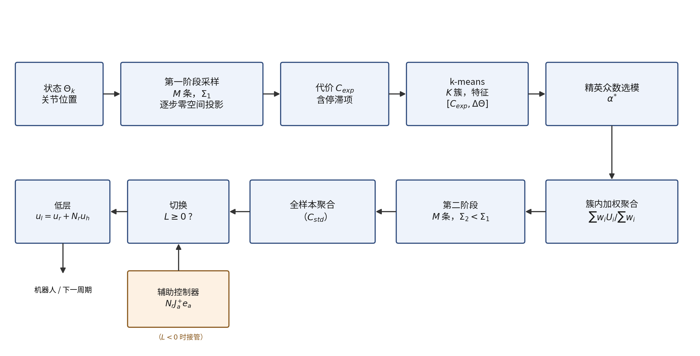

需要强调的是，第 3–4 步不是“把温度调低再采一次”，而是**先选模式、再在模式内平均**。缺少簇条件聚合并不能构成对论文方法的复现。

---

## 3. 双臂协调的数学表述

关节向量记为 `Θ ∈ R^n`（`n = n₁ + n₂`；UR3 对为 12，Franka 对为 14）。控制输入为关节速度 `u = Θ̇`，预测模型为速度积分：

```text
Θ(k+1) = Θ(k) + T_h · u(k) ,   Θ̈(k) = ( u(k) − u(k−1) ) / T_h        (12)

```

约束为

```text
Θ_min ≤ Θ(k) ≤ Θ_max ,  |Θ̇(k)| ≤ Θ̇_max ,  |Θ̈(k)| ≤ Θ̈_max             (13)(14)(15)
x_r(k) = x_r,d   ⇔   J_r(Θ(k)) · u(k) = 0                           (16)(29)
d(k,i,j) ≥ d_min ,  ∀(i,j) ∈ C                                      (18)
ϑ_min ≤ ϑ(k) ≤ ϑ_max                                                (17)

```

其中 `x_r` 为相对位姿，`d_k,ij` 为第 `i`、`j` 个碰撞球心距，`ϑ_k` 为物体倾角。表 1 给出符号、坐标帧与单位；这些约定直接影响代价的数值尺度。


<!--pagebreak-->
| 符号 | 含义 | 坐标帧 | 单位 |
|---|---|---|---|
| `Θ`, `u` | 关节位置、速度 | 关节空间 | rad, rad/s |
| x / x_r / x_a | 位姿、相对位姿、绝对位姿（单位对偶四元数） | 世界/末端 | 8 个实数（6 维流形） |
| `r`, `d` | 对偶四元数实部、对偶部 | — | 无量纲、长度 |
| J / J_r / J_a | 对偶四元数雅可比 | — | 混合（见 §5） |
| N | 零空间投影矩阵 | 关节空间 | 无量纲 |
| T_h / N | 预测步长、预测步数 | — | s, 步 |
| M / K / m | 样本数、簇数、精英数 | — | 个 |
| p_* / λ | 代价权重、温度 | — | 与代价同量纲 |
| L / η | 未探索度、切换阈值 | — | 无量纲 |

**表 1 主要符号与单位**


注：论文中 `N` 同时表示预测步数与零空间投影矩阵，本文按上下文区分（投影矩阵在公式中带下标，如 `N_r`）。

---

## 4. 对偶四元数运动学

### 4.1 表示与基本运算

四元数 `H = {h₁ + h₂i + h₃j + h₄k}`，`i² = j² = k² = ijk = −1`；对偶四元数 `H = {h_r + ε h_d}`，`ε ≠ 0, ε² = 0`。单位对偶四元数写作

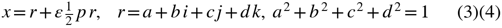


`r` 编码旋转（式 (5)：绕单位轴 `n` 转 `φ` 时 `r = cos(φ/2) + sin(φ/2)(n_x i + n_y j + n_z k)`），`p` 是纯四元数，编码平移；平移由 `t = 2 d r*` 还原。单位条件给出两个标量约束 `rᵀr = 1`、`rᵀd = 0`，因此 8 个分量只张成 **6 维流形**。这一事实决定了后文雅可比秩为 6、零空间维数为 `n − 6`。

对单位对偶四元数，逆等于共轭：`x⁻¹ = x* = r* + ε(−r* d r*)`。代码中的 `dq_inv` 先取共轭再乘标量逆，在单位输入下与上式等价；非单位输入时两者不同，这是数值实现必须固定的约定。

### 4.2 相对位姿与绝对位姿

**相对位姿**（式 (7)）：

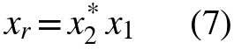


即“把末端 1 的位姿表示在末端 2 的坐标系中”。官方内核先算 `conj(x₂) ⊗ x₁`，与式 (7) 逐字一致。

**绝对位姿**（式 (8)）。论文印为 `x_a = x_2* x_(r/2)`，但官方内核实现的是

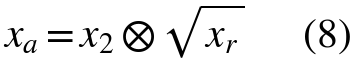


三条独立证据表明式 (8′) 才是自洽读法。其一，群中点恒等式：由 `x₁ = x₂ x_r` 与 `x_r = s²`（`s = sqrt(x_r)`），有 `x_a⁻¹x₁ = s`、`x_a⁻¹x₂ = s⁻¹`，即 `x_a` 到两个末端的群距离相等；字面式 (8) 不满足。其二，基座交换不变性：`x₁ s⁻¹ = x₂ x_r s⁻¹ = x₂ s = x_a`，交换“哪条臂是 2”不改变结果；字面式不满足。其三，正文明确说“averaging the transformations”。

必须同时纠正一个直觉：这个中点是 **SE(3) 螺旋中点**，一般不等于位置坐标的算术平均。固定反例（`R₁ = R_z(0.9)`、`R₂ = R_z(−0.4)`、`t₁ = (0.5,0.2,0.1)`、`t₂ = (−0.1,0.3,0.2)`）给出 `t_a = (0.1832, 0.1489, 0.1500)` m，而算术平均为 `(0.2, 0.25, 0.15)` m，相差 0.1025 m；纯平移时两者才重合。因此绝对位姿依赖相对旋转，这会直接进入终端代价与辅助控制器。

**绝对直线**（式 (9)）与倾角（式 (17)）：

```text
l_a = n_a + ε · (s_a × n_a)                                         (9)
ϑ_min ≤ ϑ(k) ≤ ϑ_max                                                (17)

```

式 (9) 是 Plücker 形式：方向加“过点 `s_a` 的矩”。倾角只用到方向；官方内核同样只算方向，没有计算矩。对纯倾角约束这是等价的，但式 (9) 的完整直线语义在实现中不存在。

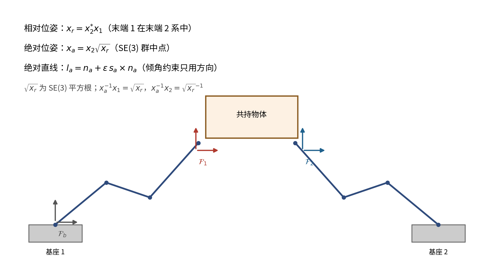

---

## 5. 雅可比与零空间约束控制

### 5.1 微分运动学

```text
vec8(ẋ) = J(Θ) · Θ̇ ;   vec8(ẋ_r) = J_r · Θ̇ ;   vec8(ẋ_a) = J_a · Θ̇   (10)(11)

```

论文把 `J_r, J_a, J_l` 的推导交给其参考文献而未在正文给出推导。复现必须补齐，否则无法判断代码是否正确。设 `x_i = b_i A_i,1(q_i,1) … A_i,n_i(q_i,n_i) e_i`，单关节导数 `∂A_k/∂q_k = ½ ζ_k A_k`，则第 `k` 列为 `j_k = ½ z_k x`，`z_k` 为轴在当前坐标系的表达。对 `x_r = x₂* x₁` 求导：

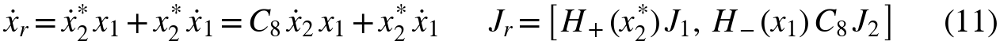


其中 `H₊, H₋` 为四元数左/右乘矩阵，`C₈ = diag(1,−1,−1,−1, 1,−1,−1,−1)`。官方内核的 `Jxr1 = H₊(x₂*)J₁`、`Jxr2 = H₋(x₁)C₈J₂` 与此逐项一致。

**维度与秩**：`J_r ∈ R^(8×n)`，一般位形下秩为 6。8 行中只有 6 行独立，因为 `x_r` 恒在 6 维流形上。因此 `J_r J_rᵀ` 奇异，伪逆必须正则化；`J_r⁺J_r` 是秩 6 的投影，零空间维数为 `n − 6`（UR3 对为 6 维，Franka 对为 8 维）。

### 5.2 逐步投影

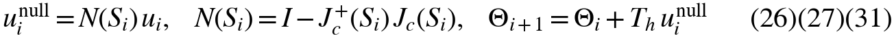


`N` 对称幂等，值域为 `ker(J_c)`，故 `J_c N = 0`：投影后的速度在当前线性化点不产生相对位姿变化。但“精确”只在一阶意义成立。对有限步长，

```text
x_r( Θ(k) + T_h N u ) = x_r(Θ(k)) + T_h J_r N u + (T_h²/2) ẍ_r + O(T_h³)
                      = x_r(Θ(k)) + O(T_h²)

```

即每步残差是 `T_h²` 量级，`N` 步累积 `O(N T_h²)`。论文贡献 2 写“enforced exactly”，严格说应写成“一阶精确、二阶残差”。本复现以 log-log 斜率检验这一点：投影漂移斜率 2.000、未投影 1.001，`T_h = 0.005` s 时漂移比约 `1.0×10⁴`（图 3）。

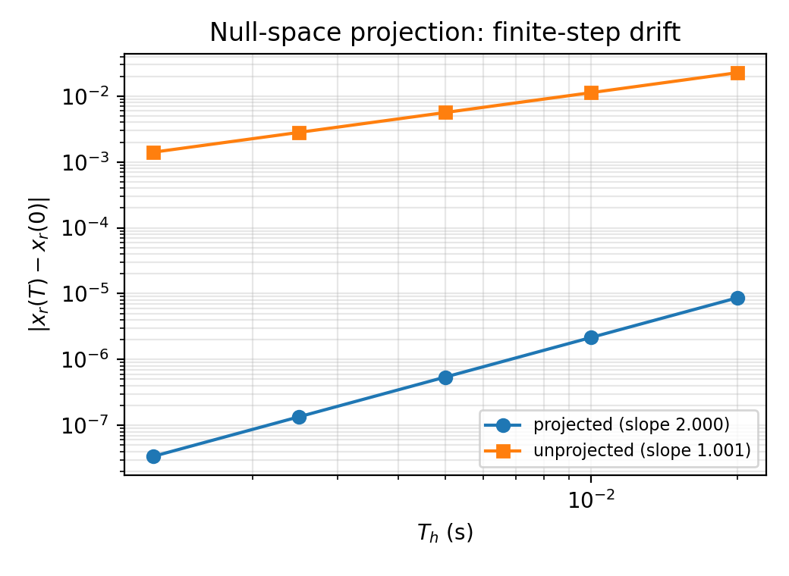

### 5.3 数值实现的一个具体问题

官方 `mppi_project_step` 用 `J⁺ = Jᵀ(JJᵀ + 10⁻¹⁶ I)⁻¹`。对 8 行秩 6 的雅可比，`JJᵀ` 有两个结构零特征值；加 `10⁻¹⁶` 后条件数约 `10¹⁶`，float64 求逆的舍入被放大到 `O(1)`。实测投影器幂等残差 `‖N² − N‖ = 0.247`，而 SVD 截断伪逆（`rcond = 10⁻¹⁰`）为 `7×10⁻¹⁶`。本实现因此使用 SVD 伪逆 `[工程]`；数学定义仍是 `I − J⁺J`。

---

## 6. MPPI 采样、加权与优化

### 6.1 采样与加权

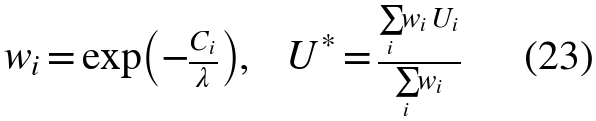


式 (23) 是自归一化指数加权均值。把 `w` 归一化后，估计量的有效样本数为 `M_eff = 1/Σ w̃_i²`；当代价在样本间近似常数时 `M_eff ≈ M`，命令标准差约 `σ/√M`；当代价差异远大于 `λ` 时 `M_eff → 1`，退化为“取最优样本”。

论文表 I 把 `Σ_exp, Σ_std` 写成 3.0 与 0.6，但同一符号在原文中分别被称作协方差矩阵、方差与标准差；官方示例 YAML 使用标量 `std = 3.0`。本实现固定为**逐元素标量标准差**，并把噪声逐元素截断到 `±0.3`（见 §9 的参数表）。频域采样保留 `1/f^γ` 谱形，但把时间域幅度归一化到请求的 `std`（见 §9.3 的工程选择，及 §12.2 第 4 项）。

### 6.2 代价

```text
C_tilt = Σ_k p_t [ I( ϑ(k) < ϑ_min ) + I( ϑ(k) > ϑ_max ) ]           (32)
C_ec   = Σ_k Σ_i Σ_j p_ec I( d(k,i,j) < r_i + r_j + δ_e )            (33)
C_sc   = Σ_k Σ_i Σ_j p_sc I(k,i,j)                                   (34)(35)
w      = ( Π(i=1..6) σ_i )^(1/2) ,  σ_i 为 J_rJ_rᵀ 的非零特征值       (36)
C_sing = p_e / max(ζ, w)                                             (37)
C_goal = p_g ‖vec8( x_a,N − x_a,d )‖₁                                (38)
C_vel  = Σ_k p_v ‖Θ̇(k)‖₁ ,  C_acc = Σ_k p_a ‖Θ̈(k)‖₁                 (39)(40)
C_std  = C_ec + C_sc + C_tilt + C_sing + C_goal + C_vel + C_acc      (41)
C_stay = p_s C_goal / max( ζ , ‖Θ(0) − Θ(N)‖₁ )                      (42)
C_exp  = C_std + C_stay                                              (43)

```

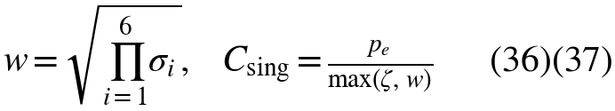


式 (34)(35) 中 `C_sc` 只对安全对（`j > i+1`）求和。

`C_sing` 的 `w` 是吉川可操作度。`J_r` 是 8×n 矩阵、秩为 6，故 `det(J_rJ_rᵀ) = 0`，`sqrt(det(·))` 不能直接使用；`w` 应取**伪行列式**，即 6 个非零奇异值之积：`w = Π_{i=1..6} s_i = sqrt(pdet(J_rJ_rᵀ))`，其中 `pdet(·)` 表示非零特征值之积。论文用“非零特征值”表述，与此等价。

`C_stay` 的分母是关节变化量，故关节几乎不动而终端误差大时该项变大——它是**反停滞**项。代码实现把 `p_s` 放在分母、用平方 `L₂` 范数，函数形式与论文不同（见 §6.3 与 §12.2）。

### 6.3 论文公式与实现的差异

- **C_goal**：论文为 8 维差的 L₁；官方代码另加 3 维位置差（位置被罚两次）；本实现以论文单一项为主，代码双计作对照。
- **C_stay**：论文把 `p_s` 放在分子、用 L₁ 分母；代码把 `p_s` 放在分母、用平方 L₂；两个版本都实现。
- **C_sing**：论文逐 step、两层、`p_e = 10`；代码仅第二阶段终端、权重 0.5；本实现以论文式为主，代码版作对照。
- **采样**：论文式 (20)(24) 写高斯；官方代码用频域与对数正态；本实现以频域 + 对数正态为主，高斯作对照。
- **加速度**：论文为 `(u(k) − u(k−1)) / T_h`；代码未除 `T_h`；本实现采用论文式。

---

## 7. 两阶段采样与 k-means 模式选择

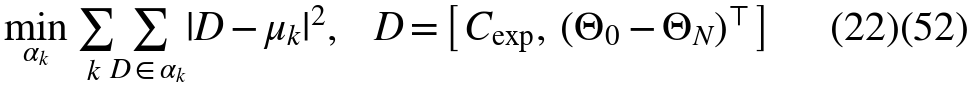


第一阶段的样本按描述子聚类；取代价最低的 `m` 条精英，统计其簇标签众数得到主导模式 `α*`，只在该簇内做加权聚合。第二阶段以该聚合序列为均值、以小方差重采样，并对全样本加权。

两阶段的作用可以这样理解：设两个可行模式 `A, B` 代价相同、样本各半，则全样本均值 `½(U_A+U_B)` 一般既不在 `A` 也不在 `B` 的可行域内；簇条件均值 `E[U|α*]` 则保持在一个模式内。代价是方差不再随 `M` 下降（只随簇内样本数下降），这正是第二阶段要补的。

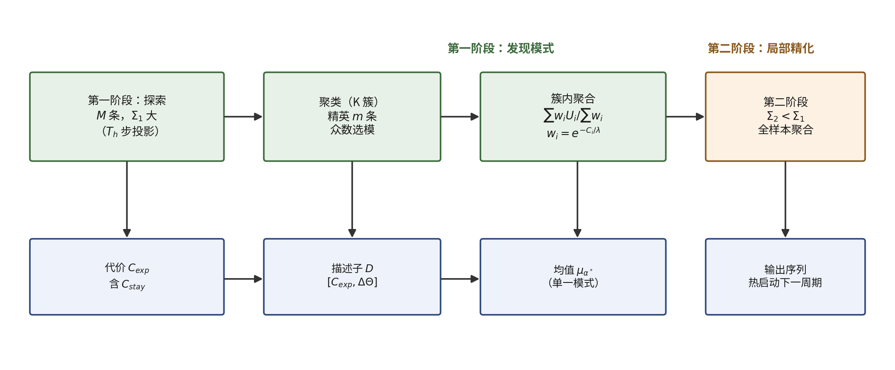

复现时必须记录三个论文未完全给定的口径：描述子各列的归一化、精英数 `m`、温度 `λ` 的“归一化 [5,10]”定义。本实现在二维任务上用平均横向偏移替代 `ΔΘ`（两种绕行终点的净位移相同），并把代价项从描述子中移除——若以 0.2 权重并入，聚类一致率会从 0.88 降到 0.65（1500 的碰撞罚使 k-means 按“撞没撞”分裂）`[适配]`。

---

## 8. 辅助控制器与切换

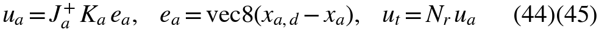

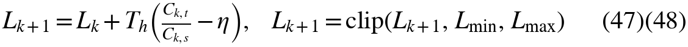


辅助控制器先算绝对位姿任务的伪逆速度，再投到相对零空间的 `N_r`，保证不破坏相对位姿。它的 `N` 步开环 rollout 用与采样 MPC 相同的代价评估，得 `C_t`，从而可与 `C_s` 比较。

`L` 是带饱和的积分比较器：`C_t/C_s > η` 时上升，`< η` 时下降；平衡点是 `η`，不是 1。饱和界不对称（`L_max = 0.4`，`L_min = −0.05`），导致“从探索退回辅助”比“从辅助切回探索”慢约 8 倍——不对称来自饱和界，不是阈值。

**复现中的一个具体发现**：式 (45) 的 `N_r u_a` 严格保持相对位姿等式，但不是绝对任务的精确解。实测 `N J_a⁺ e` 的绝对任务残差为 0.0115（与误差本身 0.0128 同量级），而优先级一致式 `N(J_a N)⁺ e` 为 `3.8×10⁻⁵`。官方代码实现的是式 (45)，这解释了它为何只能做稳态附近的微调。本实现的辅助规划器使用后者 `[工程]`。

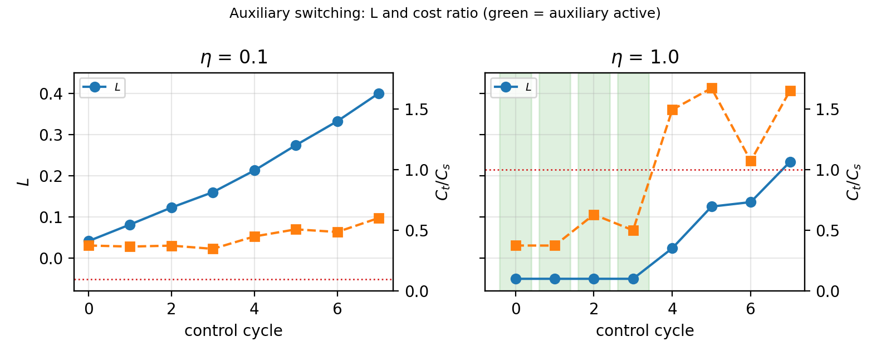

---

## 9. 数值复现实现

### 9.1 代码结构

| 模块 | 文件 | 对应内容 |
|---|---|---|
| DQ 代数 / 正运动学 | `dq.py`、`kinematics.py` | 式 (1)–(6)(10) |
| 相对/绝对位姿 | `kinematics.py` | 式 (7)(8′)(9) |
| 相对雅可比 | `kinematics.py` | 式 (11′) |
| 零空间投影 | `nullspace.py` | 式 (26)–(31) |
| 代价 | `cost.py` | 式 (32)–(43)，含可操作度 |
| 采样器 | `sampler.py` | 高斯/频域/对数正态 |
| 单阶段 MPPI | tasks_linear.py / baselines.py | 式 (19)–(21)(41) |
| 两阶段 | `twostage.py` | 式 (20)(22)(24)(52) |
| 双 UR3 任务 | `tasks_dual.py` | 式 (12)–(18)、§8 |
| 二维双通道任务 | `tasks_bimodal.py` | 模式选择实验 |

全部为纯 NumPy/SciPy、float64、CPU；不依赖 dqrobotics、cupy、cuRobo、ROS 2。

### 9.2 数值任务

1. **线性二次型任务**：二维双积分器，用于与有限时域 LQR 对比，检验加权均值确实在优化。
2. **双 UR3 共持任务**：两条 6 自由度 UR3 链，相对位姿保持、绝对位姿目标为 1.5 cm / 1° 的世界系刚体位移；两个球形障碍（间隙 1 cm）、倾角上限 8°、关节限幅 ±2.8 rad、速度限幅 ±0.8 rad/s。
3. **二维双通道任务**：点质量从 `(−0.8,0)` 到 `(0.8,0)`，`x=0` 处的墙阻断 `|y| ≤ 0.25`，必须从上或从下绕过；用于隔离模式选择机制。

**验证范围**：G1 验证对偶四元数运动学与零空间（双 UR3 构型上的静态与单步性质）；G2 验证单阶段优化器（线性 LQR 对照）与双 UR3 任务的约束传播；G3 在二维双通道任务上验证两阶段与 k-means；G3B 为控制器家族对照。**两阶段 + k-means 未在双 UR3 任务上做端到端闭环验证**，本报告不暗示其已在该任务上被验证。

### 9.3 参数与偏差

| 参数 | 值 | 来源 |
|---|---|---|
| 预测步长 T_h | 0.15 s（UR3）/ 0.10 s（二维） | 表 I |
| 预测步数 N | 15 / 25 | 表 I / 任务 |
| 样本数 M | 两阶段各 500；单阶段 1000 | 表 I |
| 簇数 K / 精英 m | 二维 2 / 10；UR3 不做聚类 | 表 I |
| 采样标准差 | 0.15（两任务） | 代码口径 |
| 噪声截断 / 控制限幅 | ±0.3 / ±1.0（二维）、±0.8 rad/s（UR3） | 代码 / 任务 |
| 代价权重 | p_ec=p_sc=p_t=1500；p_g=100；p_s=0.125；p_e=10 | 表 I |
| 温度 / 切换阈值 | 全局 λ = 0.1×极差；η=0.1（主）、1.0（诊断） | 论文口径代理 |

**表 2 主要数值参数（本实现）**


工程选择（均已在报告中标注）：零空间伪逆用 SVD 截断（`rcond = 10⁻¹⁰`）；双 UR3 任务每步加一次离散约束稳定化（0.05 rad 上限），替代 125 Hz 低层回路；闭环 MPPI 更新增益 0.3；频域噪声幅度重归一化到请求 `std`。

---

## 10. 独立 oracle 与数值结果

验证不依赖官方实现。每个模块都有独立 oracle：

| 模块 | Oracle |
|---|---|
| 正运动学 | 旋转矩阵 + 平移向量的独立 SE(3) 复合 |
| 相对雅可比 | 中心差分（`h = 10⁻⁶`） |
| 零空间投影 | SVD 零空间基（子空间主角） |
| 单阶段优化 | 有限时域 Riccati 反向递推的精确最优代价 |
| 估计器 | 解析 `M_eff` 与蒙特卡洛方差 |
| L 指标 | 一维积分器解析解 |


<!--pagebreak-->
| 指标 | 值 |
|---|---|
| 正运动学 vs SE(3)（500 构型，位置/旋转） | `4.2×10⁻¹⁶ m` / `1.0×10⁻¹⁵` |
| 相对雅可比 vs 中心差分 | `2.3×10⁻¹⁰`（相对 `6.8×10⁻¹⁰`） |
| `σ₇/σ₁` | `2.2×10⁻¹⁶`（秩 6） |
| 投影器幂等/对称/`‖JN‖` | `3.3×10⁻¹⁵` / `3.6×10⁻¹⁵` / `2.3×10⁻¹⁵` |
| 投影/未投影漂移斜率 | 2.000 / 1.001 |
| 漂移比（`T_h=0.005`） | `1.0×10⁴` |

**表 3 G1 数值验收（float64）**

| 指标 | 值 |
|---|---|
| 单阶段 MPPI 代价 / LQR | 1.030（50 种子中位数；最大 1.042；50/50 在 10% 内） |
| 估计器方差 / 预测 | 0.994（`M_eff = 13.96`） |
| L 积分器斜率 / 停留时间比 | 0.100（理论 0.1）/ 8.00（理论 8） |
| 双 UR3 最小/末位置误差（3 种子） | 1.86/2.07/1.52 cm → 2.45/2.07/1.52 cm |
| 等式漂移 / 最小间隙 / 最大倾角 | `~2×10⁻⁶` / ≥0.19 m / ≤1.2° |
| 辅助终结器（`η=1.0`） | 末误差 0.79/1.16 cm，辅助占比 0.40/0.80 |

**表 4 G2 数值验收**


双 UR3 任务的单阶段采样能把误差从 9.3 cm 压到约 2 cm，但随后在噪声地板附近回漂；这与论文引入第二阶段与辅助控制器的动机一致。`η=0.1` 时辅助控制器不接管，原因见 §12.3。

---

## 11. 受控消融与基线对照

### 11.1 模式发现

D1：k-means 与解析“从上/从下”标签的一致率 **0.83**（20 种子，最小 0.717，最大 0.919）。聚类本身在几何上成立。

### 11.2 同批次聚合对照（D2）

两种聚合共用同一全局温度 `λ = 155.41`。全样本与簇条件的终端误差中位数 1.523 m 与 1.535 m；簇条件更优 3/20；配对误差差均值 **+0.01497 m**，95% CI **[0.00859, 0.02135]**（排除 0）。即在单次更新后，簇条件聚合在统计上可辨地**略差约 1.5 cm**，但两者都停滞（约 1.5 m），不构成任务成功差异；该结果不能外推到闭环控制器。

D008 之前使用“簇内温度”的历史测量保留在报告中，标签为历史，不可与上表直接比较。

### 11.3 等预算对照（F1）

两阶段 500+500 与单阶段 1000 次/迭代，同种子、同初始序列、同代价、同温度、同限幅。

| 控制器 | 成功 [95% Wilson CI] | 终端误差中位数 | 控制序列 TV |
|---|---|---|---|
| 两阶段（频域 + 对数正态） | 20/30 [0.49–0.81] | 0.029 m | 1.49 |
| 单阶段（高斯） | 30/30 [0.89–1.00] | 0.002 m | 1.61 |
| 单阶段（频域，与 stage 1 同分布） | 20/30 [0.49–0.81] | 0.045 m | 1.32 |

**表 5 等预算对照（30 种子）**


配对 McNemar：两阶段 vs 高斯 `p = 0.002`（仅两阶段成功 0，仅高斯成功 10）；vs 频域 `p = 1.000`。


<!--pagebreak-->

### 11.4 机制消融（F2）

| 变体 | 成功 [95% CI] | 终端误差中位数 | McNemar vs full |
|---|---|---|---|
| 完整两阶段 | 12/20 [0.39–0.78] | 0.042 m | — |
| 去掉方差缩减（`Σ₂ = Σ₁`，第二阶段仍执行） | 18/20 [0.70–0.97] | 0.015 m | 0.03 |
| 真实 stage-1 only（500/迭代，预算不等） | 13/20 [0.43–0.82] | 0.035 m | 1.00 |
| 真实 stage-1 only（1000/迭代，等预算） | 12/20 [0.39–0.78] | 0.032 m | 1.00 |
| 去掉聚类（K=1） | 20/20 [0.84–1.00] | 0.002 m | 0.01 |
| 代码自适应温度 | 20/20 [0.84–1.00] | 0.003 m | 0.01 |
| 模式惯性（诊断项） | 12/20 [0.39–0.78] | 0.038 m | 1.00 |

**表 6 机制消融（20 种子）**

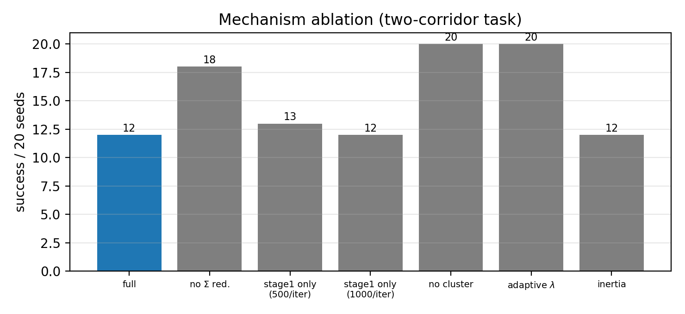


等预算下第二阶段没有带来成功数提升（12 vs 12）；不等预算下 13 vs 12 也在噪声范围内，因此不能推断第二阶段的正贡献。去掉聚类与改用代码自适应温度都达到 20/20，说明本任务中主导因素是温度/采样分布，而不是论文强调的聚类与精化。

<!--pagebreak-->

### 11.5 控制器家族对照（G3B）

| 变体 | 成功 [95% CI] | 终端误差中位数 | McNemar vs 两阶段 |
|---|---|---|---|
| 两阶段 | 20/30 [0.49–0.81] | 0.029 m | — |
| MPPI（高斯） | 30/30 [0.89–1.00] | 0.002 m | 0.002 |
| Log-MPPI | 30/30 [0.89–1.00] | 0.002 m | 0.002 |
| Fre-MPPI（频域） | 20/30 [0.49–0.81] | 0.045 m | 1.000 |
| Biased-MPPI | 30/30 [0.89–1.00] | 0.012 m | 0.002 |
| High-MPPI（去掉障碍/倾角代价） | 30/30 [0.89–1.00] | 0.003 m | 0.002 |
| CEM | 30/30 [0.89–1.00] | 0.002 m | 0.002 |

**表 7 变体对照（30 种子，等预算 10 000 次评估）**


公平性记录：所有变体同初始序列、同扰动限幅 ±0.3、同控制限幅 ±1.0、同温度定义、同 10 次迭代；两阶段总评估 10 000 次，单阶段 1000×10 次。`high_mppi` 从可行种子出发且扰动小，碰撞数为 0，不能作为“不处理约束会撞”的证据。


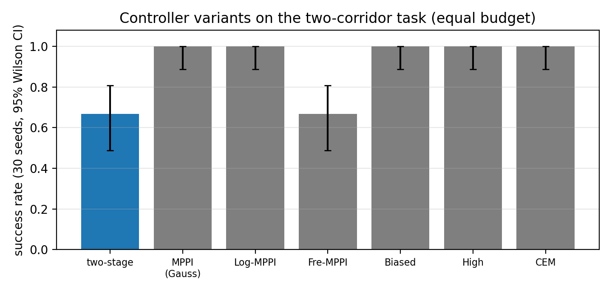

---

<!--pagebreak-->
## 12. 负结果、论文/代码差异与限制

### 12.1 N1：五个命题分开判定

| 命题 | 判定 | 证据 |
|---|---|---|
| k-means 恢复几何模式 | 支持 | D1 一致率 0.83 |
| 簇条件聚合优于全样本 | 不支持 | D2 3/20；配对差 +0.015 m，CI 排除 0（轻微劣化） |
| 真正的第二阶段改善优化 | 不支持（本任务） | 等预算 12/20 vs 12/20；不等预算 13 vs 12 |
| 完整两阶段优于等预算单阶段 | 不支持 | 20/30 vs 高斯 30/30，`p = 0.002` |
| 两阶段降低控制变化 | 不支持 | TV 1.49（介于高斯 1.61 与频域 1.32 之间）；且运动幅度不同，TV 不可直接比较 |

这些判定只针对二维双通道任务与所列参数，不是论文六场景的复刻，不能外推到 UR3/Franka 实验。


<!--pagebreak-->
### 12.2 与论文/官方代码的差异

| 编号 | 内容 | 类别 |
|---|---|---|
| 1 | 式 (8) 印为 `x₂* x_(r/2)`，自洽读法与内核为 `x₂ sqrt(x_r)` | 论文排版错误 |
| 2 | 官方 1e-16 阻尼对秩 6 雅可比在 float64 下失效（`‖N²−N‖ = 0.247`） | 官方代码数值问题 |
| 3 | 式 (45) 保持等式但不是绝对任务精确解（残差 0.0115 vs `3.8×10⁻⁵`） | 论文近似 |
| 4 | 官方频域噪声幅度不可解释（请求 `std=0.15`，实际 std≈94） | 官方代码实现 |
| 5 | 官方每周期重置随机种子，随机采样退化为确定性序列 | 官方代码实现 |
| 6 | 表 I 与示例 YAML 有 8 项数值不一致 | 参数口径 |
| 7 | 代码在采样分布、停滞项、奇异项、终端代价、倾角、种子上偏离论文式子（7 项 `CODE_MODIFIED`） | 代码与论文 |

### 12.3 N2：切换阈值

主配置保持表 I 的 `η = 0.1`。逐周期实测 `C_t/C_s` 在 0.35–0.60，`L` 从 0.04 单调升到 0.40，辅助控制器从未激活；末端误差在 2.08–2.47 cm。把 `η` 改为 1.0（与正文“收敛附近 `C_t/C_s ≈ 2`”的描述同量级）后，前 4 个周期 `C_t/C_s < 1`，`L` 触底 −0.05、辅助接管；随后 `C_t/C_s` 回升到 >1（采样计划变便宜），`L` 上升、辅助退出——切换在两种控制器之间交替，末端误差从 1.98 cm 降到 1.06 cm。

这说明辅助控制器本身工作正常；`η = 0.1` 的实际含义是“辅助代价必须低于采样代价的 10%”，与表 I 的参数直接相关。本报告只描述该实现下的行为，不据此断言论文全局不自洽。

### 12.4 N3：奇异项的量纲

`w` 的 6 个非零奇异值在 home 位形为 `[1.409, 0.962, 0.762, 0.545, 0.267, 0.158]`，`w = 0.0237`；`p_e = 10` 给出 `C_sing = 422`，而同位形 `C_goal ≈ 2.74`。把 DH 长度整体缩放 `s ∈ [0.01, 100]`，`w` 从 `1.17×10⁻⁵` 变到 `6.81×10⁵`，log-log 经验斜率 **2.712**。但 2.712 只是该有限区间上的经验斜率，**不是物理量纲**：`J` 同时含平移行（带长度单位）与旋转行（无量纲），要给 `w` 一个有物理意义的归一化，必须先指定特征长度或显式缩放约定（例如把平移行除以 `L_c`）。论文未给该约定，因此 `p_e = 10` 与 `p_g = 100` 的比值无法仅凭原文确定。

其它测量：300 个构型上 `w` 在 0.0053–0.0353（中位 0.0221）；200 个终端样本上 `C_sing` 在 393–455，`C_goal` 在 3.5–17.4，`λ = 602` 时 5–95% 跨度对应权重比 0.90；加与不加 `C_sing` 的单次更新控制差 `‖Δu‖ = 0.0067`（约 5%），余弦相似度 0.9987；近奇异网格上 `w` 最小 0.0061（肩 −2.6、肘 −2.2 rad），`C_sing = 1641`。公式保持不变，也不把 `p_e/w` 改为 `p_e·w`（优化方向相反且同样不解决归一化）。

### 12.5 限制

1. 复现仅在数值层；未验证 GPU 实时性与真实机械臂。
2. 论文的六场景、12 个基线与动态障碍膨胀规则未公开或未实现，表 II 无法逐格复现。
3. 聚类描述子、精英数、温度“归一化”与 `C_s` 取法在论文中欠定义；本实现的选择已记录。
4. 二维双通道任务是自建任务，用于隔离机制，不代表论文场景。
5. 双 UR3 任务在给定抓取位形下绝对位姿雅可比条件较差（`σ_min ≈ 0.117`），6 cm 位移需约 1.7 rad 关节运动，故目标取 1.5 cm。

---

## 13. 结论

本文在纯数值环境中复现了论文的对偶四元数运动学、零空间约束传播、两阶段采样与辅助切换框架，并用独立 oracle 验证了各模块的数值正确性：正运动学对 SE(3) 误差 `4×10⁻¹⁶`，相对雅可比对中心差分 `2×10⁻¹⁰`，投影器幂等残差 `3×10⁻¹⁵`，漂移斜率 2.000 与 1.001；单阶段 MPPI 与有限时域 LQR 相差 3%，估计器方差与 `M_eff` 预测一致（0.994），L 积分器的斜率、饱和与停留比与解析一致。

但论文的性能主张未能在二维双通道任务上复现：等预算下两阶段 20/30，高斯单阶段 30/30（`p = 0.002`）；去掉聚类反而 20/20；真实 stage-1-only 在等预算下与完整两阶段同为 12/20。簇条件聚合在同一批样本上平均差 0.015 m（CI 排除 0，属轻微劣化），但两者都停滞，不能据此推断闭环表现。

因此验收等级为 **PARTIALLY_VERIFIED**：运动学、零空间、单阶段优化与切换积分器（G1/G2）及二维任务上的两阶段机制（G3/G3B）的数值实现已验证；论文在二维任务上的性能优势未复现，且两阶段未在双 UR3 任务上端到端闭环验证。解除限制需要三类信息：聚类描述子的归一化与精英数、温度“归一化 [5,10]”的定义、`C_s` 的取法；以及奇异项 `w` 的缩放约定。在此之前，本报告不声称 `FULL_PAPER_REPRODUCED`，也不声称复现了论文表 II。

---

## 参考

1. T. Zhu, J. Mao, J. Yang, S. Li, “Real-Time Dual-Arm Cooperative Manipulation Under Multiple Constraints: A Two-Stage Sampling MPC Approach,” *IEEE Transactions on Robotics*, vol. 42, pp. 1942–1960, 2026. DOI: 10.1109/TRO.2026.3686224.
2. 官方 MPC 仓库：`https://github.com/zhutianqi2006/dual_arm_gpu_mpc`（审计快照 `fe5b49f7`、`1820a9e8`）。
3. 官方 CUDA 内核：`https://github.com/zhutianqi2006/cuda_dq_kernel`（审计快照 `231f130e`、`c762b7d6`）。
4. 项目页：`https://dq-gpu-mpc.github.io/`（仅代码与视频，无数据/参数）。
5. 本仓库审计与复现文档：`p1/P1_PAPER_STUDY.md`、`p1/P1_EQUATION_AUDIT.md`、`p1/P1_OFFICIAL_CODE_AUDIT.md`、`p1/D008_AUDIT.md`、`p1/OPEN_ISSUES.md`。
6. 数值验收报告与 JSON：见仓库 p1/reports 目录下的 G1、G2、G3、G3B 与 N3 文件。
7. 依赖：NumPy 1.24.4、SciPy 1.8.0、Matplotlib 3.5.1；Python 3.10.12。
