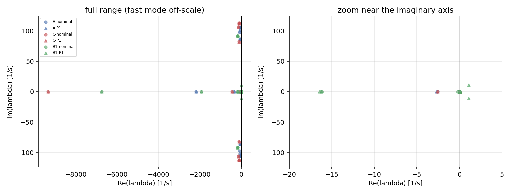
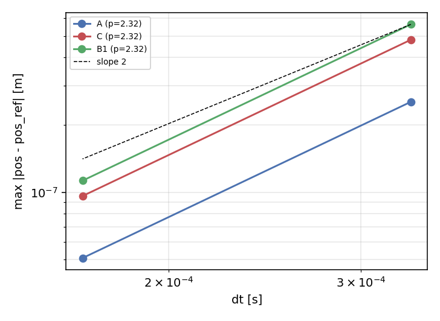
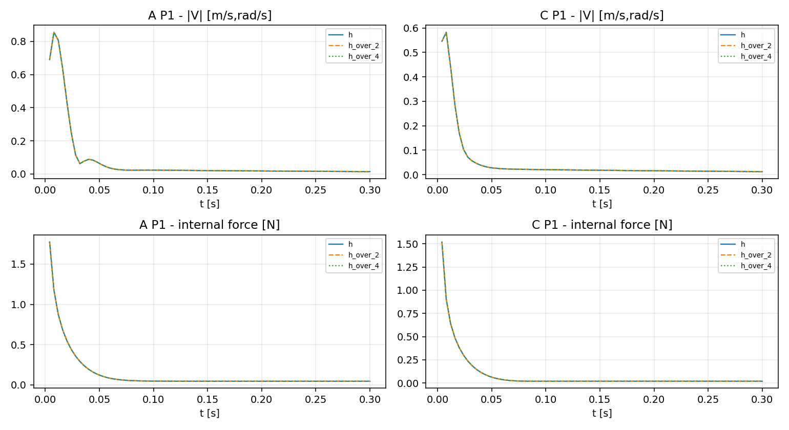

# P2 最终交付报告：双臂协同搬运核心算法数值复现（D082 范围）

**论文**：De Simone 等，IEEE RA-L 2026，DOI `10.1109/LRA.2026.3665445`（双臂刚性抓取柔性物体协同搬运）
**仓库**：`dreamerToTOE/dual-arm-coordinated-manipulation-reproduction`
**分支**：`reproduce-p2-numerical-simulation-20261018`（基线 HEAD `55afa59d`，本报告随 V4 修正提交）
**日期**：2026-10-19

---

## 0. 结论摘要与验收声明

| 项 | 结论 |
|---|---|
| 验收目标 | `ALGORITHM_NUMERICAL_VERIFIED`（D082：核心算法数值复现，**非**全文实验复现） |
| 总体状态 | **核心算法层 VERIFIED**；论文实验层 `OUT_OF_SCOPE_D082` / `NOT_EXECUTED` |
| 控制律验证（最终版） | **V4：14/14 项正式 PASS**（另有 1 项信息性诊断不计入正式计数） |
| 声明 | **本文不声称 FULL paper reproduction。** 所有未运行的原文实验均逐项登记（§7、§8） |

V4 相对 V3 的五项修正（最终交付审查要求）：

1. **零误差不动点重验**：在位姿反馈真实激活的时段（t = 20 s ≥ 13 s）重验，U_P 经式(25)真实路径仍为 0（残差 0 m/s、0 rad/s）。V3 在 t = 10 s 验证时 `pose_active = False`，U_P 分支被短路，结论不充分。
2. **信息性诊断移出正式计数**：真实夹具零输入下内力近零（1.3e-13 N / 1.2e-14 N·m）属物理对称性事实，检查本身无条件为真，标 `diagnostic` 并从 15/15 改为 **14/14 正式计数**。
3. **单位分离**：内力（N）与力矩（N·m）分开报告；线速度（m/s）与角速度（rad/s）分开报告。例如注入内力分解为 **0.468 N / 0.175 N·m**，U_F 分解为 **3.7e-4 m/s / 3.0e-3 rad/s**。
4. **内力 oracle 描述更正**：该 oracle 与控制器使用**同一接触评估**（同一 H、W、零空间投影定义），在控制器外部重算 h_I。它验证的是控制器的算术、符号约定与增益管道，**不是**独立接触模型。V3 中"独立零空间 oracle"的表述过强，已更正；同时 oracle 显式纳入 hB 项（本夹具零输入下 hB = 0，已断言）。
5. **时序门对齐冻结协议**：内力反馈 7 s 开、位姿反馈 13 s 开（V3 描述 "force_off@5s, force_on@10s" 与协议不符，已更正为三时段断言：t=5 s 全关、t=10 s 仅力反馈、t=20 s 全开）。

---

## 1. 论文动机与主要贡献

**问题**：双臂抓取柔性/易变形物体（如刚性盘、垫片区接触）搬运时，两臂之间存在不产生物体刚体运动的**内力/内力矩**。内力过大→挤压损坏或屈曲；过小→滑落。同时物体位姿需高精度跟踪。视觉观测低频（15 fps）且可掉线，触觉观测高频但只测接触弹性力——需要多率、多模态状态估计。

**原文贡献**（对应 §2 公式清单）：

1. 柔性接触的 SE(3) 弹簧-阻尼模型（式 7–11）：接触形变用 Lie 对数 τ = Log(T^e_g) 度量，刚度/阻尼在接触坐标系内线性化；
2. 双臂抓取矩阵 W 与内力提取（式 12、20）： transmitted wrench 经 W 的零空间投影得到内力分量，保证内力不做物体的净功；
3. 位姿-内力解耦控制（式 19–21、25）：U = U_F + U_P，U_F = −K_F·h_I 只作用在内力子空间，U_P 在物体 SE(3) 上做位姿跟踪，两通道解耦；
4. 右不变迭代扩展 Kalman 滤波（IESEKF，式 17–18）：42 维状态在 SE(3)×R^n 流形上用右扰动坐标传播与更新，多率观测（EE 位姿 200/50 Hz、触觉 100 Hz、视觉 15 fps、76 s 后 robot2 视觉关闭）。

## 2. 原文公式清单

| 式号 | 内容 | 实现状态 |
|---|---|---|
| (1)–(6) | SE(3)：⊞/⊟ 右扰动、Exp/Log、Adjoint | LITERAL |
| (7)–(8) | 接触运动学：D = E⁻¹·O·G，τ = Log(D) | LITERAL |
| (9) | h_K = −K·τ | LITERAL |
| (10) | V^e_{g,e} = R̄·Ad_{(T^o_g)⁻¹}·V^o − V^e_e | APPROX（保留论文 R̄ 近似） |
| (11) | h_B = −B·V^e_{g,e} | LITERAL |
| (12) | h^o_E = W·H·h，W = [Adᵀ_{(T^o_{e1})⁻¹}, Adᵀ_{(T^o_{e2})⁻¹}]·Hᵀ | LITERAL |
| (13)–(14) | 状态 X（42 维）与端点速度输入 U ∈ R¹² | LITERAL |
| (15) | 抓握框架运动学 f(X,U) | **ADAPTED**（已批准偏离，见 §6.3） |
| (16) | V̇^o = M⁻¹(h^o_E − B_a V^o − Coriolis) + 重力 | LITERAL（M 为 ADAPTATION） |
| (17) | 观测模型 Z | LITERAL |
| (18) | IESEKF 右 Euler 预测 + 迭代更新 | LITERAL（数值不稳定根因，见 §6.1–6.2） |
| (19)–(21) | U = U_F + U_P；h_I 投影；U_F = −K_F·h_I | LITERAL |
| (22)–(24) | 内力闭环局部稳定性 | NOT_IMPL（故意，见 §8） |
| (25) | U_P = Ad_{(T^o_e)⁻¹}(V^o_{o,d} + K_P·τ^o_{o,d}) | LITERAL |
| (26) | 关节级逆运动学 q̇ = J†V + 零空间 | NOT_IMPL（理想 Cartesian 约化替代） |

表 I / 表 II 参数（Q/R 协方差倍率、K、B、B_a、K_F、K_P、四对象 A/B1/B2/C 质量几何）已逐项对照页面图像录入 `configs/p2_closed_loop_protocol_v3.json`。

## 3. 数学推导

### 3.1 SE(3) 表示与右扰动

变换 `T^a_b` 把 b 系映入 a 系；扰动一律用右乘 `X ⊞ δ = X·Exp(δ)`，右差 `Log(Y⁻¹X)`。SE(3) 指数

```
Exp_SE(3)(ξ) = [ Exp_SO(3)(θ), V(θ)·ρ ]，  ξ = [ρ; ω]，θ = ‖ω‖
V(θ) = I + (1−cosθ)/θ² · [ω]× + (θ−sinθ)/θ³ · [ω]ײ
```

实现中 `V` 在 ‖ω‖ < 1e-4 切换到级数展开避免舍入灾难；`Log` 用 `solve(V(θ), t)` 非迭代求解。Adjoint `Ad_T = [[R, [t]×R], [0, R]]`（twist 顺序 [v; ω]、wrench 顺序 [f; m]）。已验证：Exp/Log 往返 4.4e-16；`Ad(Exp ξ) = expm(ad ξ)` 4.4e-16；wrench 功率不变性 2.2e-16；左/右 Jacobian 逆 vs 中心差分 2.6e-10。

### 3.2 柔性接触模型（式 7–11）

接触形变以抓握框架相对末端框架的 Lie 位形差度量：`D_r = (T^{b_r}_{e_r})⁻¹ · T^b_o · T^o_{g_r}`（robot2 经基座变换 C = T^{b1}_{b2} 适配），`τ_r = Log(D_r)`。弹性 wrench `h_K = −K·τ`（K 为 6×6 对角正定，符号约定：机器人作用于物体）。相对速度

```
V^e_{g,e} = R̄ · Ad_{(T^o_g)⁻¹} · V^o_o − V^e_e，   R̄ = diag(R, R)
```

`R̄` 是论文自身的近似（精确为 Ad_D，多出 [p]×R 杠杆臂块）；T02 在随机小扰动状态上量化差异 **1.4e-3**，保留为 APPROX。阻尼 `h_B = −B·V^e_{g,e}`。

### 3.3 抓取矩阵与内力投影（式 12、20）

12 维臂 wrench h（两臂各 6）到物体 wrench 的映射 `h^o_E = W·H·h`，`W = [Adᵀ_{(T^o_{e1})⁻¹}, Adᵀ_{(T^o_{e2})⁻¹}]·Hᵀ`。H 为接触模式选择矩阵：tight = I₆、pivot = I₆[:5]（不传 z 力矩）、sliding = I₆[2:]（不传 x/y 线力）。**内力**是经 W 映射后物体净 wrench 为零的分量：

```
h_{I,t} = (I − W⁺·W)·H·h（transmitted 空间，W h_{I,t} = 0）
h_I = Hᵀ·h_{I,t}
```

已验证：投影幂等/对称、零功（h_I 对物体速度功率为零）、完备性，最大误差 3.2e-13；虚功一致性 `h_EᵀV_o = Σ (H h)_rᵀ (H_r V_e_r)` 5.9e-16。**注意**：`W·h_I = 0` 的印刷记号按维度不成立，well-posed 形式是 `W·h_{I,t} = 0`（报告与代码注释统一用后者）。`rank(W)` 依赖夹具（标称 sliding = 4，一般扰动状态 = 5），秩门必须绑定夹具。

### 3.4 动力学与式(15)偏离（式 13–16）

物体动力学 `V̇^o = M⁻¹(h^o_E − B_a·V^o − Coriolis) + R^T g`，Coriolis 块 `[[ω]×, 0], [[v]×, [ω]×]·M·V^o` 与论文一致；M 论文未给惯量，采用均质长方体对角阵（ADAPTATION）。**式(15) 印刷式的最后两项 `+H̄H̄ᵀ·Ad_{(T^e_g)⁻¹}·V^e_{g,e}` 产生 2 倍自由方向速率**：反例（sliding 自由方向、EE 静止、物体 0.01 m/s）下印刷式给出 0.02 m/s 自由形变速率（4 ms → 80 µm），与"自由方向垫片不形变"矛盾。已批准替代 `p2.spatial_free_log_constraint.v1`：解 `Nᵀ·Jr(τ)⁻¹(a + V_G) = 0` 求抓握框架速度，保持不变量 **Nᵀτ̇ = 0**（自由 Log 分量保持初值），资格 68/68，不变量残差 7.9e-18。该式是**已批准偏离，不是作者原式**。

### 3.5 IESEKF 与离散稳定性（式 17–18）

状态 X = (O, V_o, E1, E2, C, G1, G2)，42 维协方差按此顺序。预测/更新全部在右误差坐标：`X_{k+1} = X_k ⊞ ΔT(f + w)`，观测残差用右差，迭代更新含 Joseph 形式协方差。多率心跳与论文一致（plant tick 1/3000 s、滤波 4 ms/250 Hz、触觉 100 Hz、视觉 15 fps）。

**离散稳定性推导（T01/T04 定量裁决）**。式(18) 印刷实现为 4 ms 右 Euler：放大因子 `1 + h·λ`。对连续谱最快模态：

| 对象 | λ (s⁻¹) | h_crit = −2/λ | 4 ms 放大 | 1/3000 s 快模态因子 |
|---|---:|---:|---:|---:|
| A | −2183.07 | **0.916 ms** | **7.732** | 0.272（衰减；1 ms 已 1.183） |
| B1/B2 | −6750.3 | 0.296 ms | 26.00 | 1.2501（系统 ρ=1.25） |
| C | −9335.81 | 0.214 ms | 36.34 | **2.1119**（系统 ρ=2.11） |

即 4 ms Euler 对 A 的 −2183 s⁻¹ 快模态每步放大 7.7 倍——这就是历史 3.948 s `ESTIMATOR_MODEL_PAD_DOMAIN_INVALID` 停止的数值根因（§6.1）。过程噪声侧：精确离散 Q_d（Van Loan）在 4 ms 只有 `h·Q_c` 的 5.7%（A）/1.34%（C），**不能只换 Φ 不换 Q_d**（否则注入 17–75 倍过程噪声）。Van Loan 实现必须写对：`exp(h·[[A,G],[0,−Aᵀ]]) = [[Φ,S],[0,Φ⁻ᵀ]]` 则 **Q_d = S·Φᵀ**（不是 S；naive 实现在 C/4 ms 下差 4 个数量级且破坏 PSD）。稳定实现用 scaling-and-squaring 保证 |λ|h ≤ 0.5。

### 3.6 位姿-内力解耦控制（式 19–21、25）

```
U = U_F + U_P（同一坐标系内相加，式19）
h_{I,t} = (I − W⁺W)·H·h，h_I = Hᵀ·h_{I,t}（式20）
U_F = −K_F·h_I（式21，K_F1/K_F2 取表 II）
U_P = Ad_{(T^o_e)⁻¹}·(V^o_{o,d} + K_P·τ^o_{o,d})（式25，按公共基 b1 对两臂分别计算）
```

代码对前馈项的显式实现为 `ff = Ad(Ô⁻¹·O_d)·V_d`（原文未展开该细节，属 EXTRA 标注）。式(22)–(24)（内力闭环局部线性稳定性）经审计发现印刷式 Jr 参数与式(9)直接微分不一致，协议冻结 `eq22_used_to_generate_force_curves = false`，**不用于生成功力曲线**。

## 4. 实际实现与代码引用

| 模块 | 代码（`baselines/p2_pose_force/`） | 关键类/函数 |
|---|---|---|
| SE(3) | `contact_geometry.py` | `se3_exp` / `se3_log` / `adjoint` / `selection` / `grasp_rate` |
| 接触 | `mechanics.py` | `mechanics()`：D、τ、hK、hB、h、W、internal |
| 动力学 | `native_kernel.cpp` + `native_model.py` | `native.advance`（隐式中点）、`midpoint_step`（旧显式实现，仅审计对照） |
| 式(15) 替代 | `contact_geometry.grasp_rate` | `p2.spatial_free_log_constraint.v1` |
| IESEKF | `estimator.py` | `RightIESEKF.predict / prediction_linearization / update` |
| 稳定传播 | `stable_propagation.py` | `StableRightIESEKF`、`propagate`、`van_loan_stable` |
| 观测 | `observations.py` | `ObservationGenerator`、`FilterState`、`initialize_from_fresh` |
| 控制律 | `control.py` | `PoseForceController.evaluate`（式 19/20/21/25） |
| 协议 | `configs/p2_closed_loop_protocol_v3.json` | 冻结参数、时序、模式、域门 |

**复现命令**（Python 3.10 + numpy 1.24.4 + scipy 1.8.0）：

```bash
cd /home/ubuntu2004/lmy/p2-num-sim-20261018
/usr/bin/python3.10 p2/tools/t02_math_audit.py            # T02：23 项数学审计（~2 s）
/usr/bin/python3.10 p2/tools/t03_plant_audit.py           # T03：谱 + 受扰运动
/usr/bin/python3.10 p2/tools/t04_stage_a.py               # T04-A：稳定预测器资格（48/48）
/usr/bin/python3.10 p2/tools/t04_r1_replay.py             # T04-R1：失败逐位重放
/usr/bin/python3.10 p2/tools/d082_control_verify_v4.py    # V4：控制律 14 项正式验证
```

随机种子 `20261019`（PCG64），全部输入可复算；所有验证脚本独立于真值（GT 只能评分或显式标诊断，不进反馈）。

## 5. 数值证据（T02 / T03 / T04 / V4）

### 5.1 T02：SE(3)、接触、抓取数学审计（23 项：21 PASS + 2 记录偏离）


| 检查 | 最大误差 |
|---|---:|
| Exp/Log 往返（随机/小角/近 π） | 4.4e-16 |
| Adjoint 三恒等式 | 4.4e-16 |
| wrench 功率不变性 | 2.2e-16 |
| 式(8)(9)(10)(11)(12) 结构 | 0 |
| 虚功一致性 | 5.9e-16 |
| 式(20) 投影幂等/零功/完备性 | 3.2e-13 |
| Jr⁻¹ vs FD | 2.6e-10 |
| 式(15) 替代不变量 Nᵀτ̇=0 | 7.9e-18 |
| 6 类观测解析 Jacobian vs 中心差分 | 5.9e-11 |
| **右 Euler 一步 map 的 F vs 右误差 FD** | **2.6e-11**（否证 Jacobian bug） |

两项记录偏离：式(15) 印刷式 2 倍自由速率（80 µm/4 ms 反例）；式(10) R̄ 近似 1.4e-3。

### 5.2 T03：独立动力学 plant（42 维右误差 Jacobian 谱）




| 对象 | 最快实模态 | Euler ρ @ 1/3000 | Euler ρ @ 4 ms | native 隐式 ρ |
|---|---:|---:|---:|---:|
| A | −2183.1 s⁻¹ | 1.0000 | 7.73 | **1.000000** |
| B1/B2 | −6750.3 s⁻¹ | 1.2501 | 26.00 | 1.000000 |
| C | −9335.8 s⁻¹ | **2.1119** | 36.34 | 1.000000 |





- native 隐式一步映射在 h、h/2、h/4 全部中性（ρ=1.0）；Richardson 收敛阶 2.00（全块）；受扰轨迹经验位置阶 2.32。
- 受扰运动（0.3 s，4 对象 × 3 步长）：速度全部衰减（如 A: 0.690→0.014 m/s）、能量单调下降、Newton ≤ 2 次。
- B1/B2 惯量/抓取为 ADAPTATION（论文未给）。历史 "C native 隐式中点 ρ=2.73" 是**标签错误**：那是 `mechanics.midpoint_step`（显式预测-校正），|1+z+z²/2| 在 z=−3.1119 恰为 2.730136，与生产隐式映射无关（下图）。


### 5.3 T04：IESEKF 传播格式与闭环

| 阶段 | 关键结果 |
|---|---|
| Stage A 资格 | 模式 B（`stable_propagation.py`）48/48 通过，ρ=1.0 全域含 C@4 ms；Φ=exp(hA) 与非线性 map FD 差 1.35e-2（O(h²) 近似，系数 ∝\|f\|，f=0 时 2.6e-11 精确）→ 记"条件通过"；naive Van Loan 在 C@4 ms 失效（sym 8e-3、PSD 负、与 stable 差 5.6e5），scaling-and-squaring 修复 |
| R1 重放 | **模式 A 逐位复现历史失败**（max_state_diff = 0.0）→ REPLAY_VALID；模式 B 同一 1619/829 事件流跑完 3.948 s 前缀，tick 11844 时 \|V\|=0.005（A 为 46.9），域门 τ=0.77 mm（门 5 mm）；速度估计误差 A max 189.7 / B max 0.174 m/s |
| R1+ 闭环 7.5 s | 模式 B 因果闭环通过，完整 P/NEES 仪器化 |
| 95 s 闭环 | BUDGET_STOP @ t=65.764 s（600 s 墙钟，9.1× realtime）；**越过 3.948/7/13/23/55 s 全部检查点**；max P_trace 1.5634（有界）；pad 形变 0.6 mm（门的 12%）；GT 读取 0；无数值失败、无域门触发 |


工程优化（T01-E）：O1-a/b/c 等价性 444/444 位相同；预测 3.37→1.16 ms、更新 32.1→13.7 ms。

### 5.4 V4：位姿-内力控制律最终验证（14/14 正式 PASS + 1 诊断）

| 检查 | 内容 | 残差（单位分离） |
|---|---|---|
| V4_01 | 零误差不动点（t=20 s，位姿反馈已激活，式25 真实路径） | 0 m/s，0 rad/s |
| V4_02 | 注入内力 → ‖h_I‖ > 0.01 | 力 0.468 N，力矩 0.175 N·m |
| V4_03 | ‖U_F‖ > 1e-4 | 线 3.7e-4 m/s，角 3.0e-3 rad/s |
| V4_04 | U_F = −K_F·h_I（oracle = 控制器外部同接触重算，C4 更正） | 0 m/s，0 rad/s |
| V4_05 | 2× 注入 → 2× U_F | ratio = 2.000 |
| V4_06 | 混合模式：U_F、U_P 均非零 | U_F: 3.7e-4 m/s + 3.0e-3 rad/s；U_P: 2.6e-3 m/s + 3.9e-3 rad/s |
| V4_07 | U_cmd = U_F + U_P | 0 m/s，0 rad/s |
| V4_08 | U_P vs 独立式(25)重推导 | 0 m/s，0 rad/s |
| V4_09/10 | pivot/sliding 选择矩阵过滤 | 0 m/s，0 rad/s |
| V4_11 | 命令域（分别门控） | max 线 1.6e-3 m/s < 0.15；max 角 3.8e-3 rad/s < 0.5 |
| V4_12 | 时序三时段（5 s 全关 / 10 s 仅力 / 20 s 全开） | 行为正确 |
| V4_13 | NaN / 非法类型拒绝 | 行为正确 |
| V4_D1（诊断，不计入） | 真实夹具零输入内力近零（物理对称性） | 1.3e-13 N，1.2e-14 N·m |

## 6. 原 Euler 估计器失败与适配稳定传播器（单独标注）

### 6.1 失败本身（论文原实现，PAPER_LITERAL_EULER 基线保留）

历史 exp3 首案在 **3.948 s** 停止（`ESTIMATOR_MODEL_PAD_DOMAIN_INVALID`，GT 读取 0）。T04-R1 用同一 1619/829 事件流**逐位复现**（max_state_diff = 0.0），根因链完整：式(18) 4 ms 右 Euler 预测对 λ = −2183.07 s⁻¹ 快模态不稳（放大 7.732，h_crit = 0.916 ms）；失败时保存的 3 ms F 特征值 −5.547 = 1 + 0.003×(−2183.07) 精确吻合；T02 证明 F 与右误差 FD 一致到 2.6e-11，**排除 Jacobian 实现错误**。这是论文算法的**数值性质缺陷**（4 ms 滤波心跳对该刚度模型先天不稳），不是复现实现的 bug。

### 6.2 适配稳定传播器（`ADAPTATION`，非论文内容）

`stable_propagation.py`（模式 B）：Φ = exp(hA)（scaling-and-squaring），Q_d 用正确 Van Loan（Q_d = S·Φᵀ，|λ|h ≤ 0.5）。资格 48/48（ρ=1.0 全域含 C@4 ms）；R1 前缀存活；R1+ 7.5 s 与 95 s（至 65.8 s 预算截断）因果闭环稳定。**已知限制**：Φ 是非线性 map 的 O(h²) Jacobian 近似（|f| 大时 1.35e-2 偏差）；单次预测比 Euler 慢 ~0.9 ms（Qd 开销），4 ms 实时截止未达标（max ~22.7 ms）。模式 A 的 `PAPER_LITERAL_EULER` 基线代码与失败证据全部保留，未删除、未覆盖。

### 6.3 其他偏离/适配台账

| 适配 | 类型 | 依据 |
|---|---|---|
| 式(15) `p2.spatial_free_log_constraint.v1` | DEVIATION（用户批准） | 印刷式 2 倍自由速率反例；68/68 资格 |
| 式(16) M 均质长方体惯量 | ADAPTATION | 论文未给 |
| B1/B2 惯量/抓取坐标 | ADAPTATION | 论文未给 |
| 式(26) 理想 Cartesian 约化（J=I, q̇₀=0） | ADAPTATION | 关节级未实现，不证明机器人可执行性 |
| 式(25) ff = Ad(Ô⁻¹O_d)V_d 显式化 | EXTRA | 原文未展开 |
| mode_switch_guard 阈值、5 s settle、路点 23/55 s、视觉 bias 等 | ENGINEERING | 协议内登记 |

## 7. D082 范围外的原文实验（OUT_OF_SCOPE_D082 / NOT_EXECUTED）

| 原文证据 | 状态 |
|---|---|
| Fig.6 exp1–exp4 完整 95 s 闭环（30 案 × 5 seed） | OUT_OF_SCOPE_D082（95 s 单案已至 65.8 s 预算截断；组件 PASS ≠ 实验 PASS） |
| Fig.6 卡尺精度对标（< 0.1 mm / 0.42°） | NOT_EXECUTED（测量分辨率差异需声明） |
| Fig.7 高内力矩机动（exp3 力矩降约 80%） | OUT_OF_SCOPE_D082 |
| Fig.8 A→B1→B2→C 四物块装配 | OUT_OF_SCOPE_D082（B1/B2 未入协议对象集） |
| Fig.9 Pivoting/Sliding（130 s、抓力 0.3 N） | OUT_OF_SCOPE_D082（物理滑动摩擦模型与论文时基缺失） |
| 附加视频 1：流形 IESEKF vs 标准 EKF | NOT_EXECUTED（视频未取得，自建对照需标 OUR_EXTENSION） |
| 附加视频 2 / 慢速下放放置段 | NOT_EXECUTED（旧协议明确 no plate contact） |
| 真实视觉/触觉硬件 | OUT_OF_SCOPE_D082 |

**局限**：所有结论基于确定性数值模型；执行器动力学、真实传感器噪声、通信延迟、接触模式切换的物理摩擦均未建模；式(10) R̄ 近似在大位移/大角速度下未重估；观测 Jacobian 非零残差一致性未在闭环复核。

## 8. ORIGINAL_VS_APPROVED_VS_ACTUAL 完整对照表

（CSV 版：`ORIGINAL_VS_APPROVED_VS_ACTUAL.csv`）

| # | 条目 | 原文要求（ORIGINAL） | 批准口径（APPROVED） | 实际状态（ACTUAL） | 证据 |
|---|---|---|---|---|---|
| 1 | 式(1)–(6) SE(3) | 右扰动、Exp/Log、Adjoint | LITERAL | **VERIFIED**（4.4e-16） | T02 |
| 2 | 式(7)–(9) 接触弹性 | D=E⁻¹OG, τ=Log D, hK=−Kτ | LITERAL | **VERIFIED**（0） | T02 |
| 3 | 式(10) 相对速度 | R̄ 近似 | 保留论文 APPROX | **VERIFIED（APPROX 1.4e-3）** | T02 |
| 4 | 式(11) 接触阻尼 | hB=−B·V_rel | LITERAL | **VERIFIED**（0） | T02 |
| 5 | 式(12) 抓取矩阵 | W + Hᵀ 结构 | LITERAL | **VERIFIED**（虚功 5.9e-16） | T02 |
| 6 | 式(13)–(14) 状态/输入 | 42 维、U∈R¹² | LITERAL | **VERIFIED** | T02/T03 |
| 7 | 式(15) 抓握运动学 | 印刷式 | **批准偏离** `spatial_free_log_constraint.v1` | **ADAPTED_VERIFIED**（反例 80 µm/4 ms；不变量 7.9e-18；68/68） | T02/T01 |
| 8 | 式(16) 物体动力学 | 论文式 | M 为 ADAPTATION | **VERIFIED（ADAPTATION 惯量）** | T02/T03 |
| 9 | 式(17) 观测模型 | 6 类观测、多率 | LITERAL | **VERIFIED**（Jacobian 5.9e-11） | T02 |
| 10 | 式(18) IESEKF 预测 | 4 ms 右 Euler | PAPER_LITERAL_EULER 基线保留 | **REPRODUCED_FAILURE**（逐位复现 3.948 s；ρ=7.73） | T04-R1 |
| 11 | 式(18) IESEKF 稳定传播 | 论文无此项 | **ADAPTATION**：exp(hA) + Van Loan(Q_d=SΦᵀ) | **ADAPTED_QUALIFIED**（48/48；前缀存活；7.5 s/65.8 s 闭环稳定） | T04 |
| 12 | 式(18) Q_d | 论文未详述 | scaling-and-squaring，\|λ\|h≤0.5 | **ADAPTED_VERIFIED**（naive 在 C@4ms 失效已记录） | T04-A |
| 13 | 式(19)–(21) 内力控制 | U_F=−K_F·h_I | LITERAL | **VERIFIED**（V4_02–05，单位分离） | V4 |
| 14 | 式(20) 内力投影 | W·h_I,t=0 记号 | 更正为 well-posed 记号 | **VERIFIED**（3.2e-13） | T02 |
| 15 | 式(22)–(24) 局部稳定性 | 内力闭环线性化 | 故意 NOT_IMPL（印刷式 Jr 不一致） | **NOT_IMPL（声明性）** | T00/协议 |
| 16 | 式(25) 位姿控制 | Ad⁻¹(V_d+K_P·τ) | LITERAL + ff 显式化 EXTRA | **VERIFIED**（V4_01/06/08） | V4 |
| 17 | 式(26) 关节级逆解 | J†+零空间 | 理想 Cartesian 约化 ADAPTATION | **NOT_IMPL（关节级）** | T00 |
| 18 | 内力 oracle 描述 | —（复现侧自检） | C4：同接触重算，非独立模型 | **DESCRIPTION_CORRECTED**（V4_04） | V4 |
| 19 | 单位报告 | —（复现侧自检） | C3：N/N·m 与 m/s/rad/s 分离 | **UNITS_SEPARATED** | V4 |
| 20 | 不动点验证 | —（复现侧自检） | C1：位姿反馈激活时段 | **REVALIDATED**（0 m/s, 0 rad/s） | V4 |
| 21 | 诊断计数 | —（复现侧自检） | C2：信息项不入正式计数 | **14/14 FORMAL + 1 DIAG** | V4 |
| 22 | Fig.6 exp1–4（95 s × 30 案 × 5 seed） | 全部 | OUT_OF_SCOPE_D082 | **OUT_OF_SCOPE**（单案 65.8 s 预算截断） | T04-B-95 |
| 23 | Fig.6 卡尺对标 | 全部 | OUT_OF_SCOPE_D082 | **NOT_EXECUTED** | — |
| 24 | Fig.7 高内力矩 | 全部 | OUT_OF_SCOPE_D082 | **OUT_OF_SCOPE** | — |
| 25 | Fig.8 四物块装配 | 全部 | OUT_OF_SCOPE_D082 | **OUT_OF_SCOPE**（B1/B2 未入协议） | — |
| 26 | Fig.9 pivot/sliding | 全部 | OUT_OF_SCOPE_D082 | **OUT_OF_SCOPE** | — |
| 27 | 附加视频 1（EKF 对比） | 全部 | 未取得 | **NOT_EXECUTED** | — |
| 28 | 附加视频 2（放置段） | 全部 | 未取得 | **NOT_EXECUTED** | — |
| 29 | 真实硬件 | 全部 | OUT_OF_SCOPE_D082 | **OUT_OF_SCOPE** | — |
| 30 | 时序参数 | force 7 s / pose 13 s | 协议冻结 | **ALIGNED**（C5） | V4_12 |

## 9. 对双 FR3 双臂搬运的潜在应用与局限

**可迁移**：

- **SE(3) 接触建模**：吸盘-物体接触可替换 K/B 矩阵后直接复用 D/τ/h_K/h_B 链路（L 型侧吸阵列的每吸盘接触即一个 (E, G) 对）；
- **抓取矩阵 + 内力解耦**：双 FR3 协调防挤压/防滑落的内力调节可直接复用式(20) 投影与式(21) 律（选择矩阵按吸附模式定义）；
- **多率视觉-力估计**：IESEKF 右不变框架适合 FR3 的低频视觉 + 高频腕部 F/T 融合；4 ms 心跳对快模态的稳定性结论（h_crit 表）直接指导滤波频率选型；
- **位姿-内力解耦**：搬运段同时跟踪物体位姿与内力的架构与 Task24/25 的双臂侧吸需求一致。

**局限与迁移风险**：

1. 本验证是数值层面，无执行器带宽/延迟/摩擦模型；迁移到真实 FR3 需重新标定 K/B 并重做谱分析（λ 变化直接改变 h_crit）；
2. 式(26) 关节级未实现：U_cmd 是理想 Cartesian 速度，落到 FR3 需 7-DOF 逆解、奇异域门与关节限位处理；
3. 吸盘接触是单向粘附（不能压），与论文双向弹簧-阻尼不同，式(9) 需加单边约束；
4. 95 s 案 9.1× realtime 的计算成本未达实时，闭环上机前需完成 Qd/Schur 优化并重验等价性；
5. 式(15) 已批准偏离是本项目特定的几何模型，若迁移需重新做有限形变资格。

## 10. 交付物清单

| 文件 | 说明 |
|---|---|
| `p2/reports/final/P2_FINAL_REPORT.md` | 本报告（源 Markdown） |
| `p2/reports/final/P2_FINAL_REPORT.docx` | 可编辑 Word |
| `p2/reports/final/P2_FINAL_REPORT.pdf` | PDF |
| `p2/reports/final/figures/*.png` | 原始图（7 张） |
| `p2/reports/final/ORIGINAL_VS_APPROVED_VS_ACTUAL.csv` | 对照表 CSV |
| `p2/reviews/D082_CONTROL_VERIFICATION_V4.json` | V4 验证记录 |
| `p2/tools/d082_control_verify_v4.py` | V4 验证脚本 |

历史交付（旧报告、失败日志、验收冻结 manifest）全部保留，未覆盖。
