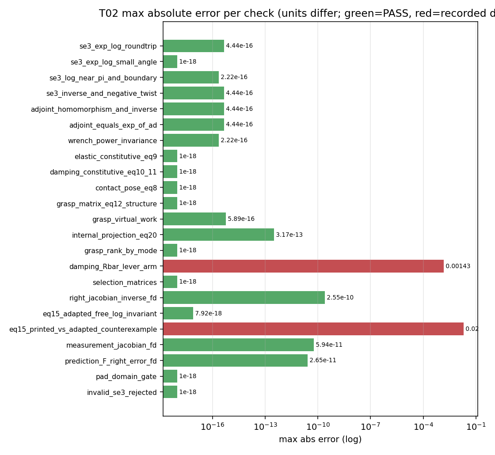

# P2-T02 数学复核报告（原版回归基线）

- **日期**：2026-10-19
- **分支**：reproduce-p2-numerical-simulation-20261018
- **提交**：d8efdb8c
- **命令**：`/usr/bin/python3.10 p2/tools/t02_math_audit.py`
- **随机种子**：20261019
- **总墙钟**：2.03 s
- **性质**：只读数学复核；无积分、无控制、无闭环

共 23 项检查：DEVIATION_CONFIRMED 2、PASS 21。全部代数恒等式在 1e-12 量级内成立；两项为**已记录的偏离**（论文自身的近似或已批准替代），不是代码缺陷。**本报告只证明数学实现与论文公式一致，不证明任何控制实验。**

## 1. 结论

SE(3) Exp/Log 往返、Adjoint 同态与逆、`Ad(Exp(τ)) = expm(ad(τ))`、wrench 功率不变性均在 1e-12 内通过；接触本构（式 9/10/11）、W 结构（式 12）、虚功一致、内部 wrench 投影（式 20）均通过。

现有右 Euler 预测的 `F` 与真实一步 map 的右误差有限差分一致（相对误差 2.6e-11），6 类观测的解析 Jacobian 与其独立差分一致（5.9e-11）。因此 3.948 s 的失败**不是 Jacobian 实现错误**，而是离散化稳定性问题（见 T01 裁决）。

两项偏离：式 (10) 用 `R̄` 替代 `Ad(D)`，丢掉杠杆臂块；式 (15) 印刷式在反例中把自由方向形变速率翻倍。

## 2. 逐项结果

单位说明：式(15) 反例的自由 Lie 坐标是沿 x 的平移，速率单位为 **m/s**；`0.02 m/s × 4 ms = 80 µm`。审计 JSON 中该检查的 `unit` 仍保留原始标注 `1/s`，更正见 `T02_UNIT_ERRATA.json`，数值未改动。

| 检查 | 状态 | 最大绝对误差 | 最大相对误差 | 容差 | 单位 |
|---|---|---|---|---|---|
| se3_exp_log_roundtrip | PASS | 4.44e-16 | 4.44e-16 | 1e-12 | m/rad |
| se3_exp_log_small_angle | PASS | 2.71e-20 | 2.71e-20 | 1e-14 | m/rad |
| se3_log_near_pi_and_boundary | PASS | 2.22e-16 | 2.22e-16 | 1e-09 | rad |
| se3_inverse_and_negative_twist | PASS | 4.44e-16 | 4.44e-16 | 1e-12 | dimensionless |
| adjoint_homomorphism_and_inverse | PASS | 4.44e-16 | 4.44e-16 | 1e-12 | dimensionless |
| adjoint_equals_exp_of_ad | PASS | 4.44e-16 | 4.44e-16 | 1e-12 | dimensionless |
| wrench_power_invariance | PASS | 2.22e-16 | 2.22e-16 | 1e-12 | W |
| elastic_constitutive_eq9 | PASS | 0.00e+00 | 0.00e+00 | 1e-12 | N/Nm |
| damping_constitutive_eq10_11 | PASS | 0.00e+00 | 0.00e+00 | 1e-12 | N/Nm |
| contact_pose_eq8 | PASS | 0.00e+00 | 0.00e+00 | 1e-12 | dimensionless |
| grasp_matrix_eq12_structure | PASS | 0.00e+00 | 0.00e+00 | 1e-12 | dimensionless |
| grasp_virtual_work | PASS | 5.89e-16 | 5.89e-16 | 1e-10 | W |
| internal_projection_eq20 | PASS | 3.17e-13 | 3.17e-13 | 1e-10 | N/Nm |
| grasp_rank_by_mode | PASS | 0.00e+00 | 0.00e+00 | - | rank |
| damping_Rbar_lever_arm | DEVIATION_CONFIRMED | 1.43e-03 | 1.43e-03 | - | relative |
| selection_matrices | PASS | 0.00e+00 | 0.00e+00 | - | dimensionless |
| right_jacobian_inverse_fd | PASS | 2.55e-10 | 2.55e-10 | 1e-07 | dimensionless |
| eq15_adapted_free_log_invariant | PASS | 7.92e-18 | 7.92e-18 | 1e-10 | m/s or rad/s (mixed) |
| eq15_printed_vs_adapted_counterexample | DEVIATION_CONFIRMED | 2.00e-02 | 2.00e-02 | - | m/s |
| measurement_jacobian_fd | PASS | 5.94e-11 | 5.94e-11 | 1e-06 | relative |
| prediction_F_right_error_fd | PASS | 2.65e-11 | 2.65e-11 | 1e-05 | relative |
| pad_domain_gate | PASS | 0.00e+00 | 0.00e+00 | - | m/rad |
| invalid_se3_rejected | PASS | 0.00e+00 | 0.00e+00 | - | dimensionless |

*图 1：各检查的最大绝对误差（对数轴，单位随检查不同）。绿色为通过，红色为已确认偏离。*

## 3. 两处已确认的偏离

**式 (15) 印刷式 vs 已批准几何**：在同一反例（D=I，sliding，物体沿 x 以 0.01 m/s 运动，EE 静止）下，已批准几何的自由方向形变速率为 0.0e+00 1/s，印刷式为 0.02 1/s；4 ms 对应形变 80 µm（应为 0）。印刷式恰好等于 2 倍自由速率（`printed_equals_two_times_a=True`），与旧审计的 80 µm 结论独立一致。

**式 (10) 的 `R̄` 近似**：`R̄ = diag(R,R)` 丢掉了 `Ad(D)` 的 `[p]×R` 块（杠杆臂耦合）。在随机小扰动状态上，相对 twist 最大相对差 1.43e-03。这是论文自己的线性化近似，不是实现错误；T04 需在运动状态下评估其影响。

**秩的夹具依赖性**：`rank(W)` 在标称夹具为 tight 6 / pivot 6 / sliding 4；在一般扰动状态 sliding 变为 5，因为两条滑移轴的共同自由方向退化为一个叉积方向。后续秩门必须绑定具体夹具。

## 4. 未优化回归基线（供 T01-E 使用）

`p2/reviews/T02_MATH_BASELINE.json` 记录了 4 个源文件的 SHA256 与一组黄金数值：标称状态的 D/τ/hK/hB/h/W/奇异值/内部 wrench、两臂 grasp rate、6 类观测 Jacobian 的范数与校验和、一次 4 ms 预测的 F 范数与校验和、一次 3 观测更新的后验 V 与 P 对角。

T01-E 的等价性判据：同一输入下逐项相对误差 ≤1e-12（或位相同），并附绝对/相对误差与最大差异；**“运行不报错”不算等价**。

| 源文件 | SHA256（前 12 位） |
|---|---|
| baselines/p2_pose_force/contact_geometry.py | 47557da9189d |
| baselines/p2_pose_force/mechanics.py | 34831b2cd371 |
| baselines/p2_pose_force/estimator.py | 5c045a79b210 |
| baselines/p2_pose_force/observations.py | cc902ea09239 |
| configs/p2_closed_loop_protocol_v3.json | 0de8477faaa5 |

## 5. 局限

本报告只覆盖**单点/小扰动**的数学性质，不覆盖长时积分、模式切换瞬态、非正规矩阵谱、闭环统计；这些属于 T03/T04。

观测 Jacobian 的对照在零残差处进行；非零残差时的左 Jacobian 约定（`H = J_l^{-1}(r) ∂h/∂δ`）与 IEKF 更新式一致，但需在 T04 的闭环中复核。

不得据此报告声称论文控制实验成功或部分成功。

