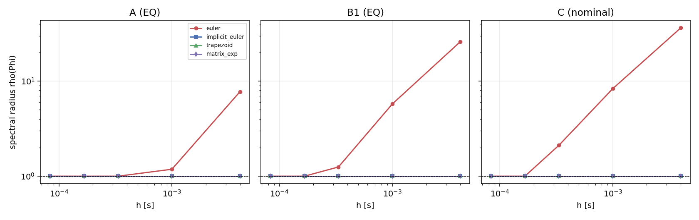
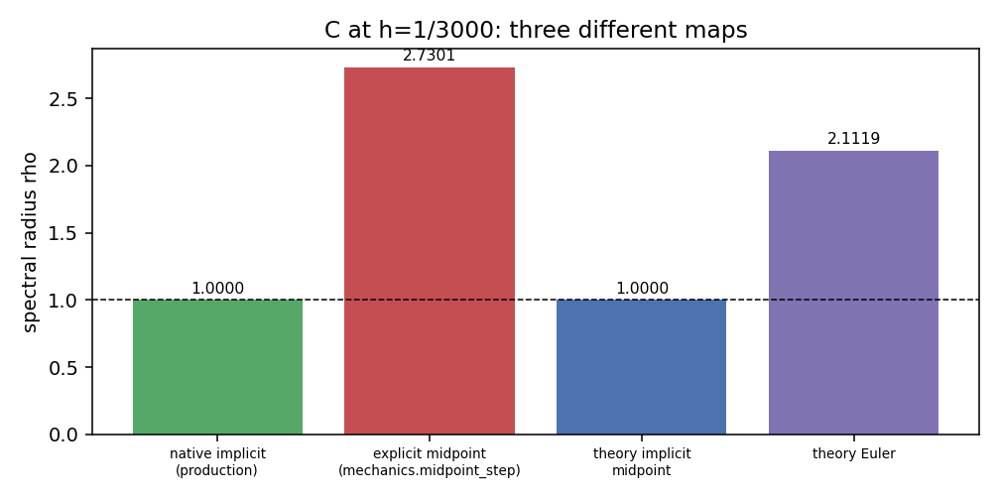

# P2-T03 独立物体-软接触动力学数值审查

- **日期**：2026-10-19
- **分支**：reproduce-p2-numerical-simulation-20261018
- **脚本**：`p2/tools/t03_plant_audit.py`
- **谱阶段墙钟**：12.51 s（上限 120 s）
- **受扰阶段墙钟**：6.83 s（上限 240 s）
- **性质**：独立 plant 数值分析；无估计器、无控制、无闭环

A/B1/B2 在 1/3000 s 下 native 隐式一步映射谱半径均为 1.0（中性），理论梯形 1.000000–1.000004；显式 Euler 则分别达 1.000/1.250/2.112，4 ms 时 7.73/26.0/36.3。历史 C 的 ρ≈2.73 **不是 native 隐式积分器**的性质：它精确等于 `mechanics.midpoint_step`（显式中点预测-校正）的稳定函数 |1+z+z²/2|=2.730136，而同一 z=hλ 下 native 隐式映射为 1.0、理论隐式中点为 1.0。受扰运动在所有对象上衰减、能量单调下降、无异常增长。

## 1. 连续谱与工作点

每个工作点给出 42 维右误差 Jacobian 的全部特征值。最快实模态：A −2183 s⁻¹、B1/B2 −6750 s⁻¹、C −9336 s⁻¹。A/B1/B2 的数值平衡点由 COM 高度二分求得（COM 下移 0.595 mm / 0.243 mm，残差 <1e-8）；C 在该夹具下**不存在仅靠竖直位移的完整平衡点**（残差 9.81 由非竖直分量主导），故 C 只报告 nominal 与两个扰动点。

| 对象 | 工作点 | ‖f‖ | min Re | 正实部模态 | max‖λ‖ | native ρ(h) | 理论梯形 ρ(h) | Euler ρ(4ms) |
|---|---|---|---|---|---|---|---|---|
| A | nominal | 9.8e+00 | -2183.1 | 0 | 2183.1 | 1.000000 | 1.000000 | 7.73 |
| A | EQ | 2.6e-09 | -2183.1 | 0 | 2183.1 | 1.000000 | 1.000000 | 7.73 |
| A | P1 | 1.4e+03 | -2180.1 | 3 | 2180.1 | 1.000000 | 1.000002 | 7.72 |
| A | P2 | 1.4e+03 | -2180.7 | 4 | 2180.7 | 1.000000 | 1.000004 | 7.72 |
| B1 | nominal | 9.8e+00 | -6750.3 | 0 | 6750.3 | 1.000061 | 1.000000 | 26.00 |
| B1 | EQ | 1.1e-08 | -6750.3 | 0 | 6750.3 | 1.000000 | 1.000000 | 26.00 |
| B1 | P1 | 1.2e+03 | -6750.2 | 4 | 6750.2 | 1.000311 | 1.000351 | 26.00 |
| B1 | P2 | 8.8e+01 | -6750.2 | 4 | 6750.2 | 1.000058 | 1.000071 | 26.00 |
| B2 | nominal | 9.8e+00 | -6750.3 | 0 | 6750.3 | 1.000061 | 1.000000 | 26.00 |
| B2 | EQ | 1.1e-08 | -6750.3 | 0 | 6750.3 | 1.000000 | 1.000000 | 26.00 |
| B2 | P1 | 1.2e+03 | -6750.2 | 4 | 6750.2 | 1.000311 | 1.000351 | 26.00 |
| B2 | P2 | 8.8e+01 | -6750.2 | 4 | 6750.2 | 1.000058 | 1.000071 | 26.00 |
| C | nominal | 9.8e+00 | -9335.8 | 0 | 9335.8 | 1.000000 | 1.000000 | 36.34 |
| C | P1 | 5.2e+02 | -9346.0 | 2 | 9346.0 | 1.000000 | 1.000003 | 36.38 |
| C | P2 | 1.6e+03 | -9344.0 | 5 | 9344.0 | 1.000000 | 1.000003 | 36.38 |

*图 1：连续谱（左：全范围；右：虚轴附近放大）。最左端点即最快实模态。*

## 2. 离散稳定性（同一连续线性化）

五种格式用**同一个** A 与 h 构造；Euler 在 h=1/3000 即对 B1/B2/C 不稳，隐式 Euler/梯形/矩阵指数在整个范围内 ρ≤1（P1/P2 的 1.000002–4e-4 来自连续谱中约 +0.01…+1.05 s⁻¹ 的小正实部，不是格式不稳）。

*图 2：ρ 随步长变化（虚线为 1）。Euler 在 1/3000 处已越过 1。*

## 3. 历史 C ρ≈2.73 的归因

旧夹具下 z = hλ = -3.1119。三个**不同**映射的 ρ：native 隐式 1.000000、理论隐式中点 1.000000、`mechanics.midpoint_step` **2.730136**。后者是显式中点预测-校正，稳定函数 |1+z+z²/2| = 2.730136，逐位吻合；同一 z 下 Euler |1+z| = 2.111936（即 2.112）。

FD 的 ε 从 1e-4 到 1e-7，两个映射的 ρ 均不变（native 1.0；显式中点 2.730136），说明不是差分步长伪影。该点不是平衡点（|f|=9.81），但 native 的 Newton 一步收敛 （1 次迭代，残差 4e-16）；受扰 0.2 s 速度衰减到 2.9%，与 ρ=1.0 一致，与 ρ=2.73 不符。结论：**2.73 属于旧审计使用的显式中点实现，不属于生产 plant**；不能把 Euler 的 2.112 与它混为一谈。

*图 3：C 在同一 z 下三种映射的谱半径。*

## 4. 非平衡受扰运动

每个对象两个扰动点、三个步长（h、h/2、h/4），各积分 0.30 s，每 4 ms 采样。全部运行：最大 Newton 2 次迭代；速度衰减；能量单调下降（<0）；无异常增长或数值振荡。

| 对象 | 点 | ρ(native) | max‖τ‖ | max 内力 | max 内力矩 | ΔE [J] | Newton | p(pos) |
|---|---|---|---|---|---|---|---|---|
| A | P1 | 1.000000 | 0.0186 | 1.7748 | 1.76e-01 | -8.65e-02 | 2 | 2.32 |
| A | P2 | 1.000000 | 0.0144 | 1.2783 | 1.27e-01 | -3.18e-02 | 2 | 2.32 |
| B1 | P1 | 1.000311 | 0.0194 | 2.2611 | 8.48e-02 | -5.93e-02 | 2 | 2.32 |
| B1 | P2 | 1.000058 | 0.0150 | 1.7252 | 6.47e-02 | -1.84e-02 | 2 | 2.32 |
| B2 | P1 | 1.000311 | 0.0194 | 2.2611 | 8.48e-02 | -5.93e-02 | 2 | 2.32 |
| B2 | P2 | 1.000058 | 0.0150 | 1.7252 | 6.47e-02 | -1.84e-02 | 2 | 2.32 |
| C | P1 | 1.000000 | 0.0200 | 1.5191 | 1.84e-01 | -8.17e-02 | 2 | 2.32 |
| C | P2 | 1.000000 | 0.0153 | 1.1066 | 1.34e-01 | -2.76e-02 | 2 | 2.32 |

*图 4：A/C 的速度范数与内力随时间（三种步长几乎重合）。*

## 5. 步长收敛

以 h/4 为参考，h 与 h/2 在 4 ms 对齐时刻的最大位置差；实测经验阶约 2.32。该值高于名义二阶，说明误差处于渐近区但仍含高阶项；**不据此宣称严格二阶收敛**。

*图 5：位置误差随 dt（双对数），黑虚线为斜率 2。*

## 6. B1/B2 的适用性边界

B1/B2 的质量 0.280 kg 与尺寸 75×140×40 mm 来自论文 Fig.5(d)；**惯量张量与抓取几何为 ADAPTATION**（均质长方体、±37.5 mm 对称抓取、EE z 沿物体 x）。因此 B1/B2 的谱与受扰结果只能作为 assumption-dependent 参考，不能称为论文匹配。其 Euler 在 1/3000 已不稳（ρ=1.25），若未来使用 B 类对象，必须用隐式/指数格式。

## 7. 局限

① 全部为单点线性化与 0.3 s 短时积分，不覆盖模式切换、长时漂移、接触分离/再接触；② C 的夹具旋转导致无竖直平衡点，其 P1/P2 从非平衡 nominal 出发；③ 收敛阶仅用两个步长估计，未做 Richardson 外推；④ 未验证非正规谱在实际受扰方向上的瞬态增长（仅给出 cond(V)/Henrici 指标）；⑤ 不构成论文 Fig.6–9 或控制实验的任何证据。

