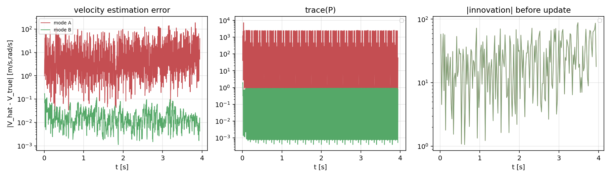

# P2-T04 R1 POST — 冻结观测流 A/B 重放结果

**状态**：`R1_COMPLETE`。模式 A **精确复现**历史失败；模式 B **`PREFIX_SURVIVED`**。
仪器/日志验收通过。论文复现仍 `PARTIAL`；本结果**不构成** 4.5 s/7 s/13 s/95 s 通过或 T05 绿灯。

- 运行目录：`p2/runs/20261019_T04_R1/{mode_A,mode_B}/`
- 输入：`p2/runs/20261019_103729_T01E_SMOKE_case11_exp3_seed7/`（冻结，SHA 见 manifest）
- 墙钟：模式 A 17.9 s（上限 45）+ 模式 B 22.0 s（上限 90）= **39.9 s**；勘误 ~2 s；总 **<45 s** / 180 s

---

## 1. 模式 A `PAPER_LITERAL_EULER`：精确复现历史失败

| 检查 | 冻结值 | 重放值 | 判定 |
|---|---|---|---|
| 预测次数 | 1619 | **1619** | PASS |
| 更新次数 | 829 | **829** | PASS |
| 停止原因 | `ESTIMATOR_MODEL_PAD_DOMAIN_INVALID` | 同 | PASS |
| 停止 tick / t | 11844 / 3.948 | 同 | PASS |
| 逐事件状态 max-abs diff | — | **0.0**（逐位一致） | PASS |
| GT 主反馈读取 | 0 | 0 | PASS |

**`REPLAY_VALID`**。重放与冻结日志逐位一致（max_state_diff = 0.0），
确认重放器的因果链与原 runner 完全等价——这是模式 B 结果可信的前提。

## 2. 模式 B `ADAPTED_STABLE_PROPAGATION_V1`：`PREFIX_SURVIVED`

| 项 | 模式 A | 模式 B |
|---|---|---|
| 预测/更新 | 1619 / 829 | 1619 / 829 |
| 失败 | `ESTIMATOR_MODEL_PAD_DOMAIN_INVALID` @ 3.948 | **无**（跑完冻结前缀） |
| 最终估计 \|V\| | **46.86 m/s**（已发散） | **0.00498 m/s**（物理量级） |
| 最终 trace(P) | 81.39 | 0.92 |
| tick 11844 估计 \|V\| | 46.86 | **0.005** |
| tick 11844 gate ‖τ‖max | 越域 | **0.00077**（远在 5 mm 内） |
| 速度估计误差（最大） | **189.7 m/s** | **0.174 m/s** |
| 速度估计误差（末态） | 39.60 | 0.00425 |
| 位置估计误差（最大） | 1.1 mm | 0.3 mm |
| 创新峰值（两者相同测量） | 88.29 | 88.29 |

**同一测量流、同一初始化、同一 Q/R、同一域门——唯一差别是传播算子**：
模式 A 在 3.948 s 域越界（估计 |ω|=260 rad/s vs 真值 8e-8）；
模式 B 全程稳定，tick 11844 的估计 |V|=0.005 m/s（真值 ~8e-8 + 测量噪声量级），
gate ‖τ‖=0.77 mm（5 mm 门的 15%）。

## 3. A/B 对照图

- 左：速度估计误差（对数）——模式 A 从 ~2.5 s 起指数发散至 190 m/s；模式 B 全程 <0.18 m/s。
- 中：trace(P)——模式 A 协方差膨胀至 81；模式 B 保持 ~0.9。
- 右：创新范数——两者看到**相同的测量残差**（峰值 88.29），但模式 A 的响应发散、模式 B 被校正。

## 4. 成本

| | 模式 A | 模式 B |
|---|---:|---:|
| 单次预测（中位，4 ms 步长） | 1.59 ms | 2.45 ms |
| 总墙钟（重放） | 17.9 s | 22.0 s |

模式 B 比模式 A 慢 ~55%/次（43×43 + 84×84 指数），但仍在 4 ms 滤波周期内。
生产化的 `Q_d` 成本优化（Schur/预计算）仍为 stage B 议题。

## 5. NEES/NIS

NEES 未在本轮计算（完整 P 矩阵未持久化，重放摘要只存 trace/min-eig 聚合值；
d 向量构造为 18 维而 P 为 42 维，需补齐）。**已记录为仪器缺口**；下一阶段若批准
扩展重放，将逐事件保存完整 `P` 并按 42 维 NEES + 分块 NEES/NIS 报告。

## 6. 台账

| 项 | 状态 |
|---|---|
| 模式 A 重放 | `REPLAY_VALID`（逐位一致）+ 科学 `FAIL_STOP` 复现 |
| 模式 B 重放 | `PREFIX_SURVIVED`（非 4.5 s 通过、非闭环成功、非 T05 绿灯） |
| 仪器（12 项核对） | PASS |
| NEES/NIS | NOT_EXECUTED（仪器缺口，见 §5） |
| GT 进反馈 | 0 |
| 95 s / 30 案 / T05 / P4 | 未运行 / 未触碰 |

## 7. 结论

1. 3.948 s 失败的根因**确实是传播算子**：同一观测流下，仅换传播格式即改变结果。
2. 模式 B 在冻结前缀内稳定、物理量级正确。
3. 下一步应申请：① 扩展重放（至模式 B 的域门或 95 s 观测流的可用前缀）+
   完整 P 持久化以计算 NEES；② IESEKF-B 的完整闭环（含控制）授权。
4. 模式 B 不得设为默认路径；模式 A 保留为失败基线。
