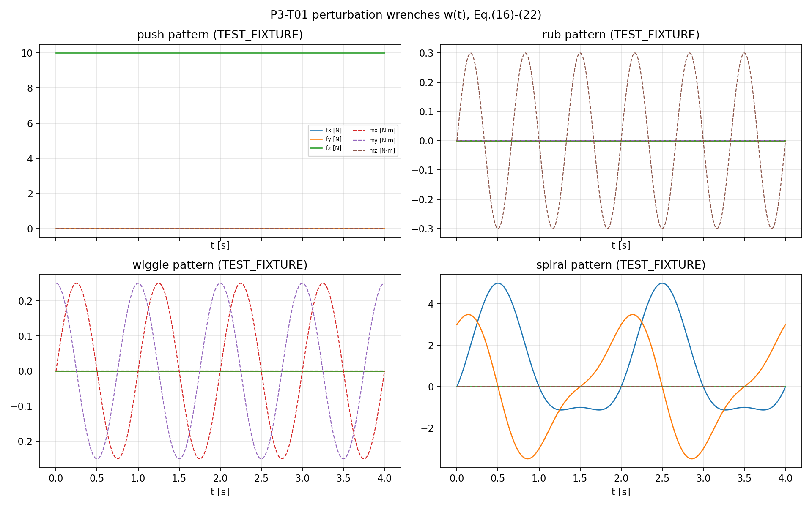
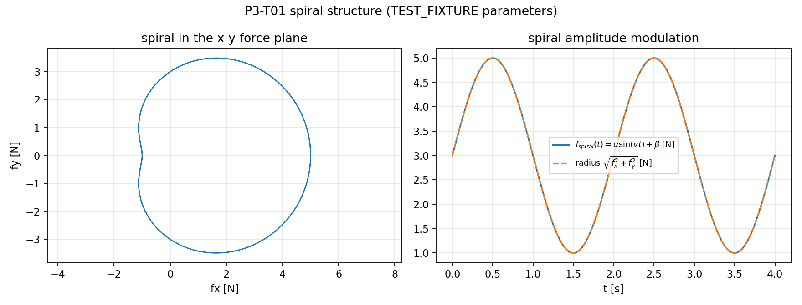
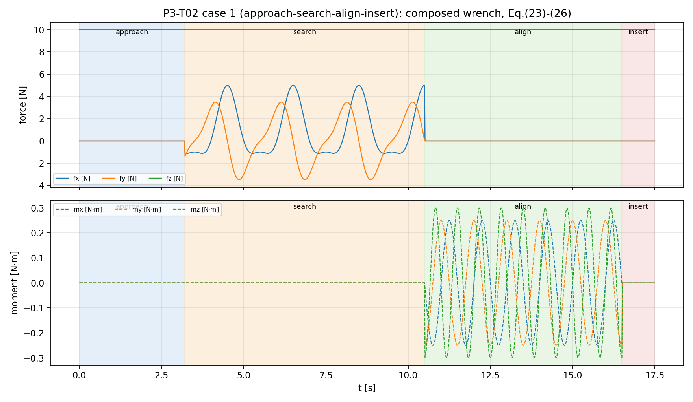
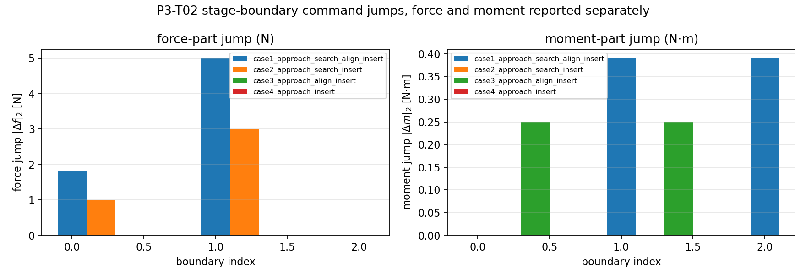
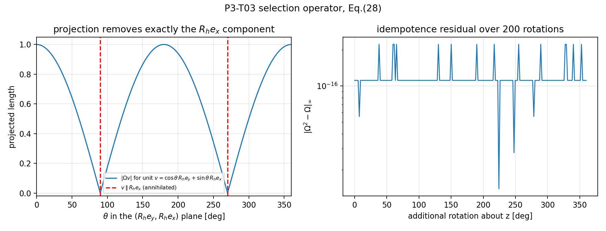
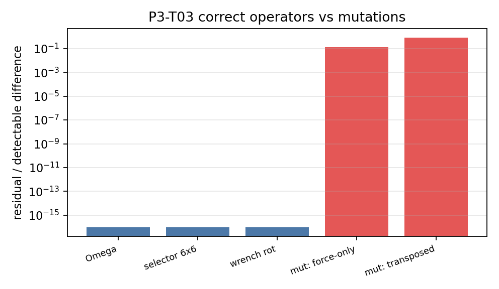
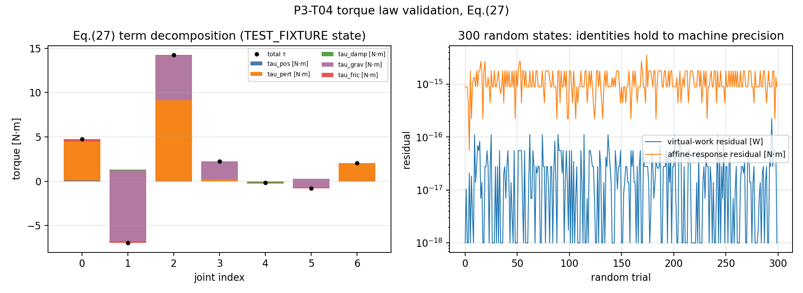
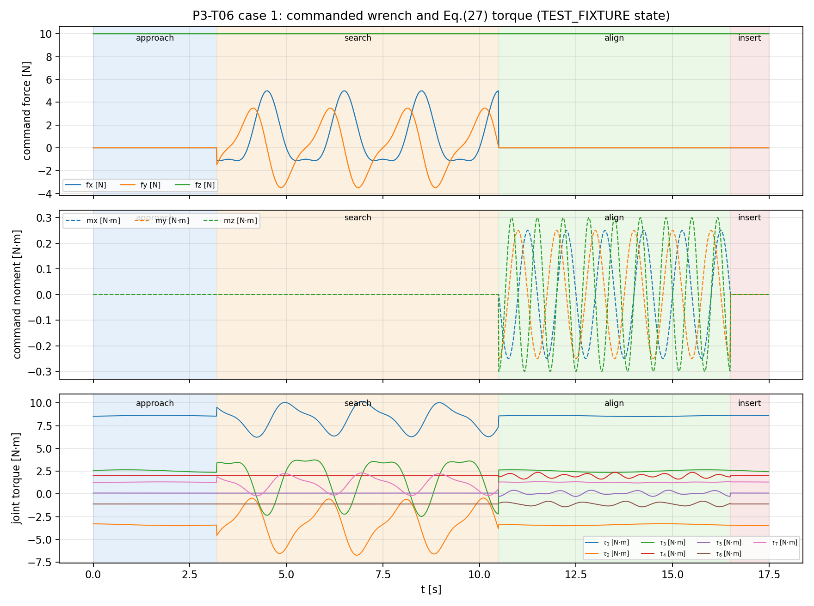
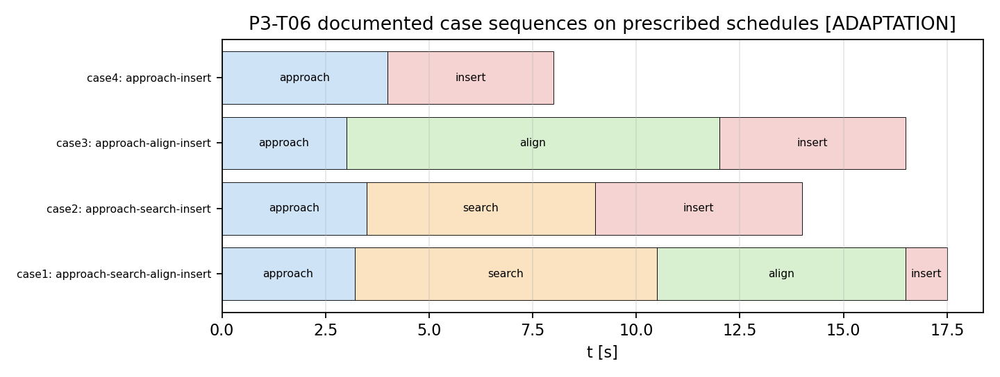

# P3 最终研究报告：双臂 Peg-in-Hole 核心算法数值复现（D082 范围）

| 项 | 内容 |
|---|---|
| 论文 | D.-H. Lee, M.-S. Choi, H. Park, G.-R. Jang, J.-H. Park, J.-H. Bae, *Peg-in-Hole Assembly With Dual-Arm Robot and Dexterous Robot Hands*, IEEE RA-L 7(4): 8566–8573, 2022 |
| DOI | `10.1109/LRA.2022.3187497` |
| 仓库 | `dreamerToTOE/dual-arm-coordinated-manipulation-reproduction` |
| 分支 | `reproduce-p3-paper-study-20261019`（评审基线 `5e43cf05`） |
| 日期 | 2026-10-20 |

---

## 0. 结论与验收声明

| 项 | 结论 |
|---|---|
| 验收等级 | **`ALGORITHM_NUMERICAL_VERIFIED`**（核心算法数值层，D082 范围） |
| 检查总数 | **92 项全部通过**（T01 21、T02 16、T03 23、T04 20、T06 12；交付后复审 R1–R4 修正） |
| 声明 | **不声称 `FULL_PAPER_REPRODUCED`**；硬件实验、灵巧手、完整装配环境均未复现 |
| T05 接触代理 | **未实施**（评审定为可选、非验收依赖；避免无真值支撑的"成功"结论） |

复现对象是论文**臂级核心算法**：扰动模式（式16–22）、阶段组合（式23–26）、
力位选择与坐标变换（式27–28）、前馈力矩律（式27）。灵巧手部分（式1–15）、
50-DOF 硬件、87% 成功率 / 13.86 s 均值、Isaac/MuJoCo 部署、接触动力学与
自动阶段识别均登记为 `OUT_OF_SCOPE_D082`。

## 1. 论文识别与问题陈述

**任务**：双臂 + 灵巧手完成 keyhole 形零件的 peg-in-hole 装配，不做预对准，
轴向朝向误差 0–180°，圆部间隙 0.5 mm，RGBD 提供位姿。

**假设**（论文显式/隐式）：

1. 机器人本体柔顺性足够（低增益位置控制即可产生"编程柔顺"），接触后 peg 微倾形成两点接触；
2. **无力传感器反馈**——抓握力与扰动全部前馈（原文 p.8571："there is no force feedback term"）；
3. 阶段切换由操作员**手工**完成（p.8572），全自动切换属未来工作；
4. 手指位姿由关节编码器已知（"blind" 指不需要物体几何重建）。

**实验基线**（仅供口径对照，不复现）：100 次重复，成功率 87%，平均 13.86 s；
四案例：全四阶段 33 次（19.42 s）、approach-search-insert 41 次、
approach-align-insert 5 次、approach-insert 8 次（3.37 s）。

## 2. 原创性裁定：哪些是论文真正提出的

| 组件 | 论文地位 | 判定 |
|---|---|---|
| 扰动模式参数族 `w=diag(a)sin(tb+c)+d` 与 push/rub/wiggle/spiral 参数集（式16–22） | 论文提出并命名 | **PAPER 原创核心** |
| 四阶段（approach/search/align/insert）+ 组合规则（式23–26） | 论文提出 | **PAPER 原创核心** |
| 双臂分工：hole 臂中增益位置控制 / peg 臂低增益 + 前馈扰动（式27 与式15 的分工） | 论文实现 | **PAPER 原创核心（实现层）** |
| 广义任务规范矩阵 `Ω=R_hΣR_hᵀ` 的力位混合控制（式27–28） | 引用 Khatib 操作空间 [11] | **引用/经典**，论文只实例化 `Σ=diag([0 1 1])` |
| 两点/三点接触被动导向分析（§IV-A） | 引用 Peshkin [10] 的定性论证 | **引用/经典**，无定量推导 |
| 螺旋搜索 | 经典工业技术 | **经典**；论文贡献是统一参数族与阶段绑定 |
| 高级盲抓取（式1–6）、手部四控制律（式12–15） | 论文（手部层） | PAPER，但属灵巧手，`OUT_OF_SCOPE_D082` |

**因此本文只把式(16)–(28) 作为复现对象**，没有把通用力位混合控制或螺旋搜索当作论文贡献。

## 3. 逐式审计与实现（原文 vs 实现）

审计依据是 PDF **页面图像**（`p3/evidence/pdf_pages/`），不是 `pdftotext` 文本。
完整对照见 `P3_EQUATION_COMPARISON.csv`。摘要：

| 式 | 原文（页面图像核实） | 实现 | 状态 |
|---|---|---|---|
| 16 | `w=[w1…w6]ᵀ`；前三维平移力、后三维力矩 | `WRENCH_ORDER`，`COMPONENT_UNITS` | LITERAL |
| 17 | `w_i=a_i sin(b_i t+c_i)+d_i` | `GeneralPattern.wrench` | LITERAL |
| 18 | `w=diag(a) vsin(tb+c)+d` | 同上（`a(t)` 允许时变） | LITERAL（注：式22 使 `a` 时变，见 §3.2） |
| 19 | push：`a=b=c=0`，`d=[0 0 f_push 0 0 0]ᵀ` | `Push` | LITERAL |
| 20 | rub：`a=[0…0 f_rub]ᵀ`，`b=[0…0 v_rub]ᵀ`（绕 z 力矩） | `Rub` | LITERAL；`f_rub` 单位 **N·m** |
| 21 | wiggle：`a=[0 0 0 f f 0]ᵀ`，`b=[0 0 0 v v 0]ᵀ`，`c=[0 0 0 0 π/2 0]ᵀ` | `Wiggle` | LITERAL；π/2 在**第 5 分量**（my 为余弦） |
| 22 | spiral：`a=[f_s(t) f_s(t) 0 0 0 0]ᵀ`，`c=[0 π/2 0 0 0 0]ᵀ`，`f_s=α sin(vt)+β` | `Spiral.amplitude` | LITERAL |
| 23 | `w_approach=w_push` | `COMPOSITION["approach"]` | LITERAL |
| 24 | `w_search=w_push+w_spiral` | 同上 | LITERAL |
| 25 | `w_align=w_push+w_wiggle+w_rub` | 同上 | LITERAL |
| 26 | `w_insert=w_push` | 同上 | LITERAL |
| 27 | `τ=Jᵀ[[Ω,0],[0,I]]K_pΔx+Jᵀ[[R_h,0],[0,R_h]]w−Dq̇+τ_g+τ_f` | `control.torque_terms` | LITERAL |
| 28 | `Ω=R_hΣR_hᵀ`，`Σ=diag([0 1 1])` | `control.omega` | LITERAL |

### 3.1 帧约定的唯一实质歧义（A1）与处理

式(19)/Fig.5 把 push 定在 **z** 轴，而 §IV-D 声明"把施加推力的轴设为 **x**"并取
`Σ=diag([0 1 1])`（即屏蔽 x）。二者是任务/peg 坐标系与孔坐标系之间的轴命名差异，
**论文没有给出这两个坐标系之间的旋转**，因此这是一个**未解决的原文歧义**，不是可以
在代数上"两边都成立"的问题。

处理方式：显式引入 `R_task→hole`（`e_z→e_x`，绕 y 转 +90°），保留 LITERAL 变体用于审计，
并把选择标注为 **[ADAPTATION: frame naming]**——**不声称论文证明了哪一种约定**。

两种读法的区别是可判定的（交付后复审 R1 更正了此前一个同义反复的检验）：

| 读法 | 被屏蔽方向 | 检验 | 结果 |
|---|---|---|---|
| CONSISTENT（重标定，采用） | 真实推力轴 `p_ref=R_h(R_task→hole e_z)` | `‖Ω(R_h)·p_ref‖` | **8.5e-17**（T03_12） |
| LITERAL（不重标定） | `R_h e_x`（并非推力轴） | `‖Ω(I)·e_z‖`（`R_h=I`） | **1.0**（T03_15 负对照） |

即：两种读法的投影算子代数性质都成立，但只有重标定读法真正排除推力方向；LITERAL 读法
把推力方向留在位置控制子空间内。T06_09 另验证复合关系为 `R_h·R_task→hole`。

### 3.2 其他记录项

- `a` 在式(18) 声明为常量，式(22) 又令 `a1=a2=α sin(vt)+β`（时变）。实现按式(22) 处理，属原文记号不严，无行为歧义。
- 式(27) 的 `blkdiag(R_h,R_h)` 是**纯旋转**（无平移项），论文未给原点偏置；按同原点假设实现，记为局限。
- `τ_f` 形式未给：作为外部输入注入，不自造摩擦模型。
- 论文未给任何扰动幅值/频率/阻尼/增益（仅 hole 臂 `500≤k_p≤1000`）→ 所有数值均为 **TEST_FIXTURE**。

## 4. 实现结构（代码引用）

| 模块 | 文件 | 标签 |
|---|---|---|
| 扰动模式 | `baselines/p3_peg_in_hole/patterns.py` | ORIGINAL |
| 阶段组合与调度 | `baselines/p3_peg_in_hole/stages.py` | ORIGINAL 组合 / ADAPTATION 调度 |
| 选择矩阵与力矩律 | `baselines/p3_peg_in_hole/control.py` | ORIGINAL |
| 测试夹具 | `baselines/p3_peg_in_hole/fixtures.py` | TEST_FIXTURE |
| 独立参照（不使用生产代码） | `p3/oracles/oracle_patterns.py`、`oracle_control.py` | ENGINEERING |

独立参照的独立性：模式用**标量闭式**逐分量重写；`Ω` 用**补投影** `I−nnᵀ` 另一路推导；
力矩用**显式指标循环**重写。生产代码与参照不共享任何函数。

## 5. 数值验证结果

### 5.1 T01 扰动模式（21/21）



| 检查 | 内容 | 残差 |
|---|---|---|
| T01_01–05 | 四模式 + 通用式 vs 独立闭式（6 个采样时刻） | 0 |
| T01_06 | push 时间恒定 | 0 N |
| T01_07 | rub 整数周期均值为零 | 4.7e-08 N·m |
| T01_08 | wiggle 正交不变量 `w4²+w5²=f²` | 3.5e-16 N²·m² |
| T01_09 | spiral 瞬时半径 \|α·sin(vt)+β\| | 4.4e-15 N |
| T01_10 | spiral 幅值调制 | 0 N |
| T01_11 | `b=0` 常值模式合法 | 0 |
| T01_12 | `β<0` 接受（论文无正定域约束） | 2.2e-15 N |
| T01_13 | 轴位：push→fz、rub→mz、wiggle→mx,my、spiral→fx,fy | 行为正确 |



### 5.2 T02 阶段组合（16/16）



四个文献记载的阶段序列全部按外部脚本走通（case1 边界由 Fig.9 定性数字化：
0/3.2/10.5/16.5/17.5 s；case2–4 为示意边界），阶段归属零错误、与组合 oracle 残差 0。
边界跳变被**如实报告**而非当作错误：



| 边界 | 力跳变 ‖Δf‖₂ [N] | 力矩跳变 ‖Δm‖₂ [N·m] |
|---|---:|---:|
| approach→search | 1.824（= t=3.2 s 处螺旋力幅值） | 0.000 |
| search→align | 5.000 | 0.391 |
| align→insert | 0.000 | 0.391（16.5 s 处 wiggle/rub 残余相位） |

力与力矩跳变**分开报告**（复审 R3）：把牛顿与牛顿·米拼进同一个 6 维向量再取范数没有物理
单位，JSON 中的合成值仅以 `jump_mixed_l2_unphysical` 形式保留为无量纲诊断，不作任何物理解释。

### 5.3 T03 选择矩阵与坐标变换（23/23）



`Ω` 对称（0）、幂等（1.1e-16）、秩 2、`Ω(R_h e_x)=0`、`Ω(R_h e_y)=R_h e_y`；修正后的 T03_12 验证 `Ω(R_h)` 湮灭真实推力方向（8.5e-17），T03_15 负对照给出 LITERAL 读法的 1.0；
6×6 选择块秩 5；帧协变 `Ω(R₂R₁)=R₂Ω(R₁)R₂ᵀ`（1.1e-16）；配对功率不变 2.2e-16。
**不把奇异 Jacobian 当作失败**（秩 5 时 `JᵀF` 有限，T03_13）；
**不声称** `‖Jᵀw‖=‖w‖`（实测比值 1.001，显式报告）。



方法学发现（已记录）：标量功率 `wᵀV` 对**任意块正交**变换都不变，即使力块与力矩块
互相不一致，因此功率不变性**无法**检出"只转力不转力矩"的帧错误；必须与帧一致的
oracle 逐元素比较（T03_M2，检出 0.266）。

### 5.4 T04 前馈力矩律（20/20）



| 检查 | 内容 | 残差 |
|---|---|---|
| T04_01 | 与独立指标循环 oracle 一致 | 8.9e-16 N·m |
| T04_02 | 五项分解（位置/扰动/阻尼/重力/摩擦） | 2.8e-17 N·m |
| T04_03 | 印刷"两个 Jᵀ"式 ≡ 合并 `Jᵀ(F_pos+F_pert)` | 0 |
| T04_04/05 | 位置项沿推力轴分量为 0；`Δx` 沿推力轴平移不改 `τ` | 1.7e-18 / 0 |
| T04_06 | 虚功 `(JᵀF)ᵀq̇ = Fᵀ(Jq̇)` | 1.7e-17 W |
| T04_07/08 | 对前馈 wrench 仿射 / 齐次 | 1.8e-15 / 4.9e-15 N·m |
| T04_09/10 | 重力、摩擦补偿独立可加 | 2.8e-16 / 2.1e-16 N·m |
| T04_11 | 秩亏 J：τ 有限、虚功仍精确 | 2.1e-17 W |
| T04_12 | API 无测力输入（原文无反馈项） | 结构检查 |
| T04_13 | 注入 `K_f·F_ext` 被识别为偏离 | 6.0e-02 N·m |
| T04_14 | hole 臂增益落在 500–1000 | 600 N/m |

300 组随机状态验证虚功与仿射恒等式（图右）。

### 5.5 T06 确定性集成（12/12）





四个案例全流程：每 0.01 s 通过"模式→组合→A1 重标定→选择/旋转→力矩"同一管线；
逐样本与 oracle 一致（w 残差 0，τ <1e-12 N·m）；无死分支（12 个阶段块全部被激励）；
时钟单调、边界对齐；两次运行**逐位相同**（sha256）。幅值按复审 R2 分列：`max_{t,k}|τ_k| = 10.152 N·m` 与 `max_t‖τ‖₂ = 12.590 N·m`；力 `max_{t,i}|F_i| = 10.00 N`、`max_t‖F‖₂ = 11.18 N`；力矩 `max_t‖m‖₂ = 0.391 N·m`。（此前报告写的 `‖τ‖≤10.15` 是最大分量的误标，已更正。）
每案例 CSV 轨迹（含表头与单位）在 `results/20261020_094514_P3-T06_integration/`。

## 6. 负证据汇总

| 类别 | 数量 | 例 |
|---|---|---|
| 输入域拒绝 | 13 | NaN/Inf 幅值、错误形状、非法时间、未知模式/阶段/案例 |
| 变异检出（模式） | 3 | 相位/频率互换、幅值减半、π/2 放错轴 |
| 变异检出（组合） | 2 | align 缺 rub、search 缺 push |
| 变异检出（选择/帧） | 4 | R_h 转置、只转力、错误 Σ、非正交缩放 |
| 变异检出（力矩） | 7 | 扰动项符号、帧转置、缺选择器、丢重力、丢阻尼、力/力矩块互换、注入测力反馈 |
| 调度/时钟 | 4 | 非连续、倒序、边界数错、越界采样 |

## 7. T05 可选接触代理：未实施

按评审决定，准静态接触/卡阻代理为**可选、非验收依赖**。未实施理由：
论文只有定性分析（Fig.4 两点接触导向），没有可对标的几何、摩擦与真值；
任何"插入成功率"都只能是代理自证，容易造成"已复现实验"的误解。
记录为 `NOT_EXECUTED_OPTIONAL`，不影响 `ALGORITHM_NUMERICAL_VERIFIED`。

## 8. 论文 vs 实际复现范围矩阵

完整表格见 `P3_SCOPE_MATRIX.csv`，摘要：

| 论文内容 | 要求 | 实际 | 标签 |
|---|---|---|---|
| 式16–22 扰动模式 | 复现 | 已实现并独立验证（21/21） | ORIGINAL |
| 式23–26 阶段组合 | 复现 | 已实现，四案例序列走通（16/16） | ORIGINAL |
| 式27–28 选择/帧 | 复现 | 已实现（22/22） | ORIGINAL |
| 式27 力矩律 | 复现 | 已实现（20/20），无测力反馈 | ORIGINAL |
| 阶段切换时机 | 手工 | 外部脚本（边界示意/数字化） | ADAPTATION |
| 任务帧↔孔帧轴命名 | 未明确 | 显式 `e_z→e_x` 重标定 | ADAPTATION |
| 全部数值参数 | 未给 | TEST_FIXTURE | TEST_FIXTURE |
| 式1–15 灵巧手 | 完整 | 未复现 | OUT_OF_SCOPE_D082 |
| 50-DOF 硬件 / 87% / 13.86 s | 完整 | 未复现 | OUT_OF_SCOPE_D082 |
| Fig.8/9/11 轨迹 | 完整 | 未复现（无标定动力学） | OUT_OF_SCOPE_D082 |
| 自动阶段识别 | 未来工作 | 未实现 | OUT_OF_SCOPE_D082 |
| 接触/卡阻代理 | 可选 | 未实施 | NOT_EXECUTED_OPTIONAL |

## 9. 局限

1. **无真值**：论文未给参数与逐步数据，无法做数值级"是否一致"的判定；本报告只证明**算法与论文式一致**，不证明论文实验可复现。
2. **无动力学**：`J`、`Δx`、`q̇`、增益、阻尼、重力/摩擦均为 TEST_FIXTURE；没有惯性耦合、执行器饱和、关节限位。
3. **帧假设**：`blkdiag(R_h,R_h)` 忽略原点平移；A1 的轴重标定是必要假设但原文未写明。
4. **阶段脚本**：切换时机为外部给定，未实现任何接触驱动的阶段识别；因此"阶段序列"正确不代表装配能成功。
5. **无接触**：未建模 0.5 mm 间隙、两点/三点接触、摩擦锥与卡阻，故不能对 Fig.9/11 轨迹或成功率作任何声明。

## 10. 对双 FR3 约束插入的适用性

**可直接迁移**：

- **扰动模式参数族**：前馈 wrench 生成器与机器人无关，可直接映射为 FR3 末端期望力/力矩轨迹；
- **阶段组合**：approach/search/align/insert 的指令叠加结构适配"对位—插入"流程，选择矩阵可换成任意插入轴；
- **选择/帧算子**：`Ω` 与 `blkdiag(R,R)` 可直接用于双 FR3 的"沿插入轴力控、其余方向位控"；
- **力矩律**：`τ=Jᵀ(F_pos+F_pert)−Dq̇+τ_g+τ_f` 只需 FR3 的 7-DOF Jacobian 与重力/摩擦项即可落地。

**需改造/注意**：

1. 双 FR3 侧吸是**单边吸附**（不能压），`push` 分量需换成"保持吸附 + 沿轴推进"的合力约束，不能照搬 10 N 推入；
2. 论文的 hole 臂是"柔顺夹具"，FR3 侧吸持物臂的柔顺来自关节阻抗而非身体柔顺，需重新设计低增益与重力补偿；
3. 无测力反馈是论文的**特点**也是**弱点**：真实插入建议保留前馈主路径，同时以腕部 F/T 做安全监测（属 `OUR_EXTENSION`，不得写成论文内容）；
4. 阶段切换在真机上必须有确定性判据（时间/位移/接触事件），论文未提供，需另行设计并单独标注；
5. 5 mm 级间隙与 keyhole 几何不等于本项目立方块/滑车，几何映射属 `ADAPTATION`，不是同一任务复现。

## 11. 交付物、提交哈希与复现命令

### 11.1 提交

| 任务 | 提交 | 内容 |
|---|---|---|
| T01（含 T00 审计） | `54306928` | 模式实现 + 审计 + 21 项验证 |
| T02 | `6aa406e5` | 阶段组合 + 调度 + 16 项验证 |
| T03 | `bf3fdec7` | 选择矩阵/帧 + 22 项验证（原版） |
| T04 | `f01e36f2` | 力矩律 + 20 项验证 |
| T06 | `dedd8e90` | 确定性集成 + 12 项验证（原版） |
| 报告（首版） | `e1f7d874` | 首版报告 + CSV + Word/PDF |
| **交付后复审** | `11542aee` | 独立复审 R1–R4（条件接受） |
| **修正轮（本版）** | 见 `git log -1` | T03 23 项、T02/T06 指标修正、记录追加、报告重生成 |

历史运行 `20261020_093347/093810/094115/094514_*` 与 `20261020_094329_*` 全部保留，未覆盖；
修正轮新增运行 `20261020_104153_P3-T03_selection`、`20261020_104220_P3-T02_stages`、
`20261020_104237_P3-T06_integration`。

### 11.2 复现命令

```bash
cd /home/ubuntu2004/lmy/p3-paper-study-20261019
/usr/bin/python3.10 p3/tools/run_t01_patterns.py     # 21 checks
/usr/bin/python3.10 p3/tools/run_t02_stages.py       # 16 checks
/usr/bin/python3.10 p3/tools/run_t03_selection.py    # 22 checks
/usr/bin/python3.10 p3/tools/run_t04_torque.py       # 20 checks
/usr/bin/python3.10 p3/tools/run_t06_integration.py  # 12 checks
```

每次运行生成 `results/<timestamp>_P3-Txx_*/results.json`，T06 另生成四份 CSV 轨迹。
环境：Python 3.10 + NumPy（无新增依赖）。随机种子固定 `20261019`。

### 11.3 交付文件

| 文件 | 说明 |
|---|---|
| `p3/reports/final/P3_FINAL_REPORT.md/.docx/.pdf` | 本报告（源 Markdown / 可编辑 Word / PDF） |
| `p3/reports/final/P3_EQUATION_COMPARISON.csv` | 逐式原文 vs 实现对照 |
| `p3/reports/final/P3_SCOPE_MATRIX.csv` | 论文 vs 实际复现范围矩阵 |
| `p3/reports/final/figures/*.png` | 9 张验证图（含单位与图例） |
| `p3/reviews/P3_T0*.md` | 各任务 PRE/POST 与源码审计 |
| `p3/reviews/P3_T00_SOURCE_AUDIT.md` | 式16–28 页面图像审计与歧义登记 |
