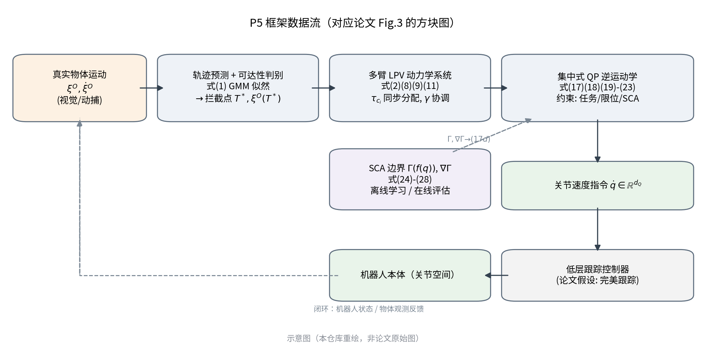
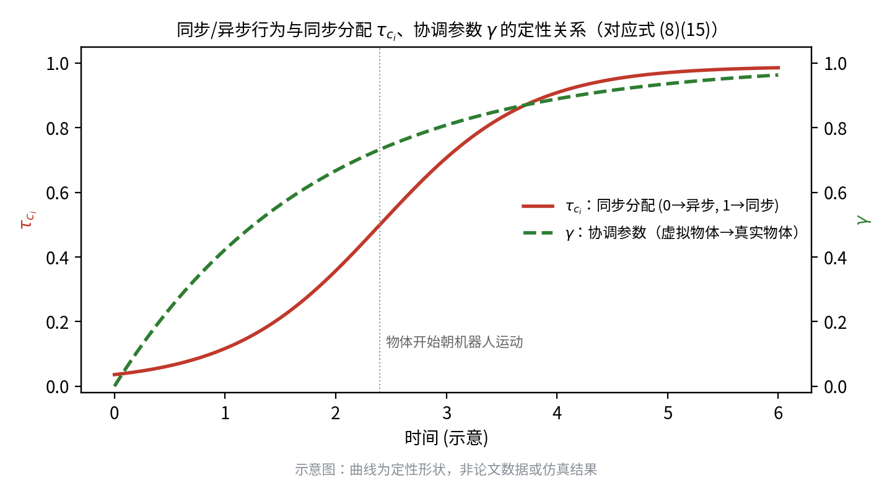
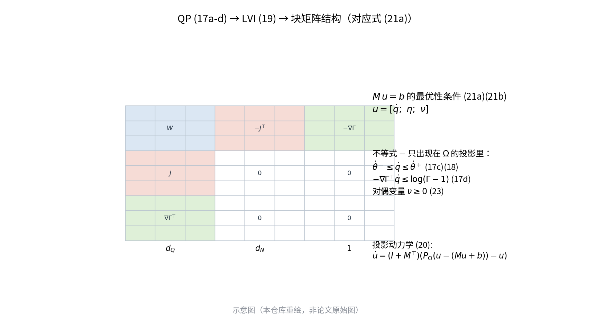

# P5 论文研究：A Unified Framework for Coordinated Multi-Arm Motion Planning

> 阶段：**P5 论文研究 + 复现规划（不进入数值实现）**
> 分支：`reproduce-p5-paper-study-20261020`
> 基点：`c39ef42c`（P3 验收提交 `P3: accept archived D082 numerical reproduction after 92-check corrections`）
> 论文：Mirrazavi Salehian, Figueroa, Billard, *A unified framework for coordinated multi-arm motion planning*, IJRR 37(10):1205–1232, 2018, DOI `10.1177/0278364918765952`
> 本文件与 `P5_EQUATION_AUDIT.md`、`P5_OFFICIAL_CODE_AUDIT.md`、两个 CSV 矩阵、`P5_IMPLEMENTATION_PLAN.md` 构成同一交付。

---

## 0. 文档定位与阅读方法

本文不是"QP 求解器综述"，也不把 P5 简化为"一个带约束的逆运动学"。论文的三块内容彼此依赖：**任务空间的多臂动力学系统**决定给 QP 什么期望速度，**集中式 QP** 把期望速度变成关节速度，**学习到的 SCA 边界**把"别自撞"变成 QP 里的一条线性不等式。任何一块单独拿出，都会丢掉论文真正的贡献。

阅读与核对方法（可复算）：

1. 全文 28 页逐页渲染为 150 dpi 图像通读；所有公式在 300 dpi 下逐条裁切核对，避免 `pdftotext` 对数学符号的错位（P2 阶段已记录过该类事故）。
2. 公式判读结论分三级：**字面可读 / 需结合上下文消歧 / 存在自相矛盾**。第三类集中在 `P5_EQUATION_AUDIT.md`。
3. 源码审计只读：GitHub REST API + `codeload` 快照，固定到具体 commit，记录 tar 包与关键文件 SHA256（见 `p5/evidence/`）。
4. 本阶段**未运行**任何论文算法、未训练、未做长期实验。唯一的可执行产物是文档、示意图生成脚本与三个表格的一致性检查脚本。



---

## 1. 论文识别与身份校验

### 1.1 书目信息

| 项 | 值 |
|---|---|
| 标题 | A unified framework for coordinated multi-arm motion planning |
| 作者 | Seyed Sina Mirrazavi Salehian\*, Nadia Figueroa\*, Aude Billard（\* 同等贡献） |
| 单位 | Learning Algorithms and Systems Laboratory (LASA), EPFL |
| 期刊 | The International Journal of Robotics Research（IJRR） |
| 卷期页 | 2018, Vol. 37(10), 1205–1232（28 页） |
| DOI | `10.1177/0278364918765952` |
| 通讯 | sina.mirrazavi@epfl.ch |
| 关键词 | multi-arm motion planning, coordination, dynamical systems, self-collision avoidance |

### 1.2 全文 PDF 定位与指纹

| 项 | 值 |
|---|---|
| 路径（本地私有，不入库） | `/home/ubuntu2004/lmy/papers_and_reference_all/references/private_sources/P5_original.pdf` |
| 字节数 | 31,161,208 |
| 页数 | 28（页码 1205–1232 连续） |
| 页面 | 594 × 792 pt，PDF 1.6 |
| SHA256 | `6f367be45e0c925df64ec5e4ab3046e1de8aa96627c65ddb2fd71720d9eedc02` |
| 与资料包清单一致性 | ✅ 与 `SHA256SUMS.txt` 中 `P5_original.pdf` 记录逐字相同 |
| 生成链 | Creator `dvips(k) 5.96dev`，Producer `MiKTeX GPL Ghostscript 8.60; modified using iText 4.2.0 by 1T3XT` |
| 时间戳 | CreationDate 2018-11-09；ModDate 2026-09-23（本地副本被重新保存过元数据） |

**身份结论**：指纹与本地资料包清单一致；正文首页的标题、作者、期刊卷期页码与 DOI 与任务书给定信息逐项吻合；28 页公式为矢量文本，可逐式核对。`ModDate` 表明该文件在本机被改写过元数据，因此**身份依据是正文内容证据，而不是"发行方原始字节"**。这一点必须在任何后续引用中如实说明。

### 1.3 与仓库既有卡片的关系

`references/P5_qp_coordination.md` 是立项期的粗粒度卡片，只写了"集中式 QP + 学习 SCA + 同步/异步"三点，并把学习 SCA 定为"核心 QP 稳定之后的 paper-like 扩展"。本研究的结论是：**这个排序在科学上不成立**——SCA 边界不是 QP 的可选插件，而是论文第 4、5 节的主体贡献（论文 8 页篇幅在讲 Γ、∇Γ、CPSP 与 2 ms 预算）。已在 `P5_PROPOSED_REPRODUCTION_MATRIX.csv` 中把 SCA 相关任务提升为 `MINIMUM_ESSENTIAL`，并在卡片末尾追加了指向本文件的补注（不改写原卡片的历史表述）。

---

## 2. 研究问题与动机

论文要解决的问题可以精确表述为：

> 给定一个**运动模型未知**的外部物体，双臂（多臂）系统如何**同时**满足三件事：(i) 与物体在时间上对齐（不是"先到先等"）；(ii) 各臂之间保持协调，且能在物体不再靠近时**平滑退回**各自的独立目标；(iii) 全过程在关节空间不自撞，且控制回路的单次计算不超过约 2 ms。

### 2.1 为什么这是一个真问题

- **单臂不够**：抓取/搬运大而重的物体需要多臂，双臂系统的可行抓取集合远大于单臂（§1）。
- **已有工作集中在静态物体**：多数双臂控制研究假设物体被"闭合链"或"虚拟物体框架"刚性抓住（Caccavale & Uchiyama 2016 综述），对**运动中**的物体、以及**从异步切到同步**的行为切换几乎没有覆盖。
- **RRT 类方法不可用于快速物体**：Vahrenkamp 等的方法能保证抓取可行与 SCA，但计算复杂度高，且**不能保证多臂同时拦截**（§2）。论文引用的数字：人形机器人轨迹求解单次迭代 2715 ms（单线程）/ 54 ms（GPU，Chrétien 2016），规划类方法普遍 700 ms–1 s；唯一做到 <1 ms 的是 Murray 2016 的 FPGA 专用芯片，但需预先构建 PRM 且与具体机器人绑定。
- **反应式（势场）方法快但不稳**：无收敛保证、易陷局部极小、近距离无通道、可能振荡（Ge & Cui 2000）。
- **距离约束破坏凸性**：以最小距离构造避碰约束，本质上是**非凸非光滑**的（min 操作 + 非线性运动学映射），迫使规划器转向全局优化或轨迹优化，单次 0.5 s 量级（Ratliff 2015）。

### 2.2 论文的切入角度

两部分灵感来源不同：

1. **任务空间**：借用**人类协调动力学**（HKB 模型、Kelso 的相位转换、Franz 1991 的双手动实验）——人的双手受一个强耦合非线性动力学系统支配，可以在同步/异步之间连续过渡而无需"模式切换"。因此论文把同步与异步**编码进同一个 DS**，用连续变量 τ 调配。
2. **关节空间**：绕开"最小距离"这一非凸来源，改为**离线学习一个连续可微的标量函数 Γ(q)**，其水平集 Γ=1 就是自碰撞边界；在线只需一次函数值 + 一次梯度，把避碰写成**线性不等式**。凸性得以保留，2 ms 预算得以满足。

### 2.3 论文自述的三项贡献

1. 单一 DS 统一同步与异步多臂行为；
2. 带 SCA 约束的集中式 QP 逆运动学，可实时求解；
3. 数据驱动的 SCA 约束建模（稀疏核 SVM），计算上足够便宜。

第 12 节会把这三点与"常规优化技术"逐条对照，说明哪一部分是真贡献、哪一部分是把已有工具用对了地方。

---

## 3. 同步与异步：定义、极限行为与同步分配

### 3.1 定义

- **同步（synchronous）**：所有臂必须**同时**到达同一个运动物体上的各自抓取点；臂与臂、臂与物体之间存在时间约束，而不只是空间约束。
- **异步（asynchronous）**：每臂各自奔向自己的静态目标，臂间没有空间约束；但"同时到达"的时间约束在人类行为中仍然存在（§1 引 Coats & Wann 2012；论文在 Fig.1a 中用两种图并列表现）。

论文的关键设计是：**每臂一个同步分配参数** τ_ci ∈ [0,1]，而不是全局一个开关。因此可以出现"一臂已同步、另一臂仍异步"的中间状态（Fig.14 的 τ≈0.1→1 序列）。

### 3.2 单臂动力学与两个极限

论文的核心方程（式 (2)，p.1212）：

```
ẋ_i^R = τ̇_ci (x_i^V − x_i^d) + τ_ci ẋ_i^V + A_i(θ_i)( x_i^R − x_i^d − τ_ci (x_i^V − x_i^d) )
```

三项的物理含义必须分清，否则后续复现会把"前馈"与"反馈"搞混：

| 项 | 含义 |
|---|---|
| `τ̇_ci (x^V − x^d)` | **分配变化本身**产生的前馈：τ 在变，目标点就在动 |
| `τ_ci ẋ^V` | 跟随虚拟物体的**速度前馈** |
| `A_i(θ_i)(x^R − x^d − τ(x^V − x^d))` | 朝"混合目标"收敛的**反馈项**，A_i 由 LPV 给出 |

两个极限（式 (6)(7)）：

- τ_ci = 0 → `ẋ^R = A_i(θ_i)(x^R − x^d)`，即独立目标点吸引子；
- τ_ci = 1 → `ẋ^R = ẋ^V + A_i(θ_i)(x^R − x^V)`，即以虚拟物体速度为前馈的跟踪。

因此 τ 不是"权重插值"，而是**在'目标吸引'与'速度跟踪'两种闭环结构之间连续变形**。这是论文相对"加权平均两个 DS"的关键差别。

### 3.3 同步分配参数自己的动力学（式 (8)，p.1212）

```
τ̇_ci = τ_ci (1 − τ_ci) G(ξ^O, ξ̇^O) / k ,    τ_ci(0) = ε
G(·) = − ξ̇^O(t)ᵀ ( ξ^O(t) − ξ^O(T*) ) / ( ε + ‖ξ^O(t) − ξ^O(T*)‖² )
```

- 结构是 **logistic 型增长**：`τ(1−τ)` 使 τ 被约束在 (0,1)，且越靠近 0/1 变化越慢 —— 天然的软开关，无需显式饱和。
- `G` 的符号只由**物体速度与"物体到拦截点"向量的内积**决定：物体朝机器人来 → G>0 → τ 升；物体远离 → G<0 → τ 降。
- `k` 控制斜率；`ε` 既做分母正则，又做 τ 的初值（`0 < ε ≪ 1`）。
- 作者明确说明：τ 也可以人为用 logistic 函数给定（例如实验中直接设 τ=1 强制同步），式 (8) 是"自动版"。

**可复现性**：式 (8) 是显式 ODE，右侧只依赖外部量（物体状态、拦截点），**不依赖机器人状态**。因此它可以被完全独立地数值复现与验证（见 P5-T01）。G 为常数时有 logistic 闭式解，可作为独立校验。

### 3.4 协调参数 γ（式 (15)，p.1213）

```
γ̇ = (1 − γ) / ( ‖ξ^O(t) − ξ^O(T*)‖ + ε ),   γ(0) = 0
```

γ 描述"虚拟物体在多大程度上已经追上真实物体"：远离拦截点时 γ≈0（虚拟物体按预测拦截点运动），接近时 γ→1（虚拟物体与真实物体重合，从而容忍预测误差）。论文用 (15) 的 ODE 形式给出，并声称"提高了对物体运动预测误差的鲁棒性"。



> 上图为**定性示意**（解析形状，非论文数据，也非仿真输出），仅用于说明 τ 与 γ 的互补角色：τ 决定"跟谁"，γ 决定"跟到多近"。

---

## 4. 多臂动力学系统与稳定性

### 4.1 LPV 结构与调度参数

`A_i(θ_i) = Σ_{k=1}^{d_si} θ_ik A_ik`（式 (3)）。θ 由 **GMR（高斯混合回归）** 从"运动学可行的示教"中拟合得到，其天然性质是**归一化**：`0 < θ_ik ≤ 1`、`Σ_k θ_ik = 1`（§3.2 正文）。这一点很重要：论文的 LMI 条件 (5) 只要求 `θ_ik ≥ 0`，而归一化由拟合方法保证，不是额外假设。

### 4.2 定理 1 与它的证明结构（p.1212，附录 B/C）

```
若存在 P_i^R ≻ 0, Q_i^R ≻ 0 使  P_i^R A_ik + A_ikᵀ P_i^R ≺ −Q_i^R,  ∀k，且 θ_ik ≥ 0
则  lim_{t→∞} ‖ x_i^R − τ_ci x_i^V + (τ_ci − 1) x_i^d ‖ = 0
```

证明路线（附录 B，式 (29)–(32)）：取 `V = ½ (x^R − τx^V + (τ−1)x^d)ᵀ P^R (·)`，沿 (2) 求导，把含 `A_i(θ_i)` 的项写成 `Σ_k θ_ik (A_ikᵀP + PA_ik)`，逐项用 (5) 压成负定，再用 Barbalat 引理得到渐近收敛。

**注意一个容易误读的点**：收敛目标是 `τx^V + (1−τ)x^d`，即"虚拟物体与异步目标的凸组合"，而不是"虚拟物体"本身。当 τ 时变时，这个组合目标本身也在动，所以定理 1 的结论严格来说是"跟踪一个时变目标"，论文把 τ 当常数处理（原文明确 "Assuming that τ_ci is constant"），时变情形只有 Remark 1 的极限陈述。这是理论上的一个空隙，复现时**必须把 τ 常数与时变两种情形分开测**。

### 4.3 被动性

定理 1 的第二部分（附录 C）：以 `τ̇(x^V−x^d) + τẋ^V − A_i(θ_i)(x^d + τ(x^V−x^d))` 为输入、`x_i^R` 为输出，式 (2) 在 (5) 下**被动**。Remark 2 进一步声称整个框架（DS + IK）被动，理由是"机器人与低层跟踪器都是被动的"。这个论断是论文最强的系统级声明，也是最需要谨慎对待的：它依赖于"低层完美跟踪"假设（Fig.3 明说），而实际 FR3 的位置/速度环并非理想被动元件。

### 4.4 虚拟物体动力学：论文自己的推导里有一个"自消"

这是本次通读中最重要的技术发现，必须先说结论，再给推导。

**结论**：把式 (2) 代入式 (10)，得到 `U_i = τ_ci ẋ_i^V`；代回式 (9) 后，`Στẋ^V` 与左端的 `(1+Στ)ẋ^V` 部分相消，式 (11) 退化为

```
ẋ^V = γ ẋ^O + γ̇ x^O + A^V (x^V − γ x^O)            ……(36)
```

即**虚拟物体的动力学与 τ 无关**。论文附录 D 开头正是这么写的（"As ẋ_i^V = ẋ^V ∀i, (11) can be written as (36)"），说明作者知道这一点，但正文没有强调它的含义。

**含义**：τ 只改变**每个机器人**如何跟踪虚拟物体，不改变虚拟物体自己的运动。因此"臂的运动把虚拟物体拖动"这一直觉**在论文方程里不成立**；虚拟物体完全由物体运动 + γ + A^V 驱动。

**对复现的直接影响**：官方 `Multiarm_ds::Update()` 里保留了 `U_sum/(1+τ_sum)` 这一项，且 `U_ = −ATX_`（不是论文 (10) 的 U），因此**官方实现的虚拟物体动力学与式 (36) 不等价**。这不是可以忽略的实现细节：它决定了"同步行为下虚拟物体是否被臂拖动"这一可观测差异。复现方案把它列为必须量化的偏差（P5-T03），并要求两个版本并列输出，不得私选其一。

---

## 5. 集中式 QP 逆运动学

### 5.1 完整形式（式 (17a–d)，p.1214）

```
argmin_{q̇}  ½ q̇ᵀ W q̇                                        (17a)
s.t.        J(q) q̇ = ξ̇^R                                     (17b)
            θ̇⁻ ≤ q̇ ≤ θ̇⁺                                     (17c)
            −∇Γ^{ij}(q^{ij})ᵀ q̇^{ij} ≤ log( Γ^{ij}(q^{ij}) − 1 )   ∀(i,j)∈{(1,2),(1,3),…,(N_R−1,N_R)}   (17d)
```

维度（双 7 自由度臂、位置级任务）：`d_Q = Σ_i d_qi = 14`，`d_n = 3`，`d_N = N_R·d_n = 6`；决策变量是**关节速度** `q̇`（这一点常被误写成位置，正文与 (17b) 都表明是速度级）。

四个部分各自的角色：

| 式 | 角色 | 为什么需要 |
|---|---|---|
| (17a) | 加权速度范数的平方 | 冗余自由度下的最小"努力"解；W 块对角正定，可按关节加权 |
| (17b) | 任务等式 | 把任务空间 DS 输出的期望速度映射到关节空间，**精确**满足（硬约束） |
| (17c) | 关节速度盒 | 由 (18) 从位置限位推导，带前瞻减速 |
| (17d) | SCA 线性不等式 | 把"不许靠太近"变成对 `q̇` 的**线性**约束 |

### 5.2 凸性与其边界

(17a) 严格凸（W≻0），(17b) 仿射等式，(17c) 盒约束，(17d) 在给定当前 q 时对 q̇ **线性**。因此整个问题是一个凸 QP，有唯一解。

但必须说清两个"凸性代价"：

1. **Γ 本身对 q 是高度非线性的**，(17d) 只是它在当前构型处的一阶（切平面）近似。因此"满足 (17d)"只保证**这一步**不朝边界内侧走，不保证离散步长下不穿越。`log(Γ−1)` 在 Γ→1⁺ 时趋于 −∞，相当于一个无穷硬的障碍，理论上会迫使 ‖q̇‖→0，实际实现必须做限幅，否则数值爆炸。
2. **可行性没有被讨论**。任务等式 + 盒约束 + SCA 不等式三者可能冲突（例如目标在障碍另一侧、或当前已接近边界）。论文没有给出不可行时的处理（松弛变量、分层 QP、回退策略都没有）。这是论文的一个实质性缺口，也是双 FR3 落地时最先会撞到的问题。

### 5.3 关节限位如何进入速度级（式 (18)，p.1214）

```
θ̇_i⁻ := max( μ ( q_i⁻ − q_i ), q̇_i⁻ )
θ̇_i⁺ := min( μ ( q_i⁺ − q_i ), q̇_i⁺ )
```

思路（源自 Xia & Wang 2000）：位置限位不可能直接写进速度级 QP，于是用"到限位的剩余距离 × 强度 μ"生成一个**随距离收缩的速度上限**——离限位越近，允许的速度越小，从而在到达限位前自动减速。μ 决定减速度大小，需选得使可行域大于纯速度限位。`q⁻, q⁺` 是**保守**的位置界（比物理限位更靠内）。

### 5.4 三种求解路径与 Lemma 1

论文比较了三条路（§4 末 + §6.2.3）：

1. **CVXGEN**（Mattingley & Boyd 2012）：针对固定问题结构生成专用 C 代码，最快，实测 **0.358 ms/次**；
2. **NLopt**（非线性求解器）：通用、易用，但慢（Fig.17a 约 4 ms 量级）；
3. **LVI 投影动力学**（本文的解析路线）：`0.92 ms/次`，且**输出最平滑**（Fig.17b，平滑度指标 `S = mean(S_t)` 更低），因为它在加速度层面给出期望运动，可直接下发，不需要再滤波。

第三条路是论文真正的"数学贡献"部分。Lemma 1（p.1215）把 QP 等价为一个**线性变分不等式**（LVI）：

```
P_Ω( u − (M u + b) ) − u = 0                                (19)
u̇ = (I + Mᵀ)( P_Ω( u − (M u + b) ) − u )                    (20)

M = [  W      −Jᵀ     −∇Γ ]      b = [ 0 ;  −ξ̇^R ;  −log(Γ−1) ]        (21a)(21b)
    [  J        0        0   ]
    [ ∇Γᵀ       0        0   ]
```

`u = [q̇; η; ν]`，`d_u = d_Q + d_N + 1`，η、ν 是等式/不等式约束的对偶变量；`P_Ω` 是逐元素饱和（式 (22)），盒为

```
u⁻ = [θ̇⁻; −∞; 0],   u⁺ = [θ̇⁺; +∞; +∞]                     (23)
```

`ν ≥ 0` 正是不等式约束的互补松弛符号。定理 3（附录 F）证明 (20) 以 `Y = u`、`U = (I+Mᵀ)P_Ω(u−(Mu+b))` 为输入输出时被动。Remark 2 由此把整个框架串成"被动系统 + 被动系统"的反馈互联。



> 结构图（按式 (21a) 重绘，标注为示意）：不等式**不出现在矩阵里**，而是全部被吸收进 `Ω` 的投影；这是 LVI 形式能够"无约束求解"的关键。

---

## 6. 自碰撞避免：学到的边界、梯度与约束

### 6.1 为什么"学习一个标量函数"是合理选择

论文的论证链（§2.3、§5）值得完整复述，因为它是第 12 节"真贡献"判断的基础：

1. 传统方法以 `min‖c_i − c_j‖` 构造避碰，这个 min 使其**非光滑**，再叠加正运动学映射后**非凸**，直接破坏 QP 的凸性 → 只能退化为轨迹优化（0.5 s 量级）。
2. 若把"碰撞/不碰撞"学成一个**连续可微的标量场 Γ(q)**，则"不碰撞"变成 `Γ(q) > 1`，其一阶近似是**线性不等式**——凸性保住了。
3. 学习必须在**特征空间** `f(q)` 而不是关节角 `q` 上做：关节空间是 `S¹×…×S¹`（环面），欧氏距离在环面上没有意义（`−π` 与 `+π` 相距 2π 但物理上是同一姿态）；把关节角直接喂给分类器会得到"极其重叠"的数据集（脚注 6 引用 Fang 2015 的 15%/35% 误分类率与二次插值补丁）。用**关节的三维笛卡尔位置**作为特征，度量就回到欧氏空间。

### 6.2 边界函数与解析梯度（式 (24)(25)(26)，p.1216–1217）

```
Γ(f(q^{ij})) = Σ_{n=1}^{N_sv} α_n y_n exp( −‖f(q^{ij}) − f(q_n^{ij})‖² / (2σ²) ) + b        (24)
∇_f Γ = −(1/σ²) Σ_n α_n y_n exp(…) ( f(q^{ij}) − f(q_n^{ij}) )                              (25)
∇_q Γ = (∂Γ/∂f) · (∂f/∂q^{ij})                                                              (26)
```

三个细节必须原样保留，否则复现会"看起来对、数值不对"：

- 核是 `exp(−‖·‖²/(2σ²))`，其中 `σ` 是**核宽**；而 svm_perf/svm_light 模型文件里的 `-g` 参数是 `λ = 1/(2σ²)`（**不是 σ**）。官方模型 `gamma=3.3` 对应 `σ≈0.389`，若误当 `σ=3.3`，梯度会差一个数量级以上。这是本项目最容易踩的坑，已单列为开放问题 O8。
- 梯度因子是 `1/σ² = 2λ`，MATLAB 与 C++ 实现里写成 `2*lambda`，与 (25) 一致。
- (26) 的第二个因子是 `3d_qi + 3d_qj` 维特征对 `d_qi + d_qj` 维关节角的雅可比——**公开代码里没有任何一处实现它**（见第 8 节的代码审计）。

### 6.3 数据构造（式 (27)，p.1217）

- 机器人用**一串球**近似（Fig.7：每臂 6 个球，`S¹…S⁶`，装在关节与相邻连杆上；带工具时最后一个球放大）。
- 碰撞判据：最近球心距 < 两球半径之和；边界带：`b⁻ ≤ d ≤ b⁺`；更远则丢弃（不当负样本）。论文取 `b⁻ = 30 cm`、`b⁺ = 33 cm`（代码中硬编码 0.30/0.33，一致）。
- 三分类标注（式 (27)）：`y=−1` 碰撞 / `y=+1` 边界 / 丢弃 安全。注意论文 §5.1 开头写"+1 与 −1 对应非碰撞与碰撞"，§5.2 又改成"边界配置标为 +1、安全配置被过滤"，**两处表述不一致**，以实现（边界为正类）为准。
- 采样：每关节 20° 步长，`q1,q3,q5,q7 ∈ ±170°`、`q2,q4,q6 ∈ ±120°`；论文称总组合数 `18³ × 12³`，实测数据集约 **5.4 M** 点（其中约 2.4 M 为碰撞类）。这两个数字**不能直接对应**（`18³×12³ ≈ 1.01×10⁷`），论文未说明筛选比例，列为 O5。

### 6.4 稀疏化：为什么必须 CPSP（式 (28)，p.1219）

精确 SVM 的支持向量数 `N_sv` 与训练集规模同阶增长，而在线预算要求"Γ + ∇Γ 合计 ≤ 2 ms"。论文测得（Fig.9）：`N_sv = 1700 → ≈0.7 ms`，`3700 → ≈1.7 ms`，`9700 → ≈4.5 ms`；因此**硬预算 `N_sv ≤ 3000`**。

解法是 **CPSP**（Joachims & Yu 2009，cutting-plane subspace pursuit）：直接把解写成**最多 `k_max` 个基向量**的展开 `w = Σ_{i=1}^{k_max} α_i y_i Φ(b_i)`，`k_max = 3000`，绕开"先稠密求解再稀疏化"的两阶段误差。代价是优化问题变成非凸的 chasing 过程，但论文只要求分类质量。

### 6.5 学习结果（Fig.10，p.1220）

| 模型 | 训练量 | N_sv | FPR | TPR |
|---|---|---|---|---|
| 精确 SVM（1% 数据） | 2.7 万点 | 2700 | ≈2.4% | ≈96.19% |
| 精确 SVM（5% 数据） | — | >预算 | 更低 | 更高（超出 2 ms 预算） |
| **稀疏 CPSP（k=3000）** | **54 万点** | **3000** | **≈1.45%** | **≈97.4%** |

指标定义（论文给出，必须照抄，不要自创）：`FPR = FP/(FP+TN)`、`TPR = TP/(TP+FN)`、`ACC`、`F1`。论文明确指出**两类错误的代价不对称**：把碰撞判成自由（假阳性 FP，导致进入不可行区）比反过来危险得多，所以首要目标是压 FPR。

**安全含义（论文没有强调，但必须写进复现结论）**：TPR 97.4% 意味着约 **2.6% 的真实碰撞构型会被判为安全**。因此 SCA 是**统计性安全**，不是硬保证。任何"复现了 SCA 所以双 FR3 不会自撞"的说法都是错的。

---

## 7. 理论假设与保证：清单与缺口

### 7.1 论文明确给出的保证

| 编号 | 保证 | 条件 | 出处 |
|---|---|---|---|
| G1 | 单臂 DS 渐近收敛到 `τx^V+(1−τ)x^d` | (5) 成立且 τ 常数 | 定理 1 / App.B |
| G2 | 单臂 DS 被动 | (5) 成立 | 定理 1 后半 / App.C |
| G3 | 虚拟物体收敛到 `[γξ^O; γξ̇^O+γ̇ξ^O]` | (13) 成立 | 定理 2 / App.D.E |
| G4 | LVI 投影动力学被动、稳定到 QP 解 | QP 凸（W≻0） | 定理 3 / App.F |
| G5 | 整个框架被动 | 机器人 + 低层跟踪器被动 | Remark 2 |

### 7.2 论文依赖但未证明的假设

| 编号 | 假设 | 风险 |
|---|---|---|
| A1 | 低层跟踪器"完美"（Fig.3 原话） | 真实 FR3 的速度环有延迟与饱和，G5 的实际成立性未知 |
| A2 | 物体轨迹可用线性/弹道模型短期预测 | §7 承认：预测误差靠 γ 与"迭代更新拦截点"缓解，**无定量保证** |
| A3 | Γ 是真实碰撞集的良好近似 | 只有统计指标（FPR/TPR），无最坏情况界 |
| A4 | (17d) 的一阶近似在离散步长下安全 | 未证明；`log` 项只是软性屏障 |
| A5 | QP 始终可行 | 未讨论；无松弛/回退机制 |
| A6 | τ 时变时定理 1 仍成立 | 只在 τ 常数下证明；时变只有极限陈述 |
| A7 | 学习到的 Γ 只覆盖臂-臂对 (i,j) | 单臂内部自碰撞（肘-基座）不在建模范围内 |

### 7.3 论文自己承认的局限（§7）

- 收敛**速率**没有解析保证（"no any analytical proof that (11) is fast enough"），只能靠调参；
- 拦截点是"固定吸引子"假设，实际需迭代更新；
- 抓取后进入闭链，需要**力控**，本文只做位置级，"future work"；
- 计算瓶颈在特征评估（Eigen 动态分配带来方差，见脚注 8）。

---

## 8. 原始实验全景

完整清单见 `P5_ORIGINAL_EXPERIMENT_MATRIX.csv`（12 条，E01–E12）。这里给出结构与读法。

### 8.1 两套平台

| 平台 | 机器人 | 用途 | 章节 |
|---|---|---|---|
| 平台 1 | 双 7-DOF（KUKA LWR 4+ 与 KUKA IIWA）+ 4 指 OBR 手 + 16-DOF Allegro 手 | 任务空间协调、快速物体拦截 | §6.1 |
| 平台 2 | 双 KUKA IIWA 7-DOF + 两指 Robotiq 夹爪 | 双行为 + SCA + 系统评估 | §6.2 |

控制：FRI 关节阻抗；Optitrack 240 Hz 动捕 + Savitzky–Golay 滤波。

### 8.2 九类实验与其指标

| 实验 | 图/表 | 变量 | 指标 | 论文结论 |
|---|---|---|---|---|
| 自由空间协调 | Fig.11 | 人为扰动一臂 | 定性 | 无主从，另一臂同步跟随 |
| 快速物体拦截 | Fig.12 | 飞行时间 0.39/0.48 s | 定性 | 两臂同向/反向均成功拦截 |
| 双行为切换 | Fig.13/14 | 物体靠近/远离 | τ 轨迹 | τ 从 ~0.1 平滑升到 ~1，无跳变 |
| SCA 两场景 | Fig.15 | 目标点使两臂必然相撞 | 最小距离、Γ(t) | Γ 始终 >1，最小距离先减后增 |
| 系统评估 | Table 3 / Fig.18–20 | 3 种车件 × 20 次 | 成功率、时长、拦截点分布 | 总体 **86.7%**（52/60）；85%/85%/90%；3.4±1.6 / 3.2±1.3 / 2.3±1.2 s |
| 求解器对比 | Fig.17 | CVXGEN / NLopt / LVI-DS | 时间、平滑度 | **0.358 ms** / 约 4 ms / **0.92 ms**；DS 最平滑 |
| 噪声敏感性 | Fig.21 | 速度 0.25/1.25/3.75 m/s × 噪声 × 未测量比例 0/50/77/85% | 拦截误差 | 误差随速度与缺失率上升；165 次 |
| 学习性能 | Fig.10 | 精确 SVM vs 稀疏 CPSP | FPR/TPR/ACC/F1 | 见 §6.5 |
| 运行时间 | Fig.9 | N_sv 1700–9700 | 单次评估 (ms) | 2 ms 预算 ⇒ N_sv ≤ 3000 |
| 采样粒度 | Fig.22 | 20/22/25/30/45° | FPR/TPR | 采样越粗 FPR 越差；子采样 ≠ 粗采样 |

### 8.3 哪些能数值复现、哪些不能

- **能**（D082 算法级）：E10（运行时间趋势）、E12（2D 玩具 Γ/∇Γ）、E08/E09 的**部分**（用官方随附模型在官方测试点上复算分类指标）。
- **部分**：E03（τ 轨迹形状）、E04（Γ 与最小距离的量级）、E06（DS/NLopt 两条路，CVXGEN 不可得）。
- **不能**：E01、E02、E05、E07（都依赖真实硬件、视觉与人的行为），登记为原论文结论，不做数值复现。

### 8.4 失败率背后的原因（论文自述，对复现有用）

60 次中 8 次失败，两类原因：
1. **动捕标记被遮挡**（5 个标记中 1–2 个丢失）→ 拦截点算错；
2. **物体方向在接近时突变** → 抓取点在运动学上不可达（论文未给恢复策略）。

这说明论文框架的薄弱环节在**感知与可达性判定**，不在 QP 本身。双 FR3 若用仿真真值，这两类失败会被"免费消除"，从而**高估**框架能力——复现结论里必须声明这一点。

---

## 9. 与常规优化技术的真实贡献对照

| 论文元素 | 常规做法 | 论文的不同 | 是否真贡献 |
|---|---|---|---|
| 速度级 QP IK + 关节限位 | 标准（Kanoun 等、De Lasa 等） | 无本质差别 | ✗ 工程复用 |
| 用 log 屏障把约束软化 | 内点法常见 | 把 `log(Γ−1)` 同时用作"梯度推开"的尺度 | △ 技巧性 |
| 避碰约束 | 最小距离 + 非凸约束 / 势场 / 轨迹优化 | 学一个**连续可微标量场**，约束变线性 | ✓ 核心贡献（第 3 点） |
| 稀疏化 | SMO / 随机子采样 | CPSP 直接约束基向量个数以满足 2 ms 硬预算，并给出 FPR/TPR 权衡 | ✓ 核心贡献（第 3 点的可行性前提） |
| 同步/异步统一 | 模式切换 / 主从 / 加权 DS | **单 DS + 每臂 τ + τ 由物体运动方向驱动** | ✓ 核心贡献（第 1 点） |
| LVI 投影动力学解 QP | 现成 QP 求解器（CVXGEN/qpOASES） | 给出被动、无需滤波、可解析实现的连续时间解 | ✓ 贡献（第 2 点），但本质是把 Xia & Wang 的 LVI 结果用到 IK 上 |
| 被动性论断 | 常见于 DS 文献 | 把 DS + IK 串成被动互联 | △ 依赖 A1 假设 |

一句话：**真贡献是"把避碰从非凸几何问题改造成一个可学习、可求导、可塞进凸 QP 的标量场"，以及"用 τ 把两种行为编进同一个 DS"**；QP 本身、LVI 本身都不是新东西，论文的价值在于把它们组装成一个能在 2 ms 内跑完的闭环。

---

## 10. 与双 FR3 协调操作的相关性

| 论文元素 | 对双 FR3 码垛/搬运的可用性 | 需要做什么 | 标注 |
|---|---|---|---|
| 每臂 τ 同步分配 | 高：码垛流程本身就是"各自取件（异步）→ 共同搬运（同步）→ 各自放置（异步）"，τ 正好描述阶段过渡 | 把 τ 的驱动量从"物体是否靠近"换成"抓取/放置阶段标志或相对位姿误差" | ADAPTATION |
| LPV/GMR 单臂 DS | 中：需要示教数据拟合 `A_ik`；仓库没有 FR3 的示教集 | 用 P2/P4 已有轨迹做 GMR 拟合，或用解析二阶 DS（质量-弹簧-阻尼）构造 `A_ik` 并验证 (5) | ADAPTATION |
| 集中式 QP IK（14 DOF） | 高：与 MoveIt/Isaac 的 `q̇` 接口天然对齐；比"两臂各自 IK"更能保证相对位姿 | 需要 FR3 的解析雅可比与限位；把 14 维 QP 接到现有控制器 | ORIGINAL（数学）/ ADAPTATION（接口） |
| LVI-DS 求解器 | 中高：无需外部求解器、输出平滑、可解释 | 与 OSQP/qpOASES 对比；注意病态 W 下的收敛 | ORIGINAL |
| 学习 SCA 边界 | **低（直接用）**：官方 36 维模型是**IIWA 几何**，不能用于 FR3 | 必须用 FR3 的 DH 与球近似**重新生成数据 + 重新训练**；否则只能用 FCL 距离约束（ADAPTATION） | 官方模型：不可迁移；FCL 版本：ADAPTATION |
| `Γ>1` 的二分类语义 | 中：概念可迁移 | 新模型必须重新标定"边界=1"的映射（O7） | ADAPTATION |
| 被动性/稳定性框架 | 中：可作为控制器稳定性论证的模板 | 需替换 A1（完美跟踪）为实际闭环模型 | ADAPTATION |
| 物体拦截 | 低：码垛不追快速运动物体 | 若做传送带取件可复用（对应 P1 场景） | OPTIONAL |

**结论**：P5 对双 FR3 最有价值的是 **(a) 每臂 τ 的阶段化协调机制** 与 **(b) 集中式 QP IK 的结构**；最不能直接搬的是**学习到的 SCA 边界**（几何不匹配），必须显式降级为"重新训练"或"FCL 替代（ADAPTATION）"。这一点与仓库 `docs/tasks/TASK18` 的既有警告一致，本研究把它从"提醒"升级为"矩阵中的硬标签"。

---

## 11. 完整"公式—源码"对应表

由 `p5/tools/p5_tables.py` 生成，`P5_PAPER_STUDY.md` 与本表通过标记块保持字节一致（`--check` 会校验，漂移即失败）。完整判读见 `P5_EQUATION_AUDIT.md`。

<!-- BEGIN EQ TABLE (generated by p5/tools/p5_tables.py) -->
| 编号 | 论文公式（转录） | 位置 | 作用 | 官方代码位置 | 代码状态 |
|---|---|---|---|---|---|
| (1) | `p({^1xi^O_1,...,^N xi^O_N}; W) = prod_j p_j(^j xi^O_j; theta^W_j), delta = prod_j delta_j` | p.1211 §3.1 | 多臂工作空间联合似然与拦截点可行性判据 | LPV.cpp GMM::PDF + multiarm_ds::predict_the_object_position / CalculateCatchingprobability | `CODE_PARTIAL` |
| (2) | `dot{x}^R_i = dot{tau}_ci (x^V_i - x^d_i) + tau_ci dot{x}^V_i + A_i(theta_i)(x^R_i - x^d_i - tau_ci(x^V_i - x^d_i))` | p.1212 §3.2 | 单臂 LPV 动力学：前馈（虚拟物体/目标）+ 反馈项 | multiarm_ds.cpp: calculate_ATX() + calculate_robot_next_state() | `CODE_MATCH` |
| (3) | `A_i(theta_i) = sum_{k=1}^{d_si} theta_ik A_ik` | p.1212 §3.2 | 调度参数对状态矩阵的仿射依赖（LPV） | LPV.cpp: Calculate_A(), Calculate_Theta() | `CODE_MATCH` |
| (4) | `lim_{t->inf} \|\|x^R_i - tau_ci x^V_i + (tau_ci - 1) x^d_i\|\| = 0` | p.1212 Theorem 1 | 闭环收敛目标（异步目标与虚拟物体的凸组合） | - | `NO_PUBLIC_CODE` |
| (5) | `0 < P^R_i, 0 < Q^R_i, P^R_i A_ik + A_ik^T P^R_i < -Q^R_i, 0 <= theta_ik` | p.1212 eq.(5) | 逐组件的 Lyapunov LMI（稳定性/收敛的充分条件） | - | `NO_PUBLIC_CODE` |
| (6) | `tau_ci = 0: dot{x}^R_i = A_i(theta_i)(x^R_i - x^d_i)` | p.1212 eq.(6) | 异步行为（各自目标） | multiarm_ds.cpp: calculate_ATX (当 tau_->0) | `CODE_IMPLIED` |
| (7) | `tau_ci = 1: dot{x}^R_i = dot{x}^V_i + A_i(theta_i)(x^R_i - x^V_i)` | p.1212 eq.(7) | 同步行为（跟踪虚拟物体） | multiarm_ds.cpp: calculate_ATX (当 tau_->1) | `CODE_IMPLIED` |
| (8) | `dot{tau}_ci = tau_ci(1-tau_ci) G(xi^O, dot{xi}^O)/k,  G = -dot{xi}^O(t)^T(xi^O(t)-xi^O(T*))/(eps + \|\|xi^O(t)-xi^O(T*)\|\|^2)` | p.1212 eq.(8) | 同步分配参数的动力学（由物体运动方向决定同步/异步） | multiarm_ds.cpp: calculate_coordination_allocation() | `CODE_DIVERGENT` |
| (9) | `dot{x}^V = 1/(1+sum_i tau_ci) ( gamma dot{x}^O + dot{gamma} x^O + A^V x^V - gamma x^O + sum_i U_i )` | p.1213 eq.(9) | 虚拟物体动力学（含各臂耦合项 U_i） | - | `NO_PUBLIC_CODE` |
| (10) | `U_i = dot{x}^R_i - A_i(theta_i)(x^R_i - x^d_i - tau_ci(x^V_i - x^d_i)) - dot{tau}_ci(x^V_i - x^d_i)` | p.1213 eq.(10) | 第 i 臂对虚拟物体的“交互作用”项 | multiarm_ds.cpp: calculate_u() | `CODE_DIVERGENT` |
| (11) | `dot{x}^V = 1/(1+sum_i tau_ci)( gamma dot{x}^O + dot{gamma} x^O + A^V(x^V - gamma x^O) + sum_i tau_ci dot{x}^V_i )` | p.1213 eq.(11) | 代入 (2)(10) 后的虚拟物体闭环 | multiarm_ds.cpp: Update() | `CODE_DIVERGENT` |
| (12) | `lim \|\|x^V - gamma xi^O\|\| = 0, lim \|\|dot{x}^V - (gamma dot{xi}^O + dot{gamma} xi^O)\|\| = 0` | p.1213 Theorem 2 | 虚拟物体对真实物体的收敛 | - | `NO_PUBLIC_CODE` |
| (13) | `0 < P^V, 0 < Q^V, P^V A^V + A^{V,T} P^V < -Q^V` | p.1213 eq.(13) | 虚拟物体 DS 的 LMI 条件 | - | `NO_PUBLIC_CODE` |
| (14) | `tau_ci = 1: lim \|\|xi^R_i - gamma xi^O_i\|\| = 0, lim \|\|dot{xi}^R_i - (gamma dot{xi}^O_i + dot{gamma} xi^O_i)\|\| = 0` | p.1213 Remark 1 | “完美协调”的极限表述 | - | `NO_PUBLIC_CODE` |
| (15) | `dot{gamma} = (1-gamma)/(\|\|xi^O(t)-xi^O(T*)\|\|+eps), gamma(0)=0` | p.1213 eq.(15) | 协调参数：虚拟物体从“预测拦截点”过渡到“真实物体” | multiarm_ds.cpp: calculate_coordination_parameter() | `CODE_DIVERGENT` |
| (16) | `Gamma(q^{ij}) < 1 collided; = 1 boundary; > 1 free` | p.1214 eq.(16) | SCA 边界函数的符号语义 | SVMGrad calculateGamma; SCA 数据集标签 | `CODE_PARTIAL` |
| (17a) | `argmin_{dot{q}} dot{q}^T W dot{q} / 2` | p.1214 eq.(17a) | 集中式 IK 的二次目标（加权速度范数） | QP_IK_solver.cpp: Construct_vel() (W_ 组装) + cvxgen/*（缺失） | `CODE_PARTIAL` |
| (17b) | `J(q) dot{q} = dot{xi}^R` | p.1214 eq.(17b) | 任务空间等式约束（同步/异步 DS 给出的期望速度） | QP_IK_solver.cpp: Construct_vel() (J_、b_) | `CODE_PARTIAL` |
| (17c) | `dot{theta}^- <= dot{q} <= dot{theta}^+` | p.1214 eq.(17c) | 关节速度盒约束（由 (18) 生成） | QP_IK_solver.cpp: Construct_boundaries_vel() | `CODE_MODIFIED` |
| (17d) | `-grad Gamma^{ij}(q^{ij})^T dot{q}^{ij} <= log(Gamma^{ij}(q^{ij}) - 1), all robot pairs (i,j)` | p.1214 eq.(17d) | 把 SCA 边界变成线性不等式（论文核心技巧） | QP_IK_solver.cpp: Construct_vel() (M 最后一行/列) | `CODE_DIVERGENT` |
| (18) | `dot{theta}^-_i := max(mu(q^-_i - q_i), dot{q}^-_i);  dot{theta}^+_i := min(mu(q^+_i - q_i), dot{q}^+_i)` | p.1214 eq.(18) | 位置限位→速度界（前瞻式减速） | QP_IK_solver.cpp: Construct_boundaries_vel() | `CODE_MODIFIED` |
| (19) | `P_Omega(u - (M u + b)) - u = 0` | p.1215 Lemma 1 | QP 与 LVI 的等价性（一阶最优性） | QP_IK_solver.cpp: Solve() while 循环的停机条件 | `CODE_MATCH` |
| (20) | `dot{u} = (I + M^T)(P_Omega(u - (M u + b)) - u)` | p.1215 eq.(20) | LVI 投影动力学（被动、可实时） | QP_IK_solver.cpp: Solve() Dynamical 分支 | `CODE_MATCH` |
| (21a) | `M = [[W, -J^T, -grad Gamma], [J, 0, 0], [grad Gamma^T, 0, 0]]` | p.1215 eq.(21a) | LVI 的块矩阵 | QP_IK_solver.cpp: Construct_vel() | `CODE_MATCH` |
| (21b) | `b = [0; -dot{xi}^R; -log(Gamma - 1)]` | p.1215 eq.(21b) | LVI 的右端项 | QP_IK_solver.cpp: Construct_vel() | `CODE_DIVERGENT` |
| (22) | `P_Omega(h_i) = u^-_i if h_i<u^-_i; h_i if u^-_i<=h_i<=u^+_i; u^+_i if h_i>u^+_i` | p.1215 eq.(22) | 逐元素饱和投影 | QP_IK_solver.cpp: Omega_projector() 与 Solve() 内联实现 | `CODE_BUGGY` |
| (23) | `u^- = [dot{theta}^-; -inf; 0],  u^+ = [dot{theta}^+; +inf; +inf]` | p.1215 eq.(23) | 原始-对偶变量的可行域 | QP_IK_solver.cpp: Finalize_Initialization() + Construct_boundaries_vel() | `CODE_MATCH` |
| (24) | `Gamma(f(q^{ij})) = sum_n alpha_n y_n exp(-\|\|f(q^{ij})-f(q_n^{ij})\|\|^2/(2 sigma^2)) + b` | p.1216 eq.(24) | RBF 核 SVM 决策函数作为 SCA 边界 | SVMGrad: calculateGamma.m / svm_grad.cpp:calculateGamma | `CODE_MATCH` |
| (25) | `grad_f Gamma = -(1/sigma^2) sum_n alpha_n y_n exp(...)(f(q^{ij}) - f(q_n^{ij}))` | p.1217 eq.(25) | 特征空间中的解析梯度 | SVMGrad: calculateGammaDerivative.m / getKernelDerivative | `CODE_MATCH` |
| (26) | `grad_q Gamma = (d Gamma / d f) * (d f / d q^{ij})` | p.1217 eq.(26) | 把特征空间梯度链式法则映射回关节空间 | - | `NO_PUBLIC_CODE` |
| (27) | `y = -1 if min d(c,c) < r_i+r_j; +1 if b^- <= min d <= b^+; empty if min d > b^+` | p.1217 eq.(27) | 数据集的碰撞/边界/安全三分类标注 | SCA_data_construction: analysing_data_set.cpp | `CODE_MATCH` |
| (28) | `w = sum_{i=1}^{k_max} alpha_i y_i Phi(b_i), k_max = 3000` | p.1219 eq.(28) | CPSP 稀疏解（限制支持向量个数以满足 2 ms 预算） | SCA-Boundary-Learning: svm_perf_learn (external binary) + readCPSPmodel.m | `CODE_EXTERNAL` |
| (29-32) | `Appendix B: V = 1/2 (x^R - tau x^V + (tau-1)x^d)^T P^R (...), dot{V} <= 0 (32)` | p.1230 App.B | 定理 1 的 Lyapunov 证明（A 部分） | - | `PROOF_ONLY` |
| (33-35) | `Appendix C: V_i = 1/2 x^{R,T} P^R x^R, dot{V}+psi <= U^T Y (34)` | p.1231 App.C | 定理 1 的被动性证明（B 部分） | - | `PROOF_ONLY` |
| (36-39) | `Appendix D: dot{x}^V = gamma dot{x}^O + dot{gamma} x^O + A^V(x^V - gamma x^O) (36)` | p.1231 App.D | 定理 2 证明：把 (11) 化简为不含 tau 的形式 | - | `PROOF_ONLY` |
| (40-42) | `Appendix E: V = 1/2 x^{V,T} P^V x^V, dot{V}+psi <= U^T Y (41)` | p.1231 App.E | 定理 2 的被动性证明 | - | `PROOF_ONLY` |
| (43-45) | `Appendix F: V = 1/2 u^T u, dot{V}+psi(u) <= U^T Y (44)` | p.1232 App.F | 定理 3：LVI 投影动力学的被动性 | - | `PROOF_ONLY` |
<!-- END EQ TABLE -->

---

## 12. 阅读中发现的开放问题（O1–O12）

这些问题不是"读不懂"，而是**论文/代码/实测三者之间存在可验证的不一致**，必须在实现前裁决。每一条都写明了"若不裁决会怎样"。

| 编号 | 问题 | 证据 | 影响 | 处理 |
|---|---|---|---|---|
| **O1** | 式 (11) 自消：`U_i = τẋ^V` 使虚拟物体动力学与 τ 无关，退化为 (36) | 代数推导 + App.D 原文 | 决定"臂是否拖动虚拟物体"，影响同步行为的定性 | P5-T03 双版本并列 + 数值残差 |
| **O2** | 官方 τ 动力学与 (8) 不同（只用 x 分量、分母用当前距离、k 折成 10、硬饱和 0.001/0.99） | `calculate_coordination_allocation()` | τ(t) 形状与切换时点 | P5-T01：论文式为主，官方为 DEVIATION_REFERENCE |
| **O3** | `b` 的 SCA 末项符号：论文印 `−log(Γ−1)`，代码写 `+λ·log(Γ−1)`。以 (17d)+Fig.5 的 ∇Γ 指向推导，应为 `+log(Γ−1)`：**论文该行与自身 (17d) 不自洽**，代码方向对但 `λ` 未初始化 | `Construct_vel()`；`qp_ik_solver.h` 第 161 行 | `λ=0` 时约束退化为 `∇Γᵀq̇=0`（沿梯度方向被完全禁止） | P5-T05/T08 用"沿 +∇Γ 移动必须使 Γ 增大"判定，并把 `λ` 作为显式参数 |
| **O4** | `Omega_projector()` 计算了 `output` 却 `return Input;` | `qp_ik_solver.cpp` | 若被调用则投影失效（当前主循环用内联版本，未触发） | 记录为上游缺陷；复现用自己的投影并加单测 |
| **O5** | 采样组合数 `18³×12³ ≈ 1.01e7` 与实测 5.4 M 不一致；代码默认 `resolution=3`（30°）而非论文 20° | 论文 p.1218 + `constructing_data_set.cpp` 第 23 行 | 数据集规模/密度不可精确复现 | 记录；C 组只做"评估"不做"重训" |
| **O6** | 代码 base 偏移 `(0,1.33,0.06)` 与论文 `(0,1.3,0.34)` 不一致，且代码内有多套硬编码场景 | `constructing_data_set.cpp` 第 51–63 行 | 特征空间几何不同 → Γ 不可直接比较 | P5-T07 以模型训练时的几何为准（只能反推） |
| **O7** | "Γ=1 为边界"缺少标定：官方 CPSP 模型 `bias=0`，其分类边界是 `Γ=0`，而 QP 用 `log(Γ−1)` 要求 `Γ>1` | 模型 `bias=0`；论文无映射说明 | 直接代入会得到 NaN/负值 | P5-T07 必须给出并验证映射，否则标 ADAPTATION |
| **O8** | `σ` 与 `λ` 混淆：模型文件 `-g 3.3` 是 `λ=1/(2σ²)`，`σ≈0.389` | 论文 (24) 与 svm_perf 参数表 | 梯度差一个数量级以上 | 单测：用 `σ↔λ` 互换制造"负测试" |
| **O9** | 公开代码中 `Γ`、`∇Γ` 从未接入 QP（`Gamma_=2`、`DGamma_=0` 且不更新），`get_gamma()` 只声明未定义 | `qp_ik_solver.cpp/h` | 官方 QP 实际**没有** SCA | 代码审计结论；C 组必须自建链路 |
| **O10** | `(26)` 的链式法则**没有任何公开实现**（SCA 仓库无 Jacobian，QP 不赋值 DGamma） | 两仓库 grep | C 组核心缺口 | P5-T07 自实现 + FD 校验 |
| **O11** | `CVXGEN` 被作者因授权移除，仓库声明"无 CVXGEN 无法工作"；`CMakeLists` 硬编码 `/usr/local/lib/libnlopt.so.0.8.2` | README + CMakeLists | 官方 QP 不可原样编译 | B 组用 KKT/SLSQP/LVI 三条独立路径替代（ADAPTATION） |
| **O12** | SCA 只建模**臂-臂对**，不含单臂内部自碰撞；且 TPR=97.4% 意味着统计性安全 | (17d) 的 ∀(i,j) 与 §6.5 | 双 FR3 不能宣称"不会自撞" | 写入任何复现结论的免责声明 |

---

## 附录 A：符号速查

| 符号 | 含义 | 维度 |
|---|---|---|
| `x^R_i`, `x^V_i`, `x^d_i` | 第 i 臂末端/虚拟物体/异步目标的状态（位置+速度） | `R^{2d_n}` |
| `ξ^O`, `ξ̇^O`, `ξ^O(T*)` | 真实物体位置/速度/拦截点位置 | `R^{d_n}` |
| `τ_ci` | 第 i 臂的同步分配参数 | `[0,1]` |
| `γ` | 协调参数（虚拟物体→真实物体） | `[0,1]` |
| `θ_i` | LPV 调度参数（GMR 后验，归一化） | `R^{d_si}` |
| `q`, `q̇` | 全部机器人的关节角/角速度 | `R^{d_Q}`, `d_Q=Σd_qi` |
| `Γ`, `∇Γ` | SCA 边界函数及其关节空间梯度 | `R`, `R^{d_Q}` |
| `f(q^{ij})` | 关节三维笛卡尔位置拼接特征 | `R^{3d_qi+3d_qj}`（论文）/ `R^{36}`（官方模型） |
| `W`, `J`, `M`, `b` | QP/LVI 的权重、雅可比、块矩阵、右端 | 见 (21a)(21b) |
| `η`, `ν` | 等式/不等式约束的对偶变量 | `R^{d_N}`, `R` |

## 附录 B：页码索引（便于回查原文）

| 内容 | 页 |
|---|---|
| 摘要、贡献列表 | 1205–1207 |
| 相关工作（去中心化/集中化/SCA） | 1207–1209 |
| 式 (1) 拦截点、Fig.2/Fig.3 | 1210–1211 |
| 式 (2)–(8)、定理 1、Fig.4 | 1212 |
| 式 (9)–(15)、定理 2、Remark 1 | 1213 |
| 式 (16)–(18)、Table 2（代码清单） | 1214 |
| Lemma 1、式 (19)–(23)、定理 3、Remark 2 | 1215 |
| 式 (24)、Fig.5/Fig.6 | 1216 |
| 式 (25)–(27)、Fig.7、§5.2 | 1217 |
| Fig.8、Fig.9、§5.3 | 1218–1219 |
| Fig.10、§6.1 | 1220 |
| Fig.11/Fig.12、§6.2 | 1221 |
| Fig.13、§6.2.2/6.2.3 | 1222 |
| Fig.14–Fig.16 | 1223 |
| Fig.17、Fig.18、Table 3 | 1224 |
| Fig.19/Fig.20、求解器性能 | 1225 |
| Fig.21、§7 讨论 | 1226 |
| 脚注 1–8、§7 续 | 1227 |
| 脚注 9–16、参考文献 | 1228–1230 |
| 附录 A–E | 1230–1231 |
| 附录 F–H、Fig.22 | 1232 |
